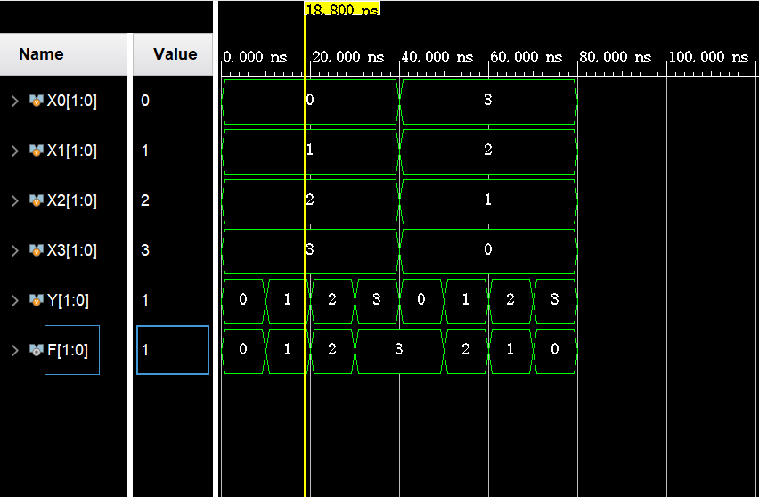
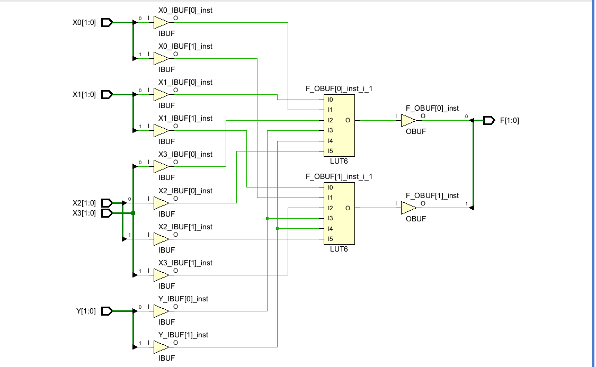
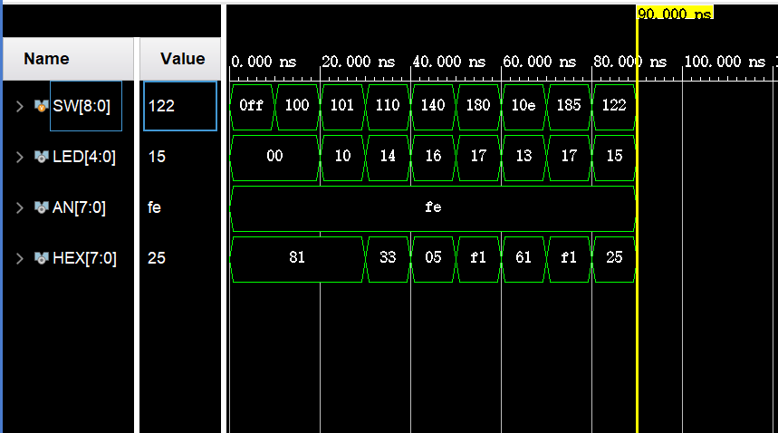
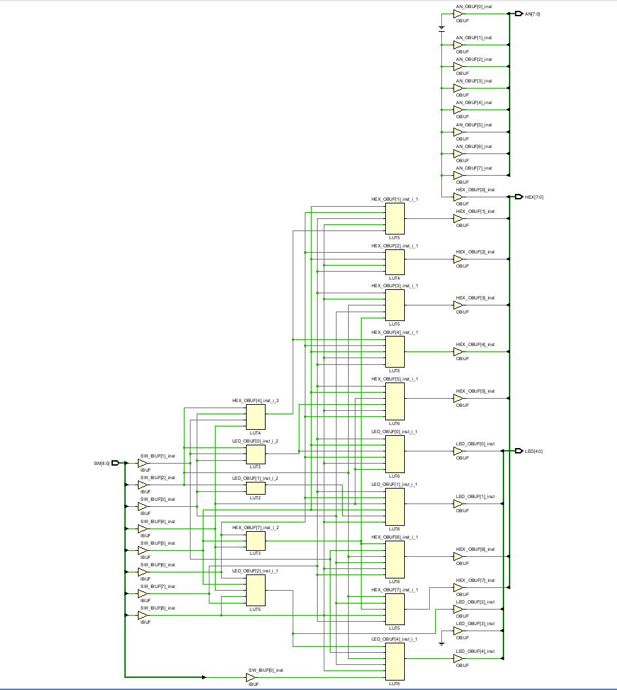

# Lab01 实验报告：选择器与编码器

- **学号**：____________（dummy）
- **姓名**：____________（dummy）
- **日期**：2026 年 8 月

---

## 1. 实验目的

1. 学习组合逻辑电路的基本设计方法，掌握用 Verilog HDL 描述组合逻辑电路。
2. 掌握 `always` 语句块、`if-else` 语句和 `case` 语句的使用，理解这些语句对应的电路结构。
3. 设计并实现一个 2 位 4 选 1 选择器，完成功能仿真并下载到开发板上验证。
4. 设计并实现一个 8-3 优先编码器，将编码结果及指示位显示在 LED 上，并译码后在七段数码管上以十进制显示。
5. 实现 64 位二进制数到格雷码的转换。
6. 熟悉 Vivado 的设计流程（仿真 → 综合 → 实现 → 生成比特流 → 下载）。

## 2. 实验原理

组合逻辑电路将数字输入映射到数字输出，无时钟、无记忆状态，输入变化时输出随之变化。本次实验涉及三类组合逻辑部件：

- **多路选择器（MUX）**：由多路数据输入、选择控制端和数据输出组成，根据控制端从多路输入中选取一路输出。用 `case` 语句描述时结构清晰，综合结果即多路复用器电路。
- **优先编码器（Priority Encoder）**：与译码器功能相反，输出编码位数少于输入。允许多个输入同时为 1，只对优先级最高的一路进行编码。本实验采用**高位优先**（SW7 优先级最高），并增加一位指示位 `valid`：当所有输入全为 0 时 `valid=0`，否则 `valid=1`。
- **七段数码管（共阳极）**：Nexys A7-100T 的数码管为共阳极接法，段引脚输入低电平点亮。位选 `AN[n]=0` 时选中第 n 个数码管。本实验中只需点亮最右位，故 `AN=8'b11111110`，并将编码结果经译码器换算成段码 `HEX` 显示对应十进制数字。
- **格雷码（Gray Code）**：相邻两个编码之间只有一位不同。二进制转格雷码的公式为 `G = B ^ (B >> 1)`，即 `G[i] = B[i] ^ B[i+1]`（最高位 `G[63] = B[63]`），只需一条 `assign` 语句即可实现。

## 3. 实验设备

- 电脑一台（安装 Xilinx Vivado 2022.1）
- Digilent Nexys A7-100T 开发板（Artix-7 XC7A100T-1CSG324C）一块
- USB 下载线一根

## 4. 实验步骤

### 4.1 2 位 4 选 1 选择器（exp1_mux4to1）

1. 用 `case` 语句编写 2 位 4 选 1 选择器。端口：数据输入 `X0~X3[1:0]`、控制端 `Y[1:0]`、输出 `F[1:0]`。当 `Y=00/01/10/11` 时分别输出 `X0/X1/X2/X3`，`case` 末尾加 `default` 防止产生锁存器。
2. 编写自检式功能仿真文件 `exp1_mux4to1_tb.v`：遍历 4 个选择端、两组不同输入数据共 8 个用例，仿真自动比对输出并打印 `TEST PASSED`。在 Vivado 行为仿真中运行通过，波形与真值表一致。
3. 编写约束文件 `exp1_mux4to1.xdc`：`Y` 接 `SW0、SW1`；`X0~X3` 依次接 `SW2、SW3；SW4、SW5；SW6、SW7；SW8、SW9`；`F` 接 `LED0、LED1`。
4. 综合、实现、生成比特流并下载到开发板，拨动开关验证。

### 4.2 8-3 优先编码器与数码管显示（exp2_priority83）

1. 设计 8-3 优先编码器（高位优先）：输入 `X[7:0]`，输出 3 位编码 `code` 与指示位 `valid`，并增加使能端 `en`（`en=0` 时输出无效）。用 `if-else` 链从高位到低位依次判断。
2. 用 `case` 语句实现 7 段译码器（共阳极，段码 `seg[6:0]={G,F,E,D,C,B,A}`）。
3. 编写上板自包含顶层 `exp2_priority83_top`：端口 `SW[8:0]`、`LED[4:0]`、`AN[7:0]`、`HEX[7:0]`。`SW7~SW0` 接编码器输入，`SW8` 接使能端；`LED2~LED0` 显示编码结果，`LED4` 显示指示位；`AN=8'b11111110` 只点亮最右位，`HEX={seg,1'b1}` 将编码译码后以十进制显示（小数点点亮不需要，置 1 熄灭）。
4. 编写自检式功能仿真文件 `exp2_priority83_top_tb.v`：覆盖使能无效、无输入、单 bit、多 bit 高位优先等 9 个用例，校验 LED/AN/HEX 并打印 `TEST PASSED`，Vivado 行为仿真通过。仿真验证后综合、实现、生成比特流并下载上板。例如输入 `00001110`，高位优先编码结果为 `011`，LED 显示 `011`、指示位亮，数码管最右位显示 `3`。

### 4.3 格雷码转换（exp3_graycode）

1. 按照规范接口编写模块 `graycode`：`input [63:0] B`，`output [63:0] G`。
2. 用一句 `assign G = B ^ (B >> 1);` 实现 64 位二进制转格雷码。
3. 本任务仅需提交代码，不需上板验证。

## 5. 实验结果

- **exp1_mux4to1**：在线评测（OJ）通过。功能仿真（`exp1_mux4to1_tb.v` 自检 8 个用例，输出 `TEST PASSED`）波形与真值表一致；上板后拨动 `SW0/SW1` 选择不同的数据端，`LED0/LED1` 正确显示对应 2 位输入。初次上板时因未重新烧录最新比特流导致开关映射看起来不对，重新下载后行为符合手册要求。

- **exp2_priority83**：OJ 通过。功能仿真（`exp2_priority83_top_tb.v` 自检 9 个用例，输出 `TEST PASSED`）覆盖使能无效、无输入、单 bit 及多 bit 高位优先等场景，LED/AN/HEX 均与预期一致。上板验证：`SW8` 为使能，`SW7~SW0` 输入数据，`LED2~LED0` 显示 3 位优先编码，`LED4` 显示指示位，最右位七段数码管以十进制显示编码值。例如输入 `00001110` 时编码为 `011`，数码管显示 `3`，与手册一致。

- **exp3_graycode**：OJ 通过，64 位二进制转格雷码功能正确。

### 实验小结
本次实验实现了三种组合逻辑电路，掌握了 `case`/`if-else` 与 `assign` 三种描述方式，理解了它们对应的电路结构；熟悉了 Vivado 从仿真到上板的完整流程。