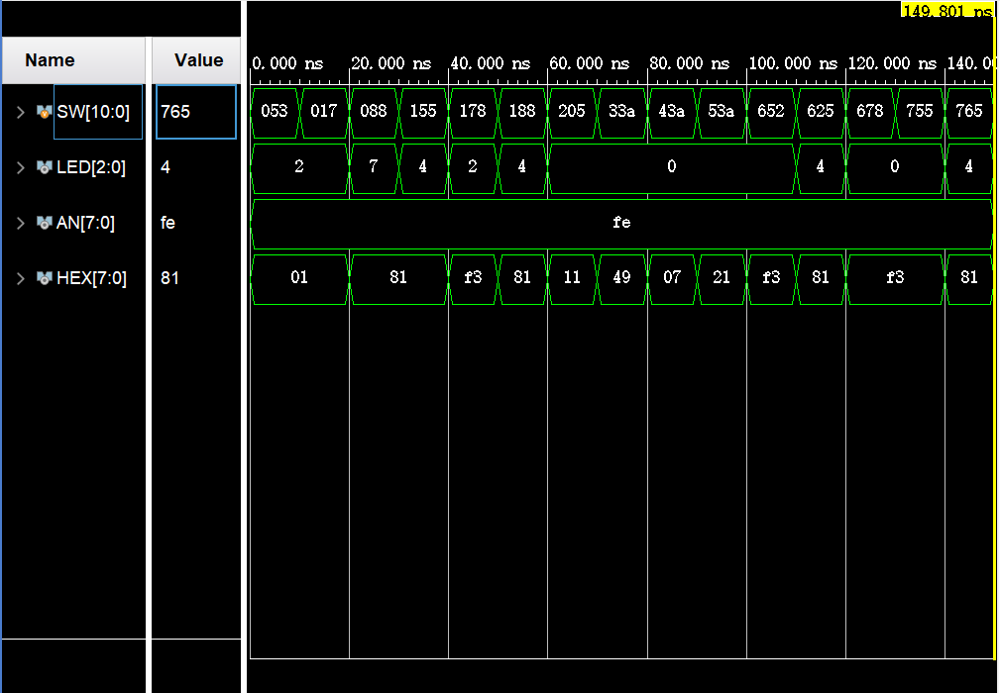
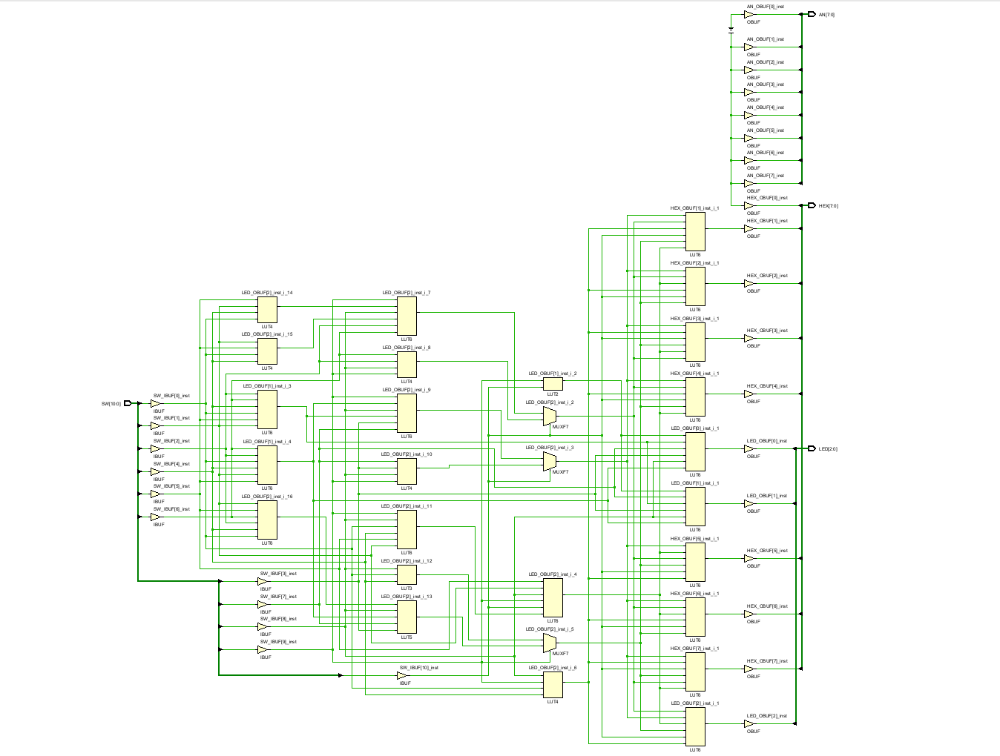

# Lab02 实验报告：加法器与 ALU

- **学号**：____________（dummy）
- **姓名**：____________（dummy）
- **日期**：2026 年 9 月

---

## 1. 实验目的

1. 复习加法器的原理，掌握多位数加法器的实现。
2. 利用加法器同时实现加法和减法运算（减数求补后再相加），掌握补码运算下进位、溢出、零标志位的判断。
3. 设计一个 4 位带符号补码 ALU，实现加、减、逻辑（取反/与/或/异或）及带符号比较、判断相等运算。
4. 掌握 ALU 中带符号数比较大小的实现方法，理解减法溢出时符号位的处理。
5. 熟悉 Vivado 从仿真、综合、实现到上板验证的完整流程。

## 2. 实验原理

### 2.1 加法器与减法

多位加法器可由一位全加器级联（行波进位）构成，也可直接用 Verilog 算术赋值语句 `{c, s} = x + y` 综合出 n 位加法器并提取进位位。减法可看作被减数加上减数的补码：`A - B = A + (~B + 1)`。用一个加/减控制端 `addsub` 统一控制：`addsub=0` 时做加法，`addsub=1` 时做减法，此时对 B 取反并令最低位进位 cin=1，即：

```
bsel      = B ^ {4{addsub}};
{c4, sum} = A + bsel + addsub;
```

### 2.2 标志位的判断

- **溢出（of）**：仅当两个有效操作数符号相同而结果符号相反时发生溢出。设 `bsel` 为有效操作数（加法为 B，减法为取反后的 B），实现为
  `of = (A[3] & bsel[3] & ~sum[3]) | (~A[3] & ~bsel[3] & sum[3])`，即"同号相加而结果符号与操作数相反则溢出"。
- **进位（cf）**：`cf = c4 ^ addsub`（加法 `addsub=0` 时 `cf=c4`，减法 `addsub=1` 时按 X86 借位定义取反）。
- **零（zero）**：`zero = ~(|sum)`，用一元约简运算判断结果是否全零。

### 2.3 ALU 的逻辑运算与带符号比较

在加法器的基础上，第二组实验用功能选择端 `ALUctr` 扩展出简单 ALU（加、减两条通路的实现见 4.2 节）。逻辑运算（取反/与/或/异或）不涉及进位和溢出，直接令 `cf=of=0`，`zero` 仍由结果判断。

**带符号比较大小（A < B）**：补码异号时符号位即为大小关系（负数小于正数）；同号时看减法结果符号位。减法溢出时结果符号位可能与真实关系相反，故当 `A[3] != B[3]`（异号）时直接取 `A[3]`，否则取减法结果符号位 `sum_sub[3]`。**判断相等**直接用 `A == B`。

## 3. 实验设备

- 电脑一台（安装 Xilinx Vivado 2022.1）
- Digilent Nexys A7-100T 开发板（Artix-7 XC7A100T-1CSG324C）一块
- USB 下载线一根

## 4. 实验步骤

### 4.1 四位补码加减法器（exp1_adder）

1. 按规范接口编写模块 `adder`：输入 `A[3:0]`、`B[3:0]`、`addsub`，输出 `F[3:0]`、`cf`、`zero`、`of`。
2. 用 `assign bsel = B ^ {4{addsub}}` 对减数取反，`{c4, sum} = A + bsel + addsub` 统一实现加减。
3. 分别按 2.2 节逻辑输出 `cf`、`of`、`zero`。
4. 在线评测（OJ）验证边界情况（-8、7 等）下的各标志位正确性。

### 4.2 简单四位 ALU（exp2_alu）

1. 按规范接口编写模块 `alu_s`：输入 `A[3:0]`、`B[3:0]`、`ALUctr[2:0]`，输出 `F`、`cf`、`of`、`zero`。
2. `alu_s` 不使用 `addsub` 控制端，而是并行计算加、减两条通路，再由 `ALUctr` 选择输出：

   ```
   bsel              = B ^ 4'hF;
   {c4_add, sum_add} = A + B;             // 加法通路
   {c4_sub, sum_sub} = A + bsel + 1'b1;   // 减法通路：A - B = A + (~B) + 1
   ```

   对应标志位：加法（`ALUctr=000`）`cf = c4_add`、`of = of_add`；减法（`ALUctr=001`）`cf = c4_sub ^ 1'b1`、`of = of_sub`（借位按 2.2 节定义取反）。
3. 逻辑与比较运算（`ALUctr=010~111`）`cf=of=0`；带符号比较大小（`ALUctr=110`）输出 `F = {3'b000, lt}`，其中 `lt = (A[3] != B[3]) ? A[3] : sum_sub[3]`；判断相等（`ALUctr=111`）`F = (A == B) ? 4'b0001 : 4'b0000`。
4. 编写自包含上板顶层 `lab02_top`（文件 `alu_top.v`，其中 `alu_s` 与七段译码器内联），编写约束文件 `alu_top.xdc`。上板引脚分配（共 11 个拨码开关）：
   - `SW3:0` 输入操作数 A（4 位补码，SW3 为符号位）；
   - `SW7:4` 输入操作数 B（4 位补码，SW7 为符号位）；
   - `SW10:8` 输入功能选择 `ALUctr`（`000`加、`001`减、`010`取反、`011`与、`100`或、`101`异或、`110`比较大小、`111`判断相等）；
   - `LED2/1/0` 分别显示 `zero/of/cf`（点亮为 1）；
   - 最右位数码管（AN0）以十六进制字符显示结果 F（0~F，F=15 时显示 "F"）。
5. 编写自检式功能仿真文件 `alu_top_tb.v`：覆盖 8 种功能共 15 个用例（含溢出/进位/零标志边界），自动比对 LED/AN/HEX 并打印 `TEST PASSED`，Vivado 行为仿真通过。初次仿真曾出现 3 处期望标志位写错（如 `3+5` 结果 8 超出 4 位补码范围应置 `of=1`、结果为 0 时 `zero` 应为 1），修正测试文件后通过，设计本身无误。
6. OJ 通过后，综合、实现、生成比特流并下载到开发板验证。

## 5. 实验结果

- **exp1_adder（四位补码加减法器）**：在线评测（OJ）通过。加法、减法及边界情况（如 `-8-7`、`7-(-8)`、`-8-(-1)=7`）下结果、进位、溢出、零标志位均正确。
- **exp2_alu（简单四位 ALU）**：OJ 通过。8 种功能（加、减、取反、与、或、异或、比较大小、判断相等）输出及标志位均正确。功能仿真（`alu_top_tb.v` 自检 15 个用例，输出 `TEST PASSED`）覆盖各功能的典型及边界输入，LED/AN/HEX 均与预期一致。





- **上板验证**：以 `lab02_top` 为顶层综合烧录后，按上述开关分配拨动开关，逐一验证 8 种功能：加减运算时 `LED2/1/0`（zero/of/cf）与结果正确，逻辑/比较运算标志位为 0，最右位数码管正确显示结果的十六进制字符（含 A~F 字符）。上板测试通过。

> **备注（SW5 损坏情况）**：开发板上物理开关 Sw5 已损坏。本实验交付的 `alu_top.xdc` 保持仓库中的原始映射（`SW3:0`=A、`SW7:4`=B、`SW10:8`=ALUctr）。若需在板上重新验证而避开 Sw5，可在本地按以下映射修改 XDC（未随仓库提交，需要时自行重建）：ALUctr 用物理 `sw2/1/0`（→ `SW[10]/SW[9]/SW[8]`），A 用物理 `sw9/8/7/6`（→ `SW[3]/SW[2]/SW[1]/SW[0]`），B 用物理 `sw13/12/11/10`（→ `SW[7]/SW[6]/SW[5]/SW[4]`），并完全不用物理 sw3/4/5。注意 sw8/sw9 位于 1.8V 的 bank 34，IOSTANDARD 必须保持 LVCMOS18。

### 实验小结
本次实验复习了加法器原理，用补码加法的思想统一实现了加、减运算，并完整实现了溢出、进位、零标志位的判断。在 ALU 设计中，重点掌握了带符号数比较大小在减法溢出时的符号位处理，以及逻辑运算时标志位的置零规则。

