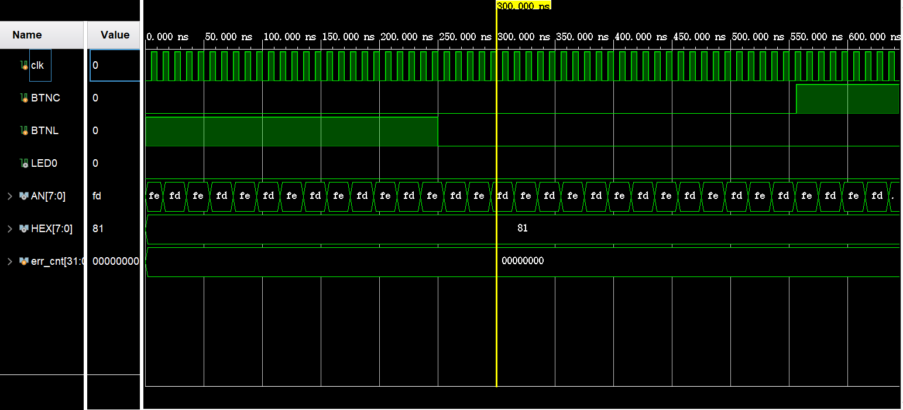
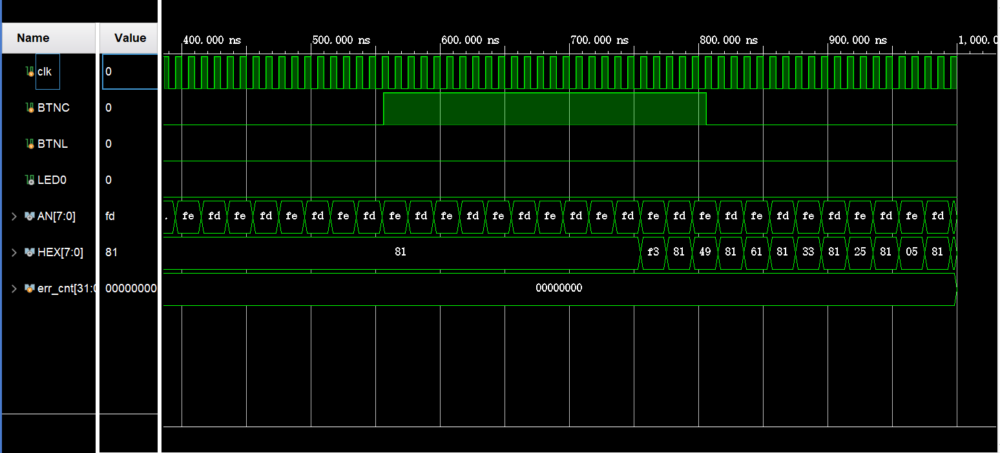
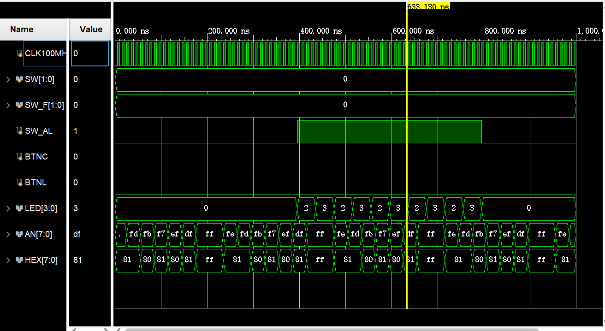

# Lab03 实验报告：计数器与时钟

- **学号**：____________（dummy）
- **姓名**：____________（dummy）
- **日期**：2026 年 9 月

---

## 1. 实验目的

1. 复习计数器的基本工作原理，掌握带使能、清零功能的二进制计数器设计。
2. 掌握四位二进制可配置、可级联加法计数器（RCO 进位指示）的设计方法，理解计数器级联构成数字钟秒计数的方法。
3. 掌握 7 位汉明码（7,4）的编码与纠错原理，实现单比特纠错电路。
4. 学会使用 FPGA 板载 100MHz 时钟，通过分频器产生 1Hz 时钟，设计 00~59 十进制计时器。
5. 掌握七段数码管动态扫描显示原理，完成两位十进制计数的显示。
6. 掌握按键消抖与边沿检测方法，实现计时器的开始、暂停、清零控制。
7. 在基础计时器之上实现电子时钟拓展：显示时、分、秒，可调整时间，到点闹铃 LED 闪烁，并提供百分之一秒精度的秒表。

## 2. 实验原理

### 2.1 加法计数器与级联

带使能、同步清零的加法计数器在每个时钟上升沿判断使能 `en`：`en=0` 保持原状态；`en=1` 且 `rst=1` 时清零；`en=1` 且 `rst=0` 时加一，计到 `cnt_limit-1` 后回 0，形成以 `cnt_limit` 为周期的循环。计数完成指示 `rco` 平时为低，仅在 `Q` 从 `cnt_limit-1` 跳变为 0 的那个时钟周期为高，可作为下一级计数器的时钟。两级级联即可构成 00~59 的秒计数，如第一级计 0~9、第二级计 0~5。

### 2.2 汉明码纠错

(7,4) 汉明码码长为 7 位：位置 1、2、4（下标 0、1、3）为校验位，位置 3、5、6、7（下标 2、4、5、6）为信息位。将 7 位分成三组：

- A 组：位置 1、3、5、7（`code[0]^code[2]^code[4]^code[6]`）
- B 组：位置 2、3、6、7（`code[1]^code[2]^code[5]^code[6]`）
- C 组：位置 4、5、6、7（`code[3]^code[4]^code[5]^code[6]`）

每组校验结果为组内 1 的个数的奇偶，偶为 0 奇为 1，三位结果按 `{C,B,A}` 拼成 `parity`。`parity=000` 表示无错，直接输出；非零时其数值即为出错位的 1 基位置，将该位取反后输出。任意一个有效码字至少要改变 3 位才会变成另一个有效码字，故单比特错误可被唯一纠正。

### 2.3 定时器与分频

板载振荡器产生周期 10ns 的 100MHz 时钟，接到 FPGA 的 E3 引脚。用计数器对 100MHz 时钟分频：计到 49 999 999 时翻转一次 `clk_1s`，得到周期为 1 秒的时钟信号；以其上升沿作为计时的 `tick` 脉冲，计时器每秒加一。计数到 59 后下一拍回 00，同时产生一个 1Hz 时钟周期宽的 `done` 脉冲点亮 LED 提示计时结束。

### 2.4 数码管动态显示

八个数码管的段选（CA~CG、DP）在 FPGA 内部共连，同一时刻只能显示相同内容，因此用扫描方式轮流选通：用计数器产生 ~100kHz 的选通信号，交替点亮 AN0（显示秒个位）、AN1（显示秒十位），利用视觉残留使两位数字同时可见。

### 2.5 按键消抖

按键/开关为机械触点，按下与释放瞬间存在约 20ms 的抖动。设计采用"定时采样"消抖：每隔约 1ms 对按键采样一次，连续两次采样为高才认为按键稳定为高，连续两次为低才认为释放；再对消抖后的信号做上升沿检测，得到一拍宽的"按下"脉冲，供开始/暂停切换与清零使用。

### 2.6 电子时钟拓展

电子时钟的时、分、秒各用两位 BCD 计数器保存：秒计数器以 1Hz 节拍递增，满 60 进位到分，分满 60 进位到时，时满 24 回绕到 00。校时模式下暂停走时，用拨码开关选择要调整的字段，按键每按一次被选字段加一，并以约 0.33 秒的闪烁相位让被选字段明暗交替以作提示。闹铃另用一组时、分、秒 BCD 寄存器保存，与当前时间逐位比较，当六个 BCD 位全部相等且闹铃使能时，令 LED0 按闪烁相位点亮。秒表用 100Hz 节拍驱动百分之一秒计数，逐级进位到秒、分，显示为 分:秒:百分之一秒，按键控制开始与暂停，另一按键清零。多位数码管仍采用动态扫描，用 3 位计数器以约 100kHz 轮流选通 6 个数码管；未使用的 AN6、AN7 不选通，其所在的两拍作为死区，避免切换残影。

## 3. 实验设备

- 电脑一台（安装 Xilinx Vivado 2022.1）
- Digilent Nexys A7-100T 开发板（Artix-7 XC7A100T-1CSG324C）一块
- USB 下载线一根

## 4. 实验步骤

### 4.1 exp1_counter 计数器级联

按接口规范编写 `counter` 模块 `lab03/exp1_counter/counter.v`：`clk` 上升沿触发；`en` 低时保持；`en` 高且 `rst` 高时同步清零；`en` 高且 `rst` 低时加一，`Q` 达到 `cnt_limit-1` 后回 0 并使 `rco` 高一拍。提交 OJ 验证两级 0~9 / 0~5 级联组成 00~59。

### 4.2 exp2_hamming 汉明码纠错

按接口规范编写 `hamming` 模块 `lab03/exp2_hamming/hamming.v`：用三组异或得到 `parity`，wire 型，高到低为 C、B、A；`parity=000` 时直接输出 `code`，否则对第 `parity` 位取反后输出 `correct`。提交 OJ 验证。

### 4.3 exp3_timer 计时器

1. 编写自包含顶层 `timer_top`，文件 `lab03/exp3_timer/timer_top.v`，包含：100MHz→1Hz 分频器、按键消抖+边沿检测、00~59 BCD 秒计数器、数码管扫描显示、完成指示 LED。
2. 顶层端口与约束文件 `timer_top.xdc`：
   - `CLK100MHZ`（E3）系统时钟；
   - `BTNC`（N17）开始/暂停切换；`BTNL`（P17）清零；
   - `LED0`（H17）计时结束指示；
   - `AN[1:0]`、`HEX[7:0]` 驱动数码管显示两位十进制秒数。
3. 编写自检式功能仿真 `timer_top_tb.v`：通过参数覆盖把 1Hz 周期、消抖周期、扫描周期缩小（CNT_HALF=1、DB_MAX=4、SCAN_MAX=1），使 1 秒 ≈ 4 个仿真时钟周期，在约 10us 内完整测试清零、开始计数、暂停保持、继续计数、59→00 回绕、`done` 指示灯持续一个 1Hz 时钟周期、再次清零等功能，自动比对 AN/HEX/LED0 并打印 `TEST PASSED`。仿真时需将 Vivado 仿真时长设置为约 10us。
4. 综合、实现、生成比特流，下载到开发板验证：按下 BTNC 开始计时，数码管从 00 每秒加一至 59 后回 00；再按 BTNC 暂停，按 BTNL 清零；每满一分钟 LED0 亮约 1 秒提示计时结束。

### 4.4 exp4_clock 电子时钟

1. 编写自包含顶层 `clock_top`，文件 `lab03/exp4_clock/clock_top.v`，把分频、消抖、时/分/秒计数、闹铃比较、秒表和数码管扫描全部内联在单文件中，可直接与该 XDC 一起上板。
2. 端口与约束 `clock_top.xdc`：`SW1 SW0` 选择模式，00 时钟、01 校时、10 闹铃设置、11 秒表；`SW3 SW2` 选择字段，00 秒、01 分、10 时；`SW4` 为闹铃使能。`BTNC` 在校时和闹铃设置时对被选字段加一，在秒表时控制开始与暂停；`BTNL` 用作秒表清零。`LED0` 为闹铃闪烁，`LED1` 指示闹铃使能，`LED3 LED2` 指示当前模式。数码管用 `AN[5:0]` 与 `HEX[7:0]` 驱动。约束只使用 SW0~SW4，不使用已损坏的 SW5。
3. 编写自检式功能仿真 `clock_top_tb.v`：通过参数覆盖把 1Hz、100Hz、扫描与消抖周期缩小，并使闹铃闪烁相位取 `cnt_1s` 的低位，以便在短仿真中观察翻转。测试覆盖初始 00:00:00、正常走时、校时各字段加一、时间 23:59:59 再过 3 秒回绕为 00:00:02、闹铃时间设置与 LED0 闪烁、秒表开始与暂停保持及清零，自动比对 AN、HEX、LED 并打印 `TEST PASSED`。仿真时长约 100us。
4. 综合、实现、生成比特流并下载，按上述开关与按键逐项验证各模式功能。

## 5. 实验结果

### exp1_counter 计数器级联

在线评测通过。`en` 低时保持、`rst` 同步清零、按 `cnt_limit` 循环计数 0,1,…,cnt_limit-1,0,… 均正确；`rco` 仅在 `Q` 从 `cnt_limit-1` 回 0 的周期为高，两级级联 0~9 / 0~5 输出 00~59 的秒计数结果正确。

### exp2_hamming 汉明码纠错

在线评测通过。三组校验结果 `parity` 高位到低位对应 C、B、A 计算正确：`parity=000` 时直接输出接收码；非零时按 `parity` 指示的出错位取反纠正，单比特错误均可恢复为正确码字。

### exp3_timer 计时器

功能仿真 `timer_top_tb.v` 自检通过，`err_cnt` 始终为 0，打印 `TEST PASSED`。波形分为两段截取。

计时器的代码思路如下：

- `timer_top` 为自包含顶层，`debounce_pulse` 作为子模块内联在同一文件。
- 分频：用 `clk_cnt` 对 100MHz 计数，计到 `CNT_HALF=49_999_999` 时翻转 `clk_1s`，得到 1Hz 时钟；再取 `clk_1s` 的上升沿得到一拍宽的 `tick` 脉冲作为计时节拍。
- 消抖：`debounce_pulse` 每隔约 1ms 采样一次按键，连续两次相同才更新稳定值，再对稳定值做上升沿检测，输出单周期“按下”脉冲；`BTNC` 切换 `running`，`BTNL` 清零。
- 计数：`running` 时每个 `tick` 让秒个位 `sec_ones` 加一，到 9 回 0 并向秒十位 `sec_tens` 进位，十位到 5 回 0 并置 `done`，构成 00~59 循环。
- 显示：用 `scan_cnt` 产生 `sel` 交替选通 AN1、AN0，按位选把对应 BCD 的七段码送到 HEX，借助视觉残留显示两位数字。
- 输出：`LED0` 直接输出 `done`，作为计时结束指示。

上板验证：下载比特流后，数码管显示两位十进制秒数并从 00 逐秒计数到 59 后回 00；按 BTNC 可在计时与暂停之间切换，暂停时数值保持不变，再按继续；按 BTNL 清零；每计满一分钟 LED0 亮约 1 秒提示计时结束。以上功能均正确。

### exp4_clock 电子时钟

功能仿真 `clock_top_tb.v` 自检通过，打印 `TEST PASSED`。

`clock_top` 内部按功能划分为以下几部分，全部内联在同一文件中：

- 分频器：把 100MHz 时钟分频为 1Hz、100Hz 和 100kHz 三种节拍；
- 按键消抖：对 `BTNC`、`BTNL` 定时采样消抖，输出单周期脉冲；
- 时钟计数：以 1Hz 节拍维护时、分、秒 BCD 计数，并接收校时加一；
- 闹铃：保存一组闹铃 BCD 时间，与当前时间比较得到 `alarm_match`；
- 秒表：以 100Hz 节拍维护 分:秒:百分秒 BCD 计数，支持启停和清零；
- 显示多路选择与数码管扫描：按模式选择显示内容，产生 `AN` 位选和 `HEX` 段码；
- LED 驱动：输出闹铃闪烁、闹铃使能和模式指示。

上板验证：数码管正常显示 时:分:秒 并逐秒走时，秒满 60 进位到分、分满 60 进位到时、时满 24 回绕；校时模式下走时暂停，被选字段闪烁，按 `BTNC` 加一后回到时钟模式从新值继续；在闹铃设置模式设好时刻并打开 `SW4` 后，到点 `LED0` 闪烁约 1 秒；秒表在百分之一秒位快速计数，可开始、暂停、继续，按 `BTNL` 清零，切换模式时数值保留；`LED3 LED2` 与 `LED1` 指示正确。整个验证过程未使用 SW5。

调试中遇到两处“仿真通过、上板失败”的问题，均已定位修正：一是 `HEX` 段码位序与 XDC 不一致，导致数码管乱码，更正为 `{seg, dp}`，并把测试平台同步改为按 `HEX[7:1]` 取段码；二是扫描周期包含未使用的第 7、8 位，阳极仍被选通，在切换瞬间产生微弱残影，改为 `scan_pos` 为 6、7 时关闭全部阳极。此外把扫描选通周期从 1kHz 提高到约 100kHz，消除了低位刷新偏慢的问题。

### 实验小结

本实验从计数器出发，完成了分频、BCD 计数与进位、动态扫描、按键消抖等基础模块，并在此基础上实现了带校时、闹铃和百分之一秒秒表的电子时钟。设计中最深的体会是“仿真通过不等于上板正确”：段码位序与约束不匹配、扫描包含了未使用的数码管、扫描频率偏低等问题在纯功能仿真中都难以暴露，必须结合 XDC 手算引脚与位序，并依据视觉残留和死区要求设置扫描时序。用参数覆盖缩短仿真时间、把子模块内联进单个顶层文件，也明显提高了上板与调试的效率。