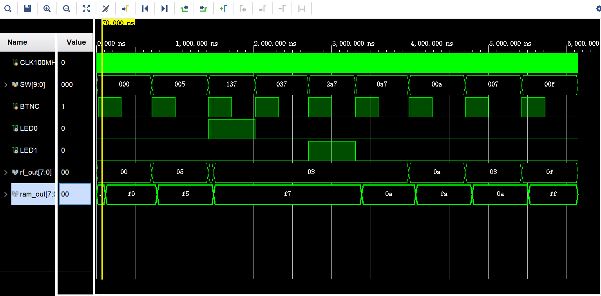
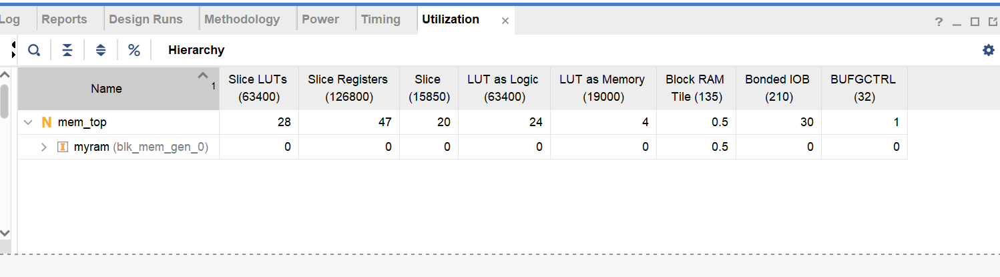

# Lab04 实验报告：寄存器堆与存储器

- **学号**：____________（dummy）
- **姓名**：____________（dummy）
- **日期**：2026 年 9 月

---

## 1. 实验目的

1. 掌握 RV32I 寄存器堆的设计方法，实现两端口组合逻辑读、单端口时钟同步写的 32×32 寄存器堆，理解 x0 恒零的实现。
2. 掌握前导零计数 clz 指令的分治实现方法，学会用 log 级组合电路处理 n 位数据。
3. 学会分别用数组与 IP 核两种方式实现 FPGA 片上存储器，理解分布式 RAM 与 Block RAM 的区别。
4. 学会使用 $readmemh 与 .coe 文件对存储器进行初始化。
5. 观察并比较两种存储器在读写时序与资源消耗上的差异，理解各自适用的场合。

## 2. 实验原理

### 2.1 RV32I 寄存器堆

寄存器堆包含 32 个 32 位寄存器 x0~x31，寄存器编号 5 位。读端口两个，地址 ra、rb 对应输出 outa、outb，读取为组合逻辑，地址变化立即输出新数据，不受时钟控制。写端口一个，在写入使能 regwr 有效且写入时钟 wrclk 上升沿时，把 wrdata 写入编号 rw 的寄存器。x0 恒为 0：写地址为 0 时忽略写入，读地址为 0 时强制输出 0。

板上验收用的寄存器堆为 16×8 规模，用 Verilog 数组 `reg [7:0] ram[15:0]` 实现，读出采用 `assign out = ram[addr]` 的组合逻辑方式，用 `$readmemh` 在 initial 块中从文本文件初始化为 00~0f。综合时 Vivado 将其实现为分布式 RAM，由查找表 LUT 构成。

### 2.2 前导零计数 clz 的分治实现

clz 计算高位开始的连续 0 的个数。采用分治思想：32 位数据的高 16 位全零时前导零个数至少为 16，此时只需继续判断低 16 位；高 16 位非零时个数落在 0~15 之间，只需继续判断高 16 位。用一个 5 位累加结果 result 从 0 开始逐级累加，一个 32 位中间变量 tmp 始终存放当前需要继续判断的窗口，并将其置于低位对齐。

第一级判断 tmp 的高 16 位：全零则 result 加 16 并把低 16 位送入 tmp，非零则把高 16 位送入 tmp；第二级同理判断 tmp 的高 8 位，如此经 16、8、4、2、1 共 5 级判断，log2 32 = 5 级组合逻辑即可得到全部 5 位结果，每级电路实际是一个二选一选择器加一个或非全零判断。判定位始终是当前窗口的最高位，因此任意输入经 5 级后窗口只剩判定位本身。输入全零时 zero 标志置 1，输出置 5'b11111。

### 2.3 IP 核生成的 RAM

Vivado 的 Block Memory Generator IP 可以配置为单口 RAM，本实验配置为 16 个单元、每单元 8 位，Native 接口，用 .coe 文件初始化为 f0~ff。其内部由 FPGA 的 Block RAM 资源实现，读出数据经过寄存，地址改变后需要一个时钟周期才能得到新数据。与分布式 RAM 相比，BRAM 容量大、定时受时钟控制，而寄存器堆读出无延迟。两者共用按钮消抖后的时钟与开关给出的读写地址，通过不同的写使能开关 SW8、SW9 分别写入。

## 3. 实验设备

- 电脑一台，安装 Xilinx Vivado 2022.1
- Digilent Nexys A7-100T 开发板一块
- USB 下载线一根

## 4. 实验步骤

### 4.1 exp1_clz 前导零计数

按接口规范编写 `clz` 模块 `lab04/exp1_clz/clz.v`：组合逻辑块内 `result` 从 0 累加，`tmp` 存放当前判断窗口并低对齐。逐级判断高半区：全零则 `result` 加对应权值并把低半区送入 `tmp`，非零则把高半区送入 `tmp`；权值依次为 16、8、4、2、1。`zero` 为 `~|in`，全零时 `out` 置 5'b11111。块首无条件赋初值且每个分支完整赋值，避免推-c出锁存器。提交 OJ 验证。

### 4.2 exp2_regfile RV32I 寄存器堆

按接口规范编写 `regfile` 模块 `lab04/exp2_regfile/regfile.v`：保留存储单元命名 `regs[31:0]`；写操作在 wrclk 上升沿且 regwr 有效时执行，写地址为 0 时忽略；outa、outb 用组合逻辑输出，读地址为 0 时输出 0。提交 OJ 验证。

### 4.3 exp3_mem 寄存器堆与 RAM 共同上板

1. 编写自包含顶层 `mem_top`，文件 `lab04/exp3_mem/mem_top.v`，包含：按键消抖产生存储器时钟、16×8 寄存器堆、IP 核 RAM 实例、四位数码管动态扫描显示。
2. 板上资源分配：
   - `SW[3:0]` 读写地址，两个存储器共用；
   - `SW[7:4]` 写入数据 4 位，写入时高 4 位补 0；
   - `SW[8]` 寄存器堆写使能，`SW[9]` RAM 写使能，分别点亮 LED0、LED1 提示；
   - `BTNC` 经约 1ms 消抖后作为两个存储器共用的时钟信号；
   - 数码管 AN1:AN0 显示寄存器堆读出的 8 位数据的两位十六进制，AN3:AN2 显示 RAM 读出结果。
3. 寄存器堆初始化文件：把 `lab04/exp3_mem/mem1.txt` 复制到 `D:/digital_logic/mem1.txt`，顶层用 `$readmemh` 读入，初始化为 00~0f。
4. IP 核生成：在 IP Catalog 中选择 Block Memory Generator，Component Name 保持默认 `blk_mem_gen_0`；Native 接口、Single Port RAM、Common Clock；Read/Write Width 为 8、Depth 为 16；不勾选 Primitives Output Register，保证读延迟为 1 个时钟周期；在 Other Options 中加载 `lab04/exp3_mem/ram16x8.coe` 初始化为 f0~ff。
5. 编写自检式功能仿真 `mem_top_tb.v`：通过参数覆盖把消抖与扫描周期缩小，模拟按键产生存储器时钟，测试初始值读出、地址切换读出、分别写寄存器堆与 RAM、两存储器互不干扰写等场景，自动比对四个数码管的段码并打印 `TEST PASSED`。
6. 综合、实现、生成比特流，下载到开发板验证：拨地址开关，右侧两位数码管立即显示寄存器堆内容，按下 BTNC 后左侧两位数码管更新为 RAM 内容；置 SW8 或 SW9 后按 BTNC 分别向两存储器写入 4 位数据。

## 5. 实验结果

### exp1_clz 前导零计数

在线评测通过。分治判断逐级累加结果：高半区全零时结果加 16 并改判低半区，非零时保持高半区继续判断，经 5 级得到 5 位前导零个数；输入全零时 `zero` 置 1 且 `out` 为 5'b11111。

### exp2_regfile 寄存器堆

在线评测通过。两端口组合读随地址变化立即输出；写操作在 wrclk 上升沿且 regwr 有效时按 rw 写入 wrdata；x0 恒为 0，写地址 0 时忽略写入，读地址 0 时输出 0。

### exp3_mem 寄存器堆与 RAM 上板

功能仿真 `mem_top_tb.v` 自检：通过参数覆盖把消抖与扫描周期缩小，仿真时长 10us，打印 `TEST PASSED`。测试覆盖初始值读出、地址切换读出、分别写寄存器堆与 RAM、写后回读、两存储器互不干扰写等场景。

上板验证：

- 上电后右侧两位数码管立即显示寄存器堆内容，初值为 00~0f；左侧 RAM 显示需按一次 BTNC 才出现 f0~ff 的初始值，体现 BRAM 同步读的特性。
- 拨动地址开关 SW3:0，右侧两位立即变化，左侧两位需按一次 BTNC 才更新，两种存储器读时序差异明显。
- SW8 有效时按 BTNC 写寄存器堆，右侧立即显示写入值；SW9 有效时按 BTNC 写 RAM，本次显示旧值，再按一次 BTNC 才显示新写入的数据。
- 只开一个写使能开关进行写入时，另一存储器内容不受影响，两存储器物理独立、可分别读写。
- 调试记录：首版数码管 F 字形左右镜像，原因是 7 段译码表中 f 的段码写错，将 0111000 修正为 0001110 后板面显示正常。后续检查又发现 E 的段码误写成 0001100，该码只点亮 D、C 两段，并非合法字形，修正为 0000110 后 0~F 全部正确。这两处都说明译码表必须从段码表原样照抄，不能凭记忆手推，现已把正确段码与这两个历史坑一并记入 AGENTS.md，并在全仓统一修正。该问题不影响读写功能。另外板上 SW5 开关损坏，写入数据 bit1 恒为 0，仅能写入 0、1、4、5、8、9、c、d 八个值，地址与使能不受影响，读写功能验证不受限制。

### 观察记录

- 读取周期数：寄存器堆为组合逻辑读，地址有效后 0 个时钟周期输出数据；IP 核 RAM 为同步读，地址改变后需 1 个时钟周期得到新数据。
- 写入周期数：两者均在时钟上升沿完成写入，各需 1 个时钟周期。RAM 在 Read First 模式下写入后 douta 仍保持旧值，需再等一个读周期才能把新数据读出。
- 实现方式：Implementation 后打开 Schematic，点进存储器最内层，寄存器堆由 LUT6 查找表构成的分布式 RAM 实现，RAM 最内层为 RAMB18E1 的 Block RAM 原语。原因：寄存器堆容量小且要求组合读，分布式 RAM 由查找表实现正好匹配；BRAM 读出必须经过同步寄存，适合时钟化的大容量存储。
- 资源消耗：Report Utilization 显示 IP 核 RAM 占用约 0.5~1 个 Block RAM Tile，寄存器堆不占用 Block RAM，仅消耗少量 LUT 与 FF。

### 实验小结

本实验先用数组实现了 16×8 寄存器堆、用 Block Memory Generator IP 核实现了 16×8 单口 RAM，共用消抖后的按钮时钟与开关地址，用两个写使能开关分别写入，四个数码管动态扫描显示两存储器的读出值。通过 OJ 验证了 RV32I 寄存器堆与前导零计数电路。上板观察验证了两种存储器实现的关键差异：分布式 RAM 组合读零延迟、BRAM 同步读一个周期，写入均为一个周期但 BRAM 写后需再一拍读出；资源上分布式 RAM 只占 LUT，IP RAM 占用 Block RAM。这些差异决定了它们在 CPU 设计中的不同用途：寄存器堆要求异步读、适合分布式 RAM，主存需要大容量与同步时序、适合 BRAM。
