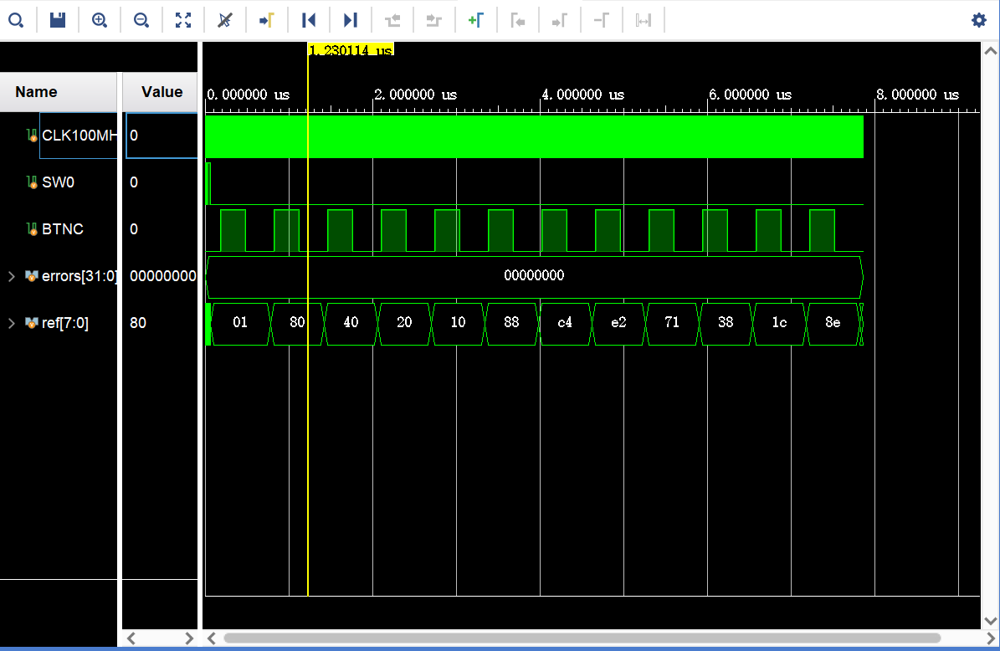

# Lab05 实验报告：移位寄存器、桶形移位器与 LFSR

- **学号**：____________（dummy）
- **姓名**：____________（dummy）
- **日期**：2026 年 9 月

---

## 1. 实验目的

1. 理解移位寄存器的工作原理，掌握清 0、置数、逻辑移位、算术移位、循环移位以及串行输入并行输出等常见工作方式。
2. 掌握线性反馈移位寄存器 LFSR 的结构，理解其能生成长度为 $2^n - 1$ 伪随机序列的原因，并认识全零状态是 LFSR 的陷阱状态及其处理方法。
3. 了解桶形移位器用多级选择器在组合逻辑上一次性完成多位移位的思路，为后续 CPU 的移位指令做准备。
4. 学会把 8 位 LFSR 的状态用七段数码管以十六进制显示，在开发板上观察伪随机序列。
5. 体会纯 LFSR 的线性性质：非零种子之间只有相位差异，以及 64 位 LFSR 的超长周期。

## 2. 实验原理

### 2.1 移位寄存器

移位寄存器在时钟触发沿根据控制信号把数据向某个方向移动一位，是数字系统的常用器件。常见功能包括清 0、置数、逻辑右移、逻辑左移、算术右移、左端串行输入并行输出、循环右移、循环左移。逻辑移位无论左右都在空位补 0；算术右移在最高位补符号位以保证有符号数不变；循环移位把移出的一位补到另一端；置数给寄存器赋初值。

用 Verilog 描述十分直观，例如逻辑右移为 `dout <= {1'b0, dout[7:1]}`，算术右移为 `dout <= {dout[7], dout[7:1]}`，循环右移为 `dout <= {dout[0], dout[7:1]}`。左端串行输入并行输出是指每个时钟右移一位，移入的最左位由外部输入 lin 决定，输出仍为同时输出 8 位。它在串并转换时很有用，可以把时间上顺序输入的 8 个 bit 存入寄存器，8 个周期后一起输出。

### 2.2 桶形移位器

传统移位寄存器一个周期只能移动一位，做多位移位需要多个时钟周期。桶形移位器用纯组合逻辑的多级选择器一次完成多位移位：第一级由 shamt[0] 决定是否移 1 位，第二级由 shamt[1] 决定是否移 2 位，第三级由 shamt[2] 决定是否移 4 位，如此逐级翻倍，级联即可实现任意位移量。对于 32 位数据，移位量 0 至 31 需要 shamt[4:0] 共 5 位，因此用 1、2、4、8、16 共 5 级。

本实验用中间变量从输入开始逐级处理：左移时每级在低位补 0；逻辑右移时在高位补 0；算术右移时在高位补符号位，符号位固定取原始输入的最高位 indata[31]，因为算术右移每次都在保留符号。该电路是纯组合逻辑，输入改变时输出立即改变，无需时钟。

### 2.3 线性反馈移位寄存器

$n$ 位 LFSR 通过把寄存器中若干位异或后反馈到串行输入端，可以生成长度为 $2^n - 1$ 的伪随机循环序列。本实验的 64 位 LFSR 右移，状态记为 $x_{63}\ldots x_0$，每个时钟右移一位，$x_0$ 移出，最高位按

$$x_{64} = x_4 \oplus x_3 \oplus x_1 \oplus x_0$$

移入。加载信号 load 为高时装入 64 位种子 seed，否则每个时钟移位一次。该 LFSR 的周期为 $2^{64} - 1$，会遍历所有非零的 64 位状态。

由于异或反馈在输入全零时输出仍为 0，全零是一个自锁的陷阱状态。上板的 8 位 LFSR 采用另一种反馈多项式 $x_8 = x_4 \oplus x_3 \oplus x_2 \oplus x_0$，周期为 255，并在状态为全零时强制回到种子 00000001，从而保证无论受到何种干扰都能回到主循环。

## 3. 实验设备

- 电脑一台，安装 Xilinx Vivado 2022.1
- Digilent Nexys A7-100T 开发板一块
- USB 下载线一根

## 4. 实验步骤

### 4.1 exp1_shiftreg 多功能移位寄存器

按接口规范编写 `lab05/exp1_shiftreg/shiftreg.v`，在一个 `always @(posedge clk)` 中用 `case` 按 func[2:0] 实现表 5-1 的全部八种功能，文件末尾给出 default 分支避免引入锁存器。实现后提交在线评测。

### 4.2 exp2_barrel 32 位桶形移位器

按接口规范编写 `lab05/exp2_barrel/barrel.v`，用一个组合逻辑 `always @(*)` 与中间变量 t，按 1、2、4、8、16 五级依次判断 shamt 的每一位是否需要移位。lr 为 1 时左移并在低位补 0；lr 为 0 且 al 为 0 时逻辑右移、高位补 0；lr 为 0 且 al 为 1 时算术右移、高位补原始符号位 indata[31]。大致思路类似快速幂算法。实现后提交在线评测。

### 4.3 exp3_lfsr 64 位 LFSR 与 8 位 LFSR 上板

1. 编写在线评测模块 `lab05/exp3_lfsr/lfsr.v`：load 有效时 `dout <= seed`，否则 `dout <= {dout[4]^dout[3]^dout[1]^dout[0], dout[63:1]}`。实现后提交在线评测。
2. 上板部分沿用自包含顶层 `lab05/exp3_lfsr/lfsr_top.v`，其余按键消抖、数码管显示等代码基本和此前的实验相同。
3. 按 Nexys A7-100T 引脚编写 `lab05/exp3_lfsr/lfsr_top.xdc`：CLK100MHZ 接 E3，复位开关 SW0 接 J15，按钮 BTNC 接 N17，数码管及段码同此前实验。
4. 编写自检式仿真 `lab05/exp3_lfsr/lfsr_top_tb.v`：通过参数覆盖把消抖与扫描周期缩小，复位后从种子 01 开始，用任务模拟按钮按下与松开，连续推进 12 步，每一步都用参考模型计算期望状态，自动比对两个数码管的段码，最后打印 TEST PASSED 或 TEST FAILED。
5. 综合、实现、生成比特流并下载到开发板，观察伪随机序列。

## 5. 实验结果

### 5.1 exp1_shiftreg 多功能移位寄存器

在线评测通过。

### 5.2 exp2_barrel 32 位桶形移位器

在线评测通过。

### 5.3 exp3_lfsr 64 位 LFSR

在线评测通过。

### 5.4 8 位 LFSR 上板

功能仿真中复位后状态为 01，参考模型按 $x_8 = x_4 \oplus x_3 \oplus x_2 \oplus x_0$ 递推，连续 12 步的两位数码管段码全部与期望一致，打印 TEST PASSED。

上板验证：

- 上电并复位后，数码管显示 01。
- 每按一次 BTNC，状态按 01 → 80 → 40 → 20 → 10 → 88 → C4 … 变化，与原理中的序列一致；松开按钮不会额外变化，按住不放也只变化一次，说明消抖与边沿检测正确。
- 8 位数据在数码管上以十六进制快速变化，周期很长，未观察到固定规律。
- 复位开关有效时显示立即回到 01，说明种子装入与全零保护有效。

### 5.5 实验小结

本实验先用一个时钟同步的 case 实现了八功能移位寄存器，再用五级组合选择器实现了 32 位桶形移位器，最后实现了 64 位 LFSR 与 8 位 LFSR 上板。三个模块均通过在线评测：移位寄存器的串并转换得到手册示例结果，桶形移位器对全部移位量与各移位方式均正确，64 位 LFSR 的周期状态与题目给定值一致。上板时用消抖后的按钮作为移位时钟，把 8 位状态以十六进制显示在数码管上，观察到序列按预定规律循环、全零状态被正确跳过。实验中体会到移位寄存器描述简单但控制分支必须齐全，桶形移位器用级联选择器把多位移位压进一个组合周期，而 LFSR 的核心是把异或网络接成串行反馈，全零陷阱必须显式处理。

## 6. 思考题

**生成的伪随机数序列仍然有一定的规律，如何能够生成更加复杂的伪随机数序列？**

1. 加长寄存器位数并选择适当的随机公式
2. 对 LFSR 的状态进行非线性变换之后再输出
3. 改用更复杂的伪随机数生成器，例如梅森旋转算法
4. 使用更好的随机种子，例如基于物理状态采样的随机种子

## 个人思考

本次实验非常简单（？）