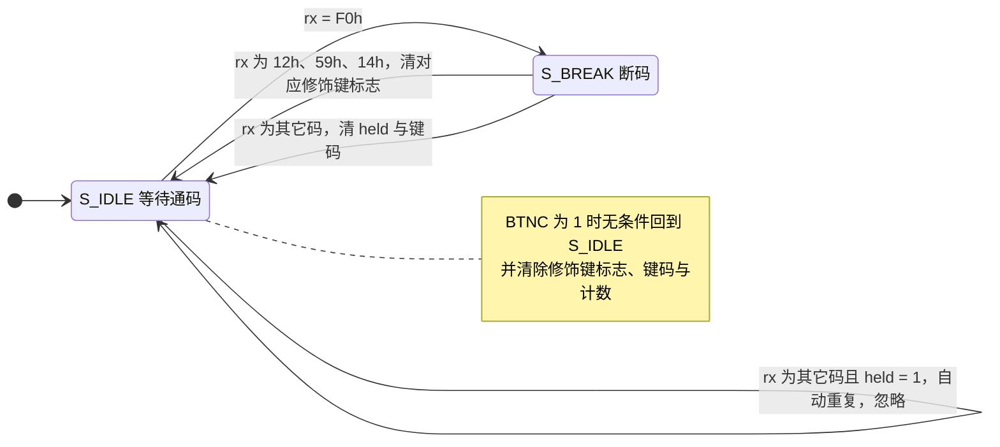

# Lab06 实验报告：状态机与键盘输入

- **学号**：____________（dummy）
- **姓名**：____________（dummy）
- **日期**：2026 年 10 月

---

## 1. 实验目的

1. 理解有限状态机 FSM 的组成，区分摩尔型与米里型状态机在输出时序上的差别。
2. 了解二进制编码、One-hot 编码与格雷码三种状态编码方式在资源与速度、稳定性上的取舍。
3. 掌握 PS/2 键盘接口的串行帧格式，理解通码、断码与扫描码集的含义。
4. 学会设计接收模块与上层处理模块之间的握手时序，避免漏键与重复读取。
5. 用状态机解析键盘扫描码，识别 Shift 与 Ctrl 修饰键，统计按键总次数，并借助扫描码查找表输出 ASCII 码。
6. 利用 64 位 LFSR 产生的比特流对 ASCII 字符做异或加密与解密。

## 2. 实验原理

### 2.1 有限状态机

有限状态机由一个起始状态、一个输入列表、一个状态转移函数和一个输出端组成，是组合逻辑与时序逻辑的组合。其中次态逻辑根据当前状态和输入决定下一个状态，输出逻辑产生输出，状态寄存器保存内部状态。摩尔型状态机的输出只与当前状态有关，输入要等到下一个时钟周期才能影响输出，因而输出在一个完整周期内稳定，抗噪声能力强；米里型状态机的输出还与输入的当前值有关，响应比摩尔型早一个周期，但输入上的毛刺会直接影响输出。

状态编码方式各有特点：二进制编码使用的触发器最少，但输出时需要较复杂的译码逻辑；One-hot 编码每个状态只用一位表示，判断状态只需简单的与门或或门，速度快、稳定性高，适合触发器资源丰富的 FPGA；格雷码在相邻状态跳转时只有一位变化，常用于 CPLD。

### 2.2 PS/2 键盘接口

PS/2 接口使用 PS2_CLK 与 PS2_DATA 两根信号线，空闲时均为高电平。键盘每按下一个键或松开一个键，都以每帧 11 位的格式串行发送数据：起始位 0、8 位数据位且低位在前、奇校验位、停止位 1，每一位在时钟的下降沿有效。数据位从低到高依次出现在 PS2_DATA 线上，接收方在 PS2_CLK 的下降沿采样。

键盘发出的字节称为扫描码。按键按下时发出的称通码，释放时先发一个字节 F0h，再发该键的通码，合起来称断码。例如 A 键的通码是 1Ch，按下的序列是 1Ch，松开的序列是 F0h 1Ch。按住一个键不放时，键盘会不断重复发送该键的通码，因此接收端必须把连续相同的通码识别为自动重复，只统计一次。本实验只需要顺序按下和松开，不处理小键盘；修饰键方面，上板顶层只额外识别单字节的左 Shift、右 Shift 与左 Ctrl，键码带 E0h 前缀的右 Ctrl、右 Alt 等扩展键不在范围内。

### 2.3 键盘控制器与握手

课程提供的键盘控制器 `ps2_keyboard` 内部有一级移位缓冲区和一个 8 字节的 FIFO 队列。它用系统时钟检测 PS2_CLK 的下降沿，每检测到一次就把 PS2_DATA 上的数据移入缓冲区，收满 11 位并校验起始位、停止位与奇校验后，把 8 位扫描码写入 FIFO。当 FIFO 非空时 ready 置 1，表示有数据可以处理；上层模块在 ready 为 1 时读取 data，再把 nextdata_n 拉低一个时钟周期，控制器收到该确认后前移读指针，准备提供下一个数据。FIFO 在两个处理速度不同的模块之间起缓冲作用，overflow 表示队列溢出。

### 2.4 扫描码查找表

键盘上各按键的扫描码是随机排列的，最直接的转换方法是查找表。课程提供的 `scancode_ram` 模块把 8 位扫描码当地址，从内部存储器 `ascii_tab` 中取出对应的 ASCII 码，读操作与时钟同步、有一个周期的延迟。仿真时由测试平台用 `$readmemh` 把扫描码到 ASCII 的映射表 `scancode.hex` 加载进该存储块。映射表把数字键映射到字符 0~9，字母键映射到小写 a~z，空格映射到 20h。

映射表只给出了未按 Shift 时的字符。按住 Shift 时，字母需要换成对应的大写形式，数字与符号键需要换成同一按键的上档字符，例如 1 键的上档字符是 `!`，其 ASCII 码为 21h。因此上板顶层在基本表之外再保留一张上档表，用 Shift 标志在两张表之间选择。

### 2.5 LFSR 流密码

异或操作可以用于加密和解密：设消息为 $M$、密钥为 $K$，则密文 $C = M \oplus K$，接收端用 $C \oplus K = M$ 即可恢复。64 位 LFSR 按

$$x^{64} = x^4 \oplus x^3 \oplus x^1 \oplus x^0$$

生成周期很长的随机比特流作为密钥流。对每个 ASCII 字符，从密钥流中取 6 个比特，与该字符的低 6 位异或。由于输入字符的高 2 位固定为 01，输出字符的高 2 位仍保持 01，字符仍落在 0x40~0x7F 范围内。解密时用同一密钥流再做一次异或即可还原。

## 3. 实验设备

- 电脑一台，安装 Xilinx Vivado 2022.1
- Digilent Nexys A7-100T 开发板一块
- USB 下载线一根
- PS/2 或 USB 接口键盘一只

## 4. 实验步骤

### 4.1 exp1_keyboard PS/2 键盘控制器

在线评测模块名为 `keyboard`，接口为：

```verilog
module keyboard(input clk, input clrn, input ps2_clk, input ps2_data,
                output reg [7:0] key_count,
                output reg [7:0] cur_key,
                output [7:0] ascii_key);
```

模块内部固定例化课程提供的 `scancode_ram myram(clk, cur_key, ascii_key)` 与 `ps2_keyboard mykey(clk, clrn, ps2_clk, ps2_data, keydata, ready, nextdata_n, overflow)`，实例名与存储块名 `ascii_tab` 都不能改动，测试平台会自动把映射表加载进 `myram.ascii_tab`。除这两个通用模块外，模块需要自行声明 keydata、ready、nextdata_n、overflow 等内部信号。

用一个两状态的解析逻辑区分通码、断码与自动重复：收到 F0h 时置 `break_flag`，表示下一个字节是断码的键码；`break_flag` 为 1 时收到的字节即键码，说明该键已松开，清 `break_flag` 与 `held`，把 `cur_key` 清 0；否则为通码，若 `held` 为 0 则记录 `cur_key`、`key_count` 加一并置 `held`，若 `held` 已为 1 则说明是按住不放的自动重复，直接忽略。这样按住不放只算一次，松开后再按同一键计数会再次加一，`key_count` 在 clrn 为 0 时同步清零。所有分支都完整赋值，避免产生锁存器。该模块以在线评测通过作为验收依据。

握手方面，`nextdata_n` 复位时置 1。当 ready 有效且 `nextdata_n` 为 1 时，取走当前 `keydata` 并在下一个周期把 `nextdata_n` 拉低一个周期，通知控制器前移读指针；`nextdata_n` 拉低期间不再读取，避免同一个字节被重复读出。这条“ready 有效才读、读后拉低一个周期”的握手保证了既不漏键也不重复。

上板顶层 `keyboard_top` 自带一份 `ps2_keyboard`，并用两个组合逻辑 case 实现扫描码到 ASCII 的查找表，一张是未按 Shift 时的基本表，另一张是按住 Shift 时的上档表，取值与课程映射表一致。解析状态机在通码与断码两态的基础上增加了对修饰键的判断：左 Shift 的键码为 12h、右 Shift 为 59h、左 Ctrl 为 14h，收到它们的通码时置位对应标志，收到断码时清零，既不改动当前显示的键码，也不累计按键次数。ASCII 输出由当前键码与 Shift 标志实时组合得到，所以按住某个键的过程中再按下或松开 Shift，上档字符会立即跟着变化，例如先按住 2 再按下 Shift，ASCII 就从 32h 变成 40h 即 `@`。键码带 E0h 前缀的扩展键未作处理。

该解析状态机只有两个状态：S_IDLE 等待通码，S_BREAK 表示刚收到 F0h、下一个字节是断码的键码。状态转移如下：



两个状态都以 BTNC 高电平为复位。S_BREAK 里对修饰键和普通键分开处理：修饰键只清标志位，普通键才清 held 与键码，因此松开 Shift 或 Ctrl 不会打断正在显示的字符。S_IDLE 里判断顺序是先 F0h、再三个修饰键，最后才落到普通按键，保证修饰键被单独识别；落到普通按键时又用 held 区分首次按下与自动重复，所以按住不放只计一次。

按键总次数用两个 BCD 数字保存，每检测到一次新的按下就在个位加一，个位为 9 时清零并向十位进位，十位为 9 时回卷。八位数码管动态扫描显示：AN7、AN6 显示按键总次数的十位与个位，AN5、AN4 熄灭，AN3、AN2 显示 ASCII 码的高、低四位，AN1、AN0 显示键码的高、低四位；按键松开时 AN3 到 AN0 全部熄灭。四只 LED 中，LED0（H17）指示 Shift 按住、LED1（K15）指示 Ctrl 按住，LED2（J13）与 LED3（N14）分别指示 ready 与 overflow。

上板前对板级顶层做自检式功能仿真 `keyboard_top_tb.v`：通过参数覆盖缩短数码管扫描周期，用键盘模型按 11 位帧格式发送扫描码，逐位核对段码、键码、ASCII 与 BCD 计数，覆盖按下、自动重复、松开、换键，以及修饰键的按下与松开、上档字符的切换、修饰键不参与计数等场景，同时核对 LED0 与 LED1 的状态，打印 `TEST PASSED`。

### 4.2 exp2_encryption 比特流加密

在线评测模块 `encryption` 的接口为：

```verilog
module encryption(input [63:0] seed, input clk, input load,
                  input [7:0] datain, output reg ready, output [7:0] dataout);
```

load 为高时把 LFSR 状态初始化为 seed，并把 6 位比特计数器清零；load 为低时每个时钟上升沿移位一次、计数器加一，计数周期为 6，从 5 变 0 时 ready 拉高一拍。输出为 `{datain[7:6], datain[5:0] ^ lfsr[63:58]}`，即用输入字符低 6 位与 LFSR 高 6 位异或。该模块以在线评测通过作为验收依据。

## 5. 实验结果

### exp1_keyboard PS/2 键盘控制器

在线评测通过。

板级顶层功能仿真 `keyboard_top_tb.v` 打印 `TEST PASSED`：复位后 held 为 0、低四位数码管全灭、LED0 与 LED1 全灭；发送 12h 后 LED0 点亮，而 held 仍为 0 且计数不变；接着发送 16h 后键码为 16h、ASCII 为 21h 即 `!`，计数变为 01；发送 F0h 与 16h 后键码与 ASCII 归零、LED0 保持点亮；发送 1Ch 后 ASCII 为 41h 即 `A`；松开该键并发送 F0h、12h 后 LED0 熄灭。随后核对按住 2 期间按下 Shift，ASCII 由 32h 变为 40h，松开 Shift 又变回 32h；按住 14h 时 LED1 点亮且计数不变；右 Shift 59h 配 ; 键显示 3Ah；发送 1Bh 时显示 73h，计数逐次累加。

上板验证：

- 复位后左边两位显示计数 00，右边四位熄灭，四只 LED 全灭。
- 按 H 键后，右边四位显示 ASCII 码 68 与键码 33，即 `6833`，左边计数变为 01；松开后右边四位熄灭。
- 连续按不同键时左侧计数逐个累加，按住不放时计数不再增加。
- 按住 Shift 的过程中 LED0 点亮，此时按 1 键显示 ASCII 码 21 与键码 16，即 `2116`，左边计数只加一；松开 Shift 后 LED0 熄灭，只按 1 键则显示字符 1。按住某个键不松再按 Shift，显示的字符会立刻切换成上档字符。
- 按住左 Ctrl 的过程中 LED1 点亮，松开后熄灭，键码与 ASCII 的显示不受影响，计数也不增加。
- LED2 在通信时闪动，LED3 即 overflow 始终不亮，说明键盘通信正常且没有丢数据。

### exp2_encryption 比特流加密

在线评测通过。

### 实验小结

本实验用一个两状态逻辑配合键盘控制器的 FIFO 完成了扫描码解析，关键是区分通码、断码与自动重复三种情况，并配合“ready 有效才读、读后拉低一个周期 nextdata_n”的握手时序，保证不漏键也不重复。在此基础上把单字节的左 Shift、右 Shift 与左 Ctrl 作为修饰键单独处理，只置标志位而不改变键码与计数。板级顶层把解析结果、含上档字符的 ASCII 查找表和两位 BCD 计数组合起来，用八位数码管动态扫描显示，并用 LED0 与 LED1 指示 Shift、Ctrl 的按住状态，用 LED2、LED3 反映 ready 与 overflow，方便上板调试。加密部分实现了一个 64 位 LFSR 加异或的流密码，用同一个模块两次异或即可完成加密与解密。

## 个人思考

右 ctrl 可能还要加一个状态 E0，先吞掉通码前两位的 E0 然后获取后面两位，来确定是右 ctrl 还是右 alt，设置 `ct_r` 然后回到 `S_IDLE`。验收的时候老师说不用实现那就不管了。 
