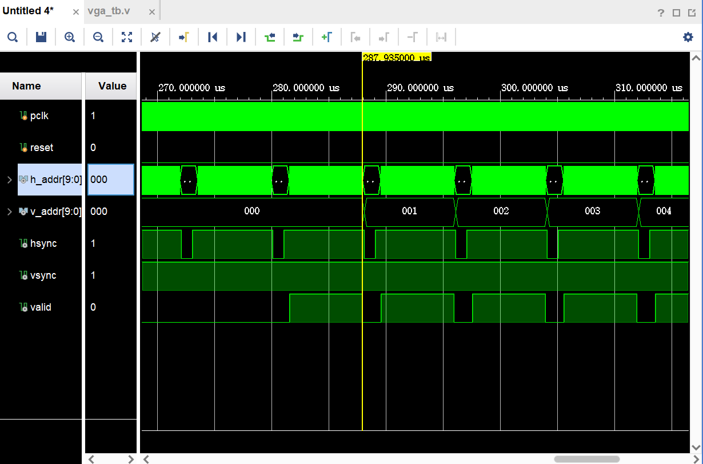

# Lab07 实验报告：VGA 接口控制器

- **学号**：____________（dummy）
- **姓名**：____________（dummy）
- **日期**：2026 年 9 月

---

## 1. 实验目的

1. 理解 VGA 视频传输标准，掌握行同步、场同步与行场消隐时序的含义。
2. 学会用计数器产生像素时钟、行场同步信号，并根据当前扫描坐标给出有效显示区域。
3. 理解用显示存储器驱动 VGA 的思路，掌握显示地址与像素坐标之间的映射关系。
4. 学会用 Block RAM IP 核实现大容量显存，并用 .coe 文件初始化图片数据。
5. 学会自行把图片转换成 .coe 文件，在显示器上显示一张静态图片。
6. 掌握用同步时序电路实现确定有限状态自动机，用状态位的奇偶性对输入字符流进行判定。
7. 学会从数字电路资源的角度分析问题，用异或累加代替大容量存储，在固定长度的寄存器内从两份名单中找出唯一缺失项。

本实验要求完成手册 7.3.1 的上板验收，即用显存显示一张静态图片；同时完成 7.3.2 在线测试的两道选做题目：确定有限状态自动机与签到题。

## 2. 实验原理

### 2.1 VGA 接口与显示原理

VGA 接口用 R、G、B 三根颜色信号和 HS、VS 两根同步信号传输视频信息。Nexys A7-100T 开发板用不同阻值的电阻把 FPGA 的数字信号合成为模拟电压，每种颜色提供 4 位亮度，三色组合可产生 4096 种颜色。VGA 信号是模拟信号，颜色用电压高低表示强弱。

图像以像素为单位，标准的 VGA 分辨率为 640×480，刷新率约 60Hz。每一帧从屏幕左上角开始逐行扫描，行同步信号是一个负脉冲，一帧结束后由场同步信号给出负脉冲，再从左上角重新开始。电子束从行尾回到行首、从右下角回到左上角的时间分别称为行消隐和场消隐，此时 RGB 电压为 0，即显示黑色。

### 2.2 640×480 的扫描时序

一行有效显示需要 96 + 48 + 640 + 16 = 800 个像素时间：行同步负脉冲宽 96，行消隐后沿 48，有效显示 640，行消隐前沿 16。一帧有效显示需要 2 + 33 + 480 + 10 = 525 个行时间：场同步负脉冲宽 2，场消隐后沿 33，有效显示 480，场消隐前沿 10。因此一帧共 800×525 = 420000 个像素时间，在 25MHz 像素时钟下约 16.8ms，对应约每秒 60 帧。

### 2.3 显存与地址映射

VGA 控制器对外提供当前扫描到的像素坐标 h_addr 与 v_addr，上层系统根据坐标决定 RGB 输出。若分配一块显示存储器，用坐标索引显存，把显存内容作为 vga_data，则其他应用只需修改显存就能改变显示，无需关心扫描过程。每个像素需要 12 位颜色信息，640×480 个像素共约 3.686Mbit，超过分布式 RAM 的容量，因此必须用 Block RAM 实现显存。

本实验按 640×512 分配显存，每个单元 12 位，共 327680 个单元，地址由 h_addr 的全部 10 位和 v_addr 的低 9 位拼接成 19 位，即 {h_addr[9:0], v_addr[8:0]}。行方向多分配 32 行是为了避免复杂的地址变换。这样每一列内的 512 个单元连续存放，像素数据实际上按列连续排列，因此生成 .coe 文件时也必须按列写入。实际参与显示的只有每列前 480 个字，多出的 32 个填充字永远不会被扫描到。

### 2.4 确定有限状态自动机

确定有限状态自动机由有限的内部状态集合、输入集合与状态转移函数构成。数字电路中的同步时序电路是它的直接实现：触发器保存当前状态，状态转移逻辑与输出逻辑都是组合电路，在时钟上升沿根据当前状态与输入决定次态并给出输出。输出只依赖当前状态的是 Moore 型，同时依赖当前状态与输入的是 Mealy 型。本题只关心两类字符计数的奇偶性，因此不必为每种输入枚举状态，只需两个状态位：一位记录大小写 n 个数的奇偶性，一位记录其余字符个数的奇偶性。每读入一个字符就翻转对应的状态位，读到结尾的 NULL 时，若 n 为奇数个且其余字符为偶数个则输出 1，否则输出 0。

### 2.5 签到查找的异或原理

签到题要在名单的 N 个姓名与签到表的 N-1 个姓名中找出唯一缺席者，允许姓名重名，N 最大可取 100000。若用存储器保存全部姓名，需要 $$128 \times 100000$$ 位，远超片上 Block RAM 的容量，因此不能逐条存储再比对。利用异或的性质：同一个姓名异或偶数次会相互抵消，只有异或奇数次才会保留。把全部输入姓名统一做异或累加，某姓名若在名单中出现 $$r$$ 次、在签到表中出现 $$s$$ 次，则它一共被异或 $$r+s$$ 次。缺席者满足 $$r=s+1$$，异或 $$2s+1$$ 次为奇数次，因而保留在结果中；其余人满足 $$r=s$$，异或 $$2s$$ 次为偶数次，全部抵消。于是只需要一个 128 位寄存器，累加结果就是缺席同学的姓名，既与签到顺序无关，也能正确处理重名。

## 3. 实验设备

- 电脑一台，安装 Xilinx Vivado 2022.1
- Digilent Nexys A7-100T 开发板一块
- VGA 显示器一台与 VGA 连接线一根
- USB 下载线一根

## 4. 实验步骤

### 4.1 VGA 控制器

编写 `lab07/exp1_vga/vga_top.v`，其中 `vga_ctrl` 用行计数器 x_cnt 和列计数器 y_cnt 分别计数 1~800 和 1~525，二者都只在像素时钟上升沿变化。由计数值直接译码出 hsync、vsync、valid，并在有效显示区域内用 `x_cnt − 145`、`y_cnt − 36` 得到 0~639、0~479 的 h_addr 与 v_addr。所有组合输出都写成完整的表达式，避免锁存器。

### 4.2 像素时钟与显存

顶层 `vga_top` 用 2 位计数器对 100MHz 时钟分频，取 div_cnt[1] 得到 25MHz 像素时钟 pclk，同时驱动控制器与显存。显存用 Block Memory Generator IP 生成，模块名 blk_mem_gen_0，配置为单口 RAM，位宽 12，深度 327680，端口 A 保留写端口但写使能恒接 0，不勾选 Primitives Output Register。IP 核不在仓库中，需按上述配置在 Vivado 中生成，并用课程样例 `my_picture_new.coe` 初始化；做拓展要求时改用自己转换出的 .coe 即可。显存地址由 `{h_addr, v_addr[8:0]}` 拼接。由于 BRAM 读出有一个时钟周期延迟，把这个延迟也算作一次输出寄存，用 valid_d 在延迟一拍后对 RGB 做消隐归零，保证消隐期间输出黑色。

### 4.3 图片到 .coe 的转换

课程样例图片为 `picture.png`，其真实画面被一圈透明边框包围，对应的 `my_picture_new.coe` 共 327680 个字，正是把透明边框裁掉后缩放到 640×480，再按列优先、每列补足 512 行写入的结果。

本实验提供两个转换脚本：

- `img2coe.py` 是本实验自用的转换器。它用 Pillow 读入图片，若图片带 alpha 通道则先按透明区域裁剪，缩放到 640×480，把 R、G、B 各截断为 4 位并拼成 `{R[3:0], G[3:0], B[3:0]}`，然后按列优先写入，每列 512 个字，其中前 480 个是图像行、其余 32 行填充 0xFFF 与课程样例保持一致。不带参数运行时它会生成一张包含彩条、四角标记和文字的自定义测试图案，用于拓展要求。
- `coe_generate.py` 是课程提供的转换代码，原始版本按行扫描、不缩放、不补列，无法直接使用。这里把它修改为：先处理 alpha 透明边框并缩放到 640×480，再按列优先、每列补足 512 行、共 327680 个字写入，与 `img2coe.py` 的输出完全一致。

两个脚本都用 `picture.png` 验证过：生成的 .coe 与课程样例 `my_picture_new.coe` 的全部 327680 个字逐个相同，证明转换逻辑与课程样例一致。

### 4.4 功能仿真

编写自检式仿真 `lab07/exp1_vga/vga_top_tb.v`。由于显存是 IP 核，仿真中直接例化 `vga_ctrl`，并在测试平台内用一套独立的参考计数器同步计算期望的 hsync、vsync、valid、h_addr、v_addr，逐拍比对，扫描到第 45 行停止，覆盖行同步边界 x=96、有效区起点 x=145、场有效起点 y=36 等关键位置。

### 4.5 上板验证

综合、实现、生成比特流并下载到开发板：

1. 先用 SW0 复位并确认显示器出现课程样例图片，画面稳定无闪烁。
2. 检查画面内容与方向是否与 `picture.png` 一致，确认没有上下或左右颠倒。
3. 完成拓展要求：用 `img2coe.py` 生成一张自定义图片的 .coe，重新初始化 IP 核后下载，确认自定义图片正常显示。

### 4.6 确定有限状态自动机

编写 `lab07/exp2_dfa/dfa.v`。用两个寄存器分别保存 n 计数与其余字符计数的奇偶性，在时钟上升沿处理输入：reset 有效时清零；输入为 NULL 时按 `n_parity & ~other_parity` 更新 result；输入为大小写 n 时翻转 n 的奇偶位；其余非 NULL 字符翻转另一奇偶位。各分支完整列出，输出寄存器只在时钟沿更新，读入过程中不关心输出。

### 4.7 签到题

编写 `lab07/exp3_attendance/attendance.v`。设置一个 128 位累加寄存器 acc，cmd 为 1 或 2 时把当前姓名异或进 acc，cmd 为 0 时把 acc 锁存到 dataout。整个电路只用一个 128 位寄存器，资源占用与人数 N 无关，重名与签到顺序都不会影响结果。

## 5. 实验结果

### 5.1 功能仿真

仿真中把参考计数器与 vga_ctrl 的计数器同步，对每一拍比对五个输出，扫描到 y=45 期间全部一致，h_addr 始终落在 0~639、v_addr 始终落在 0~479，打印 TEST PASSED。仿真覆盖了行同步脉冲边界、行有效区起点、场有效区起点等关键位置。

### 5.2 上板验证

- 下载比特流后显示器正常点亮，显示出一张 640×480 的静态图片，画面稳定无闪烁，说明 25MHz 像素时钟与 60Hz 帧率正确。
- 显示内容与课程样例图片一致，画面中没有出现白色边框，说明 .coe 与显存的列优先布局、透明边框裁剪都正确。
- 画面中建筑与天空、草地等区域的相对位置正确，行场方向没有颠倒或镜像。
- 消隐期间 RGB 被清零，画面上没有出现暗底或异常亮边。
- 拓展要求中改用 `img2coe.py` 生成的自定义图片 .coe 重新初始化 IP 核后，显示器同样正确显示该图片。

### 5.3 确定有限状态自动机

在线评测通过。手册给出的三个例子全部判定正确：`NJU` 含 1 个 N 与 2 个其它字符，输出 1；`Nanjing` 含 3 个 n 与 4 个其它字符，输出 1；`nan` 含 2 个 n，输出 0。此外还验证了空串、两个 n 再接一个空格、单个 n 等边界情况，结果都与预期一致。判定结果在读到结尾 NULL 后的下一个时钟周期给出，符合结尾后判断的要求。

### 5.4 签到题

在线评测通过。手册的两个样例都得到正确结果：样例一输出 `WangWei`；样例二中有两个重名的 `WangWei`，输出 `XuZhiYin`。电路只用一个 128 位异或累加寄存器，不需要保存完整名单，重名与签到顺序均不影响结果。

### 5.5 实验小结

本实验把行场计数器、同步信号译码、Block RAM 显存和图片转换脚本串成了一条完整的显示链路。关键点在于理解扫描坐标到显存地址的映射：地址由 h_addr 和 v_addr 的低 9 位拼接，所以数据必须按列存放，生成 .coe 时的双重循环顺序写反会导致整张图转置。课程提供的转换代码不能直接使用，需要自己补齐缩放和补列两个步骤，并用同一张图片与课程样例逐字比对来确认。另外 Block RAM 是同步读，读出比地址晚一个周期，用寄存器延迟 valid 再对 RGB 消隐，保证消隐期间输出黑，避免了画面偏暗。两道在线测试的选做题目也顺利完成：DFA 用状态位的奇偶性完成字符流判定，签到题用异或累加在固定存储下找出了唯一缺席者。

## 个人思考

这次实验最直接的体会就是“显存其实就是一块被地址索引的 RAM”。以前总觉得把图片放到屏幕上是个很玄的东西，真正做下来才发现，只要扫描到哪个坐标就用坐标当地址去取颜色，剩下的时序全都交给 VGA 控制器，思路一下就顺了。

真正让我绕了弯的是地址映射。我一开始默认显存是按行排的，写转换脚本时也就自然地去先遍历行，结果一上板整个画面是转置的。对着 `{h_addr, v_addr[8:0]}` 想了半天才反应过来：h_addr 在高位，意味着同一个横坐标的 512 个纵向像素地址是连着的，所以图片必须一列一列地写。这个错误在代码上完全看不出来，只有显示出来才会暴露。

还有一个收获是关于课程给的参考代码。手册和老师都提醒过“提供的转换代码经常不能直接用”，我一开始不太信，直接跑了一下才发现它既没缩放也没补列，出来的字数和显存深度都对不上。后来我把它改成和自用脚本一致的逻辑，再拿同一张图去和课程样例的 .coe 逐字比较，看到可见像素完全一样心里才踏实。这件事让我意识到，参考代码要当成“思路”来看，而不是可以照抄的成品，验证也不能只看“跑起来了”，得找一个可靠的基准去对。

这次的两道选做题让我真切体会到“电路”和“程序”在存储上的差别。签到题如果按软件思路写，第一反应一定是开一个数组把名单全存下来再逐个比对，可 N 到了十万、姓名又有 128 位，片上根本放不下。后来想到把所有姓名做异或，谁异或了奇数次谁就留下来，缺席的那位正好满足这个条件，一个 128 位寄存器就把问题解决了，这让我明白数字电路里“存储”是要花代价的，能用一个寄存器算出来的东西就不要去用一块 RAM。DFA 那道题则让我把状态机的状态和“记住了什么”对应了起来：其实我根本不需要记住读到了哪个字符，只要记住两个计数的奇偶性，状态自然就压缩到两位。这种把需求抽象成少量状态位的能力，应该是我以后写时序电路时最该练的东西。
