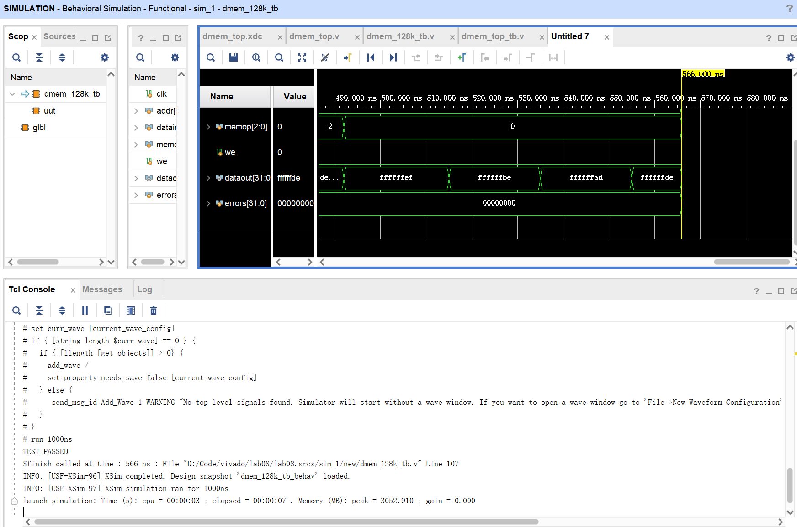

# Lab08 实验报告：CPU 数据通路

- **学号**：____________（dummy）
- **姓名**：____________（dummy）
- **日期**：2026 年 10 月

> 两个在线评测题目、板级功能仿真与上板验收均已完成。

---

## 1. 实验目的

1. 理解 RV32I 中 ALU 的功能定义与四位控制信号 `ALUctr` 的含义。
2. 掌握让加减法、移位、比较、异或等运算部件并行计算，再用选择器按 `ALUctr[2:0]` 选出结果的组织方式。
3. 理解 ALU 的 `less` 与 `zero` 两个指示位的语义，尤其是比较运算中 `zero` 表示两操作数相等。
4. 理解 RV32I 访存指令对数据存储器的读写要求，掌握按字节、半字、字读写以及带符号、无符号扩展的处理。
5. 掌握数据存储器支持 1、2、4 字节读写的手动实现方式：在线评测模块采用先读后改再整字写，上板模块把 32 位字拆成四个字节通道，按 MemOP 译码字节写使能。
6. 学会用拨码开关输入操作类型、地址和数据，并用数码管把 32 位读出结果以十六进制显示，完成上板验证。

手册中 CPU 数据通路由寄存器堆、ALU 和数据存储器三部分组成，本报告覆盖其中的 ALU 与数据存储器两项在线评测必做题，以及数据存储器的上板实现。

## 2. 实验原理

### 2.1 ALU 的功能与控制信号

RV32I 的 ALU 用四位 `ALUctr` 控制：`ALUctr[2:0]` 直接送到八选一选择器选择运算结果，`ALUctr[3]` 则作为加减选择、比较符号选择、逻辑与算术右移选择的辅助位。

| ALUctr[3] | ALUctr[2:0] | 操作 |
| :---: | :---: | :--- |
| 0 | 000 | 加法 |
| 1 | 000 | 减法 |
| × | 001 | 左移 |
| 0 | 010 | 做减法，输出带符号小于结果，`less` 按带符号比较 |
| 1 | 010 | 做减法，输出无符号小于结果，`less` 按无符号比较 |
| × | 011 | 直接输出输入 B |
| × | 100 | 异或 |
| 0 | 101 | 逻辑右移 |
| 1 | 101 | 算术右移 |
| × | 110 | 逻辑或 |
| × | 111 | 逻辑与 |

移位量取 `datab[4:0]`。`less` 只在比较大小时有明确含义，取 `ALUctr[3]` 选出的带符号或无符号小于。`zero` 在所有运算中都要正确指示结果是否为零，而在 `ALUctr[2:0]` 为 010 的比较运算里，结果本身是 0 或 1，不能直接用它判断，因此比较时令 `zero` 表示两操作数是否相等。

### 2.2 数据存储器与访存指令

数据存储器按字节编址，但对地址的齐整性不作要求：4 字节读写时地址低 2 位为 00，2 字节读写时最低位为 0。存储器用 32 位字组织，字节地址可拆成

$$
\text{addr} = \text{字索引} \times 4 + \underbrace{\text{addr}[1:0]}_{\text{字节偏移}}
$$

在线评测模块取 16 KiB，字索引为 `addr[13:2]`；上板模块取 128 KiB，字索引为 `addr[16:2]`。`addr[1:0]` 在字节访问时选出字内的第几个字节，在半字访问时用其最高位选出低半字或高半字。各条访存指令与 MemOP 的对应关系如下：

| 指令 | MemOP | 操作 |
| :--- | :---: | :--- |
| `lb` | 000 | 取 1 字节，符号扩展 |
| `lh` | 001 | 取 2 字节，符号扩展 |
| `lw` | 010 | 取 4 字节 |
| `lbu` | 100 | 取 1 字节，零扩展 |
| `lhu` | 101 | 取 2 字节，零扩展 |
| `sb` | 000 | 写 1 字节 |
| `sh` | 001 | 写 2 字节 |
| `sw` | 010 | 写 4 字节 |

### 2.3 1、2、4 字节写的两种实现

存储器要支持按字节或半字写入，同时不能破坏同一个 32 位字里相邻的位。单周期 CPU 在一个周期内只会进行读或写中的一种，因此存储器设有独立的读时钟 `rdclk` 和写时钟 `wrclk`。

在线评测模块采用先读后改再整字写：`rdclk` 上升沿把目标字读出并锁存为旧字 `rdword`，`wrclk` 上升沿再按 MemOP 只替换旧字中对应的字节或半字、其余位保留，最后整字写回。写数据组合逻辑用锁存后的旧字拼装，避免读写竞争。

上板模块改为更直接的手动实现：把 32 位字拆成四个 8 位字节通道，每个通道各是一块手写的双端口 RAM；写使能按 MemOP 与 `addr[1:0]` 译码成 4 位字节使能 `be`，写时钟沿只对 `be` 为 1 的通道整字节写入。这样 1、2、4 字节写都只改动目标字节，既不需要先读后改，也不会出现只改写某个存储单元部分 bit 的情况。

| MemOP | 操作 | `addr[1:0]` | `be[3:0]` |
| :---: | :--- | :---: | :---: |
| 010 | 写 4 字节 | 00 | 1111 |
| 001、101 | 写低半字 | 00 | 0011 |
| 001、101 | 写高半字 | 10 | 1100 |
| 000、100 | 写第 0 字节 | 00 | 0001 |
| 000、100 | 写第 1 字节 | 01 | 0010 |
| 000、100 | 写第 2 字节 | 10 | 0100 |
| 000、100 | 写第 3 字节 | 11 | 1000 |

## 3. 实验设备

- 电脑一台，安装 Xilinx Vivado 2022.1
- Digilent Nexys A7-100T 开发板一块
- USB 下载线一根

## 4. 实验步骤

### 4.1 ALU

在线评测模块写在 `lab08/exp1_alu/alu.v`，接口与题面一致：

```verilog
module alu(input [31:0] dataa, input [31:0] datab, input [3:0] ALUctr,
           output less, output zero, output reg [31:0] aluresult);
```

加减、左移、逻辑与算术右移、带符号与无符号小于、异或、或、与各运算部件并行计算，`aluresult` 用 `case (ALUctr[2:0])` 从八选一里选择；`less` 与 `zero` 作为独立组合输出。算术右移单独写成一条带符号的右移线，避免与 `datab` 的无符号性混在一起而被当成逻辑右移。所有分支完整列出并带 `default`，不产生锁存器。

官方样例 `lab08/exp1_alu/alu_rv32.v` 覆盖了 ALUctr 的整张表，用作功能仿真。

### 4.2 数据存储器

在线评测模块写在 `lab08/exp2_dmem/dmem.v`，接口为：

```verilog
module dmem(input [31:0] addr, output reg [31:0] dataout, input [31:0] datain,
            input rdclk, input wrclk, input [2:0] memop, input we);
```

容量取 4096 个 32 位字，即 16 KiB，满足在线评测对至少 4 KiB 的要求。读操作在 `rdclk` 上升沿读整字并按 MemOP 与地址低位拼接扩展，写操作按 2.3 节的方式组合出整字后在 `wrclk` 上升沿写回。官方样例 `lab08/exp2_dmem/dmem_tb.v` 用先给 `rdclk` 上升沿、再给 `wrclk` 上升沿的方式驱动读写。

### 4.3 数据存储器上板

上板顶层写在 `lab08/exp2_dmem/dmem_top.v`，其中自带一个手动实现的 128 KiB 数据存储器模块 `dmem_128k`，共 32768 个 32 位字。该模块不使用任何 IP 核，把每个 32 位字拆成 4 个 8 位字节通道 `mem_b0`～`mem_b3`，每个通道是一块 32768×8 的双端口 RAM，并用 `(* ram_style = "block" *)` 让 Vivado 把它推断成块 RAM。块 RAM 是 FPGA 芯片内部的硬件存储资源，由综合工具从手写代码推断而来，不是 IP 核。

写使能 `be` 由 MemOP 和 `addr[1:0]` 译码：字写为 `1111`；半字写根据 `addr[1]` 取 `0011` 或 `1100`；字节写根据 `addr[1:0]` 取 `0001`、`0010`、`0100` 或 `1000`。写数据也按 MemOP 放到对应通道：字写用 `datain[31:0]` 的四个字节，半字写用 `datain[15:0]`，字节写用 `datain[7:0]`。写时钟沿只对 `be` 为 1 的通道整字节写入，因此 1、2、4 字节写都只改目标字节。读时钟沿同时读出四个通道并拼成 32 位字，地址低两位也一并锁存，再按 MemOP 做符号扩展或零扩展。开关映射如下：

- `SW[2:0]` 选择 MemOP；
- `SW[3]` 为写使能 `we`；
- `SW[7:4]` 作为地址的低 4 位，高位补 0；
- `SW[15:8]` 作为 8 位写数据，在代码里重复拼接 4 次构成 32 位；
- 32 位读出结果用 8 个七段数码管以十六进制显示，动态扫描位选。

上板操作时先设置好 MemOP、地址和写数据，再把 `we` 打开写入；写完先关掉 `we` 再改地址，避免在改开关的过程中误写。

读时钟取 100MHz 系统时钟，写时钟取它的反相，使读发生在系统时钟上升沿、写发生在下降沿。上板只需要 `dmem_top.v` 与 `dmem_top.xdc` 两个文件，不依赖 IP 核或其它源文件，在线评测模块 `dmem.v` 不参与上板。仿真用两个自检式 testbench：`dmem_128k_tb.v` 用非重复的 32 位写数据单独检查四个字节通道的写数据落位和读出扩展；`dmem_top_tb.v` 检查拨码开关映射、1/2/4 字节读写和数码管段码。

## 5. 实验结果

### 5.1 ALU

在线评测通过。官方样例仿真 17 条用例全部通过，覆盖加减、左右移、带符号与无符号小于、B 直通、异或、或、与，以及 `zero` 和 `less` 指示，输出与预期逐条一致。

### 5.2 数据存储器

在线评测通过。官方样例仿真 17 条用例全部通过，覆盖字、半字、字节读写，带符号与无符号扩展，以及先读后改的字节、半字写。

### 5.3 数据存储器上板

板级自检式功能仿真打印 `TEST PASSED`：4 字节写后 `mem[0]` 为 `0xABABABAB`；2 字节写只改高半字得到 `0xCDCDABAB`，低半字写只改低 2 字节得到 `0x00007777`；对 `addr0` 所在字的三次 1 字节写分别改第 1、0、3 字节，得到 `0x33CD1122`，说明四个字节通道可以独立写入；读 `addr=2` 的字节得到符号扩展 `0xFFFFFFCD` 和零扩展 `0x000000CD`；读半字得到 `0x00001122` 和 `0x000033CD`；负半字 `0x8000` 的符号扩展为 `0xFFFF8000`，零扩展为 `0x00008000`；数码管扫描到第 0 位时显示低 4 位的段码正确。存储器单元自检 `dmem_128k_tb.v` 也打印 `TEST PASSED`，用 `0x11223344`、`0xDEADBEEF` 这类四个字节各不相同的写数据验证了字写、半字写只取 `datain[15:0]`、字节写只改目标通道，以及逐字节读出的扩展结果。



烧写比特流后按开关设置 MemOP、写使能、地址与写数据，数码管显示与预期一致。写入 `0xAB` 的整字后读出 `ABABABAB`；在地址 1 写字节 `0x11` 后读该字节得到 `00000011`，再读整字得到 `ABABAB11`，说明字节写只改目标字节。地址 2 写高半字 `0xCD` 后读整字得到 `CDCD2211`，读该字节得到符号扩展 `FFFFFFCD` 和零扩展 `000000CD`，读该半字得到符号扩展 `FFFFCDCD` 和零扩展 `0000CDCD`。写高半字 `0x80` 后读半字得到 `FFFF8080` 和 `00008080`，符号扩展与零扩展正确。地址 `0100` 所在的字初始读出 `00000000`，写入 `0x5A` 后读出 `5A5A5A5A`，再读回地址 `0000` 的字仍为 `80802211`，说明地址高位补零且不同字互不影响。数码管显示的是当前 MemOP 与地址对应的读出结果，读整字时需要把 MemOP 置为 `010` 且地址低两位为 00。

### 5.4 实验小结

本实验把 CPU 数据通路中的两个运算、访存部件做成了可独立评测的模块。ALU 的关键是把各运算部件并行算出来再用选择器选结果，同时把 `less` 和 `zero` 的语义分清楚，尤其是比较运算里 `zero` 要看两操作数是否相等，而不是看结果位。数据存储器的关键是把字节地址拆成字索引与字节偏移 `addr[1:0]`，并在写字节或半字时只修改目标字节。在线评测模块先用 `rdclk` 读出旧字、在 `wrclk` 上替换对应位再整字写回；上板时按要求改成不用 IP 核的手动实现，把 32 位字拆成四个 8 位字节通道，按 MemOP 译码字节写使能，1、2、4 字节写都只让对应通道的写使能有效。上板再把开关映射成 MemOP、写使能、地址与写数据，用 8 位数码管动态扫描显示 32 位读数据。

## 个人思考

基本沿用数逻计组的那套写法，用四个分片来分别处理一个 32 位字的四个字节，然后根据 `MemOp` 选 WE 然后选写入各个分片的内容即可。