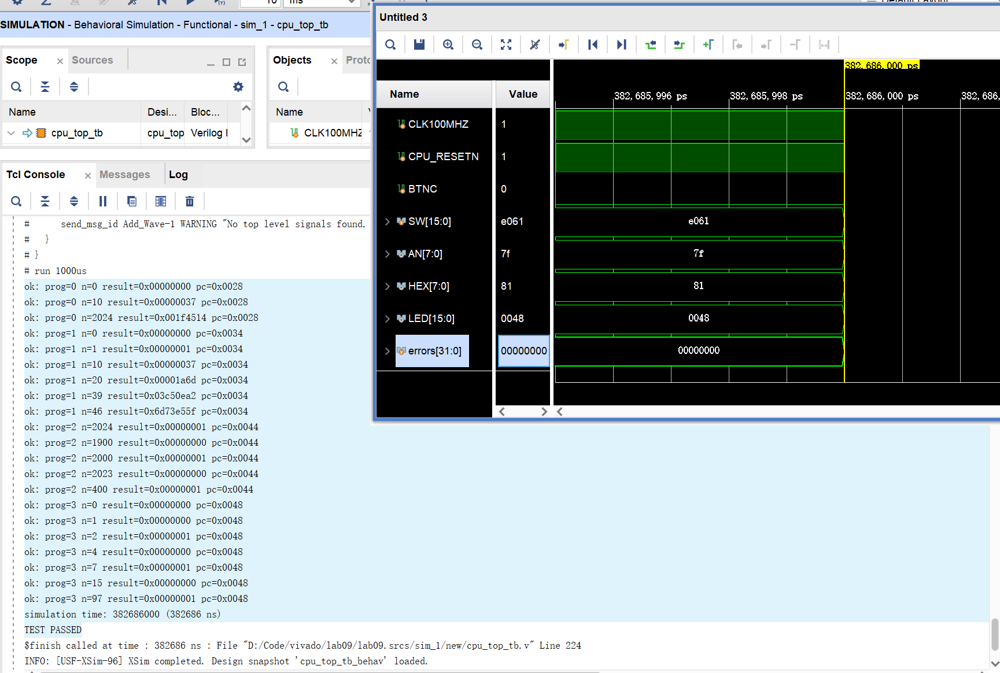
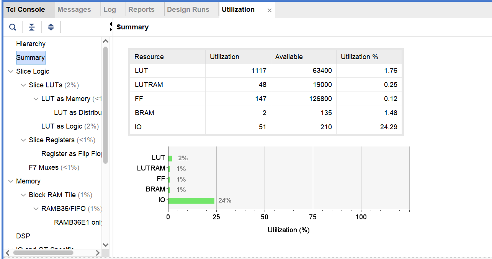
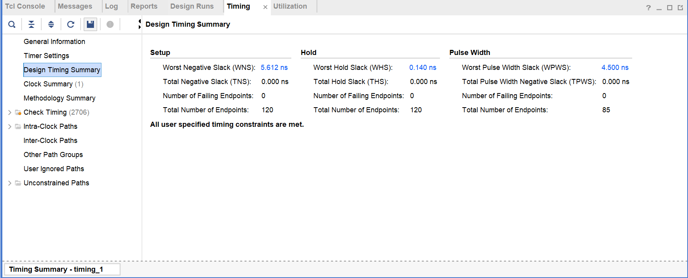

# Lab09 实验报告：RV32I 单周期 CPU

- **学号**：____________（dummy）
- **姓名**：____________（dummy）
- **日期**：2026 年 10 月

---

## 1. 实验目的

1. 理解 RV32I 六种指令格式与 37 条指令的编码方式和操作语义。
2. 掌握单周期 CPU 中控制通路与数据通路的划分方法，理解每条控制信号的作用。
3. 掌握单周期 CPU 的存储器时序设计，理解为什么指令存储器在下降沿取指、数据存储器在上升沿读、寄存器堆在下降沿写回。
4. 学会使用课程提供的单步 testbench 逐条指令检查 PC、寄存器和存储器。
5. 学会使用 RISC-V 官方测试集 rv32ui-p 对 CPU 做系统级功能验证。
6. 掌握用拨码开关输入参数、用数码管显示结果、用按钮单步执行的上板调试方法。

## 2. 实验原理

### 2.1 指令格式与立即数

RV32I 的指令长度固定为 32 位，opcode 固定在低 7 位，rd、rs1、rs2 也都在固定位置，因此译码可以直接从指令的对应位段取出：

```verilog
assign op    = instr[6:0];
assign rs1   = instr[19:15];
assign rs2   = instr[24:20];
assign rd    = instr[11:7];
assign func3 = instr[14:12];
assign func7 = instr[31:25];
```

六种格式的区别只在于立即数的切分方式。所有立即数都要符号扩展到 32 位，符号位都是 `instr[31]`：

```verilog
assign immI = {{20{instr[31]}}, instr[31:20]};
assign immU = {instr[31:12], 12'b0};
assign immS = {{20{instr[31]}}, instr[31:25], instr[11:7]};
assign immB = {{20{instr[31]}}, instr[7], instr[30:25], instr[11:8], 1'b0};
assign immJ = {{12{instr[31]}}, instr[19:12], instr[20], instr[30:21], 1'b0};
```

控制信号 `extop` 取值 `EXT_I`、`EXT_U`、`EXT_S`、`EXT_B`、`EXT_J`，分别选择 I、U、S、B、J 型立即数，再用一个多路选择器把选中的立即数送到 ALU 的 B 输入端和 PC 加法器。

### 2.2 控制通路

控制信号生成模块以 `op`、`func3`、`func7_5` 为输入，产生 `extop`、`regwr`、`alu_a_src`、`alu_b_src`、`aluctr`、`branch`、`memtoreg`、`memwr`、`memop` 九组信号，各指令对应的取值来自实验指导的表 9.10 和表 9.11。指令编码、ALU 操作和跳转类型都用 `localparam` 命名，代码里不再出现裸的二进制控制字。

`aluctr` 是一个 4 位枚举：

| ALU 控制 | 编码 | 操作 |
| :--- | :---: | :--- |
| `ALU_ADD` | 0000 | 加法 |
| `ALU_SUB` | 1000 | 减法 |
| `ALU_SLL` | 0001 | 逻辑左移 |
| `ALU_SLT` | 0010 | 带符号小于，结果置 0 或 1 |
| `ALU_SLTU` | 1010 | 无符号小于，结果置 0 或 1 |
| `ALU_XOR` | 0100 | 异或 |
| `ALU_SRL` | 0101 | 逻辑右移 |
| `ALU_SRA` | 1101 | 算术右移 |
| `ALU_OR` | 0110 | 或 |
| `ALU_AND` | 0111 | 与 |
| `ALU_LUI` | 0011 | 直接输出 B，用于 `lui` |

最高位是辅助位：加法和减法、带符号和无符号小于、逻辑右移和算术右移分别共用低 3 位，靠最高位区分。

组合逻辑的每个 `case` 都写了 `default`，每个 `if` 都有 `else`，默认值在 `always` 块开头统一赋值，避免推断出锁存器。

### 2.3 数据通路与跳转控制

数据通路以寄存器堆、ALU、数据存储器为核心。ALU 的 A 输入由 `alu_a_src` 在 `rs1` 和 `PC` 之间选择，B 输入由 `alu_b_src` 在 `rs2`、立即数和常数 4 之间选择。写回数据由 `memtoreg` 在 ALU 结果和存储器读出数据之间选择。

条件分支不另外做比较器，而是复用 ALU：`beq`、`bne`、`blt`、`bge` 令 `aluctr` 为 `ALU_SLT`，`bltu`、`bgeu` 令 `aluctr` 为 `ALU_SLTU`。`alu_zero` 在比较运算时表示两操作数相等，`alu_less` 在 `ALU_SLTU` 时取无符号小于，否则取带符号小于。

NextPC 由三条加法路径产生：`pc_plus4 = pc + 4`、`pc_plus_imm = pc + imm`、`rs1_imm = rs1 + imm`，再由跳转类型选择：

| Branch | 编码 | 含义 | 跳转条件 | NextPC |
| :--- | :---: | :--- | :--- | :--- |
| `BR_NONE` | 000 | 非跳转 | — | PC+4 |
| `BR_JAL` | 001 | `jal` | 无条件 | PC+imm |
| `BR_JALR` | 010 | `jalr` | 无条件 | rs1+imm，最低位清零 |
| `BR_BEQ` | 100 | `beq` | zero | 成立 PC+imm，否则 PC+4 |
| `BR_BNE` | 101 | `bne` | !zero | 成立 PC+imm，否则 PC+4 |
| `BR_LT` | 110 | `blt`、`bltu` | less | 成立 PC+imm，否则 PC+4 |
| `BR_GE` | 111 | `bge`、`bgeu` | !less | 成立 PC+imm，否则 PC+4 |

`jalr` 的目标地址要与 `0xfffffffe` 相与，清掉最低位：

```verilog
BR_JALR: nextpc = {rs1_imm[31:1], 1'b0};
```

### 2.4 单周期时序

单周期 CPU 的难点不在指令译码，而在存储器读写的时间点。本设计按实验指导的方案，以时钟下降沿作为一周期的起点：

- 下降沿同时做四件事：PC 装入 NextPC、指令存储器按 NextPC 取指、寄存器堆写回上一条指令的结果、数据存储器写入上一条 store 指令的数据。
- 上升沿读数据存储器。此时 ALU 已经把访存地址算好，读出的数据在下一个下降沿随寄存器堆写回。
- 两个边沿之间是纯组合逻辑：指令译码、立即数生成、寄存器读、ALU 运算、访存地址计算。

指令存储器的地址必须用 NextPC 而不是 PC。原因是取指和 PC 更新发生在同一个下降沿，PC 的输出要等这个沿之后才更新，而存储器在沿上采样地址，只能拿到沿之前就稳定的 NextPC。

由此带来一个容易忽略的细节：testbench 在 reset 有效期间也要产生一个下降沿，让 NextPC 的 0 被送入指令存储器，把 0 地址的指令取出来。否则 reset 释放后的第一个下降沿会拿未初始化的指令去算 NextPC，PC 会变成不定值。实验指导中“nextPC 在 reset 有效时应保持为全零”说的就是这件事。

load 指令的时序最紧：数据存储器在上升沿读出，寄存器堆在紧接着的下降沿写回，中间只有半个周期。本设计在 100MHz 的单步脉冲下工作，半周期为 10ns，块 RAM 的读延迟加上选择器与布线能够满足；若时序不收敛，可以降低 CPU 时钟频率。

### 2.5 上板顶层与存储器映射

上板工程按功能拆成 `cpu_top.v`、`rv32is.v`、`prog_rom.v`、`board_dmem.v` 四个 Verilog 文件，顶层只负责时钟、复位、存储器映射和外设。为了用同一份 ROM 演示多个程序，4 段程序各占 256 字的 ROM 空间，由 `SW[15:14]` 选择。机器码由 `make_rom.py` 从 `prog_*.S` 汇编成 `prog.hex`，`prog_rom.v` 用 `$readmemh` 在 `initial` 中把 1024 个字装进 BRAM。读时钟用 100MHz 而不是 CPU 的步进时钟：复位期间 PC 一直为 0，BRAM 已经在连续读 0 地址，第一次取指不会拿到未初始化的输出；地址取 PC 而不是组合的 NextPC，避免连续时钟把取指地址一个周期推一条。BRAM 的读延迟只有 10ns，相对自动运行的 1.28us 周期可以忽略。

CPU 的数据地址空间划分为：

| 地址 | 访问方式 | 功能 |
| :--- | :--- | :--- |
| `0x0000_0000` 起 4KB | 读写 | 数据 RAM |
| `0x0000_2000` | 只读 | `{16'b0, SW[15:0]}` |
| `0x0000_2004` | 只写 | 结果寄存器，二进制，送数码管以十六进制显示 |

程序用 `lw` 从 `0x2000` 读参数，用 `sw` 把二进制结果写到 `0x2004`，这样 CPU 不需要额外的端口，演示程序也保持了纯 RV32I 指令。顶层把 `result_reg` 的 8 个 nibble 轮流送到数码管，以十六进制显示。

## 3. 实验设备

- 电脑一台，安装 Xilinx Vivado 2022.1
- Digilent Nexys A7-100T 开发板一块
- USB 下载线一根

## 4. 实验步骤

### 4.1 CPU 模块

两个在线评测题目使用相同的端口定义，都提交 `lab09/exp1_cpu/rv32is.v` 这一个文件。模块端口与课程 testbench 一致：

```verilog
module rv32is(
    input  wire        clock,
    input  wire        reset,
    output wire [31:0] imemaddr,
    input  wire [31:0] imemdataout,
    output wire        imemclk,
    output wire [31:0] dmemaddr,
    input  wire [31:0] dmemdataout,
    output wire [31:0] dmemdatain,
    output wire        dmemrdclk,
    output wire        dmemwrclk,
    output wire [2:0]  dmemop,
    output wire        dmemwe,
    output wire [31:0] dbgdata
);
```

`dbgdata` 直接输出 PC，单步 testbench 用它检查跳转是否正确。寄存器堆单独写成 `rv32i_regfile` 子模块，实例名保持为 `myregfile`，数组名为 `regs`，这样 testbench 里的 `mycpu.myregfile.regs[10]` 可以直接访问。

时钟连接关系为：

```verilog
assign imemclk  = ~clock;   // 下降沿取指
assign dmemrdclk = clock;   // 上升沿读数据存储器
assign dmemwrclk = ~clock;  // 下降沿写数据存储器
```

寄存器堆的写时钟直接接 `clock`，其内部在 `negedge WrClk` 写入。

### 4.2 单步功能仿真

自检 testbench 写在 `lab09/exp1_cpu/rv32is_tb.v`，使用课程提供的 `add`、`alu`、`mem`、`branch` 四段小程序，逐条指令检查寄存器、存储器和 PC。每个检查点只在出错时打印 MISMATCH，最后输出 `TEST PASSED` 或 `TEST FAILED`。

`add` 验证三条基本运算指令；`alu` 覆盖加减、逻辑、移位、带符号与无符号比较；`mem` 覆盖 `lw`、`sw`、`lb`、`lbu`、`lh`、`lhu`、`sb`、`sh` 以及符号扩展；`branch` 覆盖六条条件分支和 `jal`、`jalr`。

仿真前要把 `lab09/exp1_cpu/tests/` 目录拷贝到 Vivado 的仿真工作目录，即 `工程名.sim/sim_1/behav/xsim/`，因为 `$readmemh` 的相对路径是相对于仿真工作目录解析的。用 iverilog 本地运行时直接在 `exp1_cpu` 目录下执行即可。

### 4.3 官方测试集

官方测试集 testbench 写在 `lab09/exp1_cpu/cpu_batch_tb.v`，按顺序运行 rv32ui-p 开头的 38 个用例。每个用例把指令文件装入指令存储器、把 `_d.hex` 装入数据存储器，然后单步运行到取指得到 `0xdead10cc` 为止。最后检查 `a0`：

- `0x00c0ffee` 表示通过；
- `0xdeaddead` 表示测试代码自己判错；
- 其他值或超过 10000 周期表示运行异常。

`dmem.v`、`testmem.v`、`testdmem.v` 是课程提供的存储器模型，只用于仿真，不参与在线评测提交。

### 4.4 上板顶层

上板文件为 `lab09/exp2_board/` 下的 `cpu_top.v`、`rv32is.v`、`prog_rom.v`、`board_dmem.v`、`prog.hex` 和 `cpu_top.xdc`。把这 6 个文件加入工程、把顶层设为 `cpu_top` 即可综合。`rv32is.v` 与在线评测提交的 CPU 文件相同，`prog_rom.v` 是同步读的指令 ROM，`prog.hex` 是它的初始化文件，`board_dmem.v` 是 4KB 数据存储器。

`$readmemh` 的相对路径按工具的工作目录解析，而不是按源文件所在目录。仿真前要把 `prog.hex` 拷到 `工程名.sim/sim_1/behav/xsim/`；综合前把 `prog.hex` 加入工程，如果综合日志提示文件打不开，再把它拷到 `工程名.runs/synth_1/`。

板上资源分配：

- `SW[15:14]` 选择程序，00 累加和、01 斐波那契、10 闰年判断、11 素数判断；
- `SW[13]` 为 1 时自动运行，约 780kHz，为 0 时用 `BTNC` 单步；
- `SW[11:0]` 是参数 n，范围 `0x000` 到 `0xFFF`，`SW[12]` 未使用；
- `CPU_RESETN` 是板上红色的 CPU RESET 按钮，低有效。上电时另有约 2.6ms 的上电复位；改参数或换程序时先设好开关，再按一下 `CPU_RESETN`，复位期间开关被锁存，运行中改开关不影响本次结果；`BTNC` 只用于单步，不是复位；
- 顶层在复位开始时产生一个 10ns 的 CPU 时钟脉冲，单步模式下没有运行时钟时也能把 PC 和结果寄存器清 0；
- `LED[15:0]` 显示 PC 的低 16 位；
- 8 位数码管以十六进制显示 32 位结果。

上板操作顺序是：先用 `SW[15:14]` 选程序、`SW[13]` 选自动或单步、`SW[11:0]` 输入 n，再按一下红色 `CPU_RESETN`；`SW[13]=1` 时程序自动运行到停机，`SW[13]=0` 时每按一次 `BTNC` 执行一条指令；最后读数码管上的 8 位十六进制结果。按住复位时 PC 和显示保持 0，松开后自动模式会马上重跑程序，所以显示很快回到计算结果；想看复位过程可以切到单步模式。

四段汇编程序分别是 `prog_sum.S`、`prog_fib.S`、`prog_leap.S`、`prog_prime.S`，由 `make_rom.py` 调用 `tools/rvasm.py` 汇编，生成 `prog.hex`。每段 256 字，用 `@000`、`@100`、`@200`、`@300` 分段，不足 256 字的部分补 nop。修改程序后执行：

```bash
cd lab09/exp2_board
python3 make_rom.py
```

四个程序都只把二进制结果写到 `0x2004`，顶层把 32 位结果按 4 位一组送到数码管，以十六进制显示。斐波那契在 n 不超过 46 时结果在 32 位内，8 位数码管可以完整显示；n 更大时 32 位加法溢出。闰年程序检查 n 能否被 4、100、400 整除：能被 4 整除且不能被 100 整除，或者能被 400 整除时结果为 1。素数判断没有除法指令，用重复减法求余数；闰年的 100 和 400 也用同样的方法。两段程序都处理了 0 和 1 的边界情况。

上板顶层自检写在 `cpu_top_tb.v`，把上电复位、自动运行分频、数码管扫描分频都通过参数缩小，逐个程序检查结果寄存器、停机 PC、LED 和数码管段码，共 21 个用例。

### 4.5 工具链交叉验证

为了避免手工编码出错，用 Docker 搭了一个 RISC-V 工具链做交叉验证：

```bash
docker build -t riscv32:12 tools/riscv32
tools/riscv32/check.sh
```

镜像里安装了 `binutils-riscv64-linux-gnu` 和 `qemu-user`。`tools/rvasm.py` 汇编出的机器码与 GNU as 用 `-march=rv32i -mabi=ilp32` 汇编的结果逐字比较，41 条覆盖各类格式和立即数边界的指令全部一致；`qemu-riscv32` 独立执行 1+2+…+10 的程序，退出码为 55，与预期一致。这只能说明汇编器和程序语义正确，CPU 本身仍以 RTL 仿真和上板为准。

## 5. 实验结果

### 5.1 单步功能仿真

四个小程序全部通过，`TEST PASSED`。四段程序覆盖了整数运算、访存、条件分支和跳转的代表性指令，寄存器、存储器与 PC 的检查点均与预期一致。

### 5.2 官方测试集

38 个 rv32ui-p 用例全部通过：

```text
TEST PASSED: 38/38
```

全部用例合计 11390 个周期，批量 testbench 的仿真时间约 230us，在 Vivado 的行为仿真里可以直接运行。用例列表：

```text
simple  add    addi   and    andi   auipc  beq    bge    bgeu
blt     bltu   bne    jal    jalr   lb     lbu    lh     lhu
lui     lw     or     ori    sb     sh     sll    slli   slt
slti    sltiu  sltu   sra    srai   srl    srli   sub    sw
xor     xori
```

`exp2_board/rv32is.v` 与在线评测模块是同一份代码，也用同一套测试集跑过，结果同样是 38/38。

### 5.3 上板

`cpu_top_tb.v` 的 21 个用例全部通过。这组测试检查四个程序共 21 组参数的结果寄存器、停机 PC、LED 和数码管段码，整段仿真约 383us，运行前要把仿真时长调到 400us 以上，否则只能看到前面几个周期。



四个程序和十六进制显示已在实物上板验证。各程序的结果：

| 程序 | 参数 | 数码管显示 |
| :--- | :--- | :--- |
| 累加和 | n=0、10、2024 | 0x00000000、0x00000037、0x001F4514 |
| 斐波那契 | n=0、1、10、20、39、46 | 0x00000000、0x00000001、0x00000037、0x00001A6D、0x03C50EA2、0x6D73E55F |
| 闰年判断 | 2024、1900、2000、2023、400 | 0x00000001、0x00000000、0x00000001、0x00000000、0x00000001 |
| 素数判断 | 0、1、2、4、7、15、97 | 0x00000000、0x00000000、0x00000001、0x00000000、0x00000001、0x00000000、0x00000001 |

上板时按住红色 `CPU_RESETN`，PC 和结果寄存器立即清 0，数码管显示 `0x00000000`；松开后自动模式会马上重跑程序，所以显示很快回到计算结果，单步模式则停在 PC=0，等按 `BTNC` 才执行第一条指令。改参数或换程序后，先设好开关，再按一下 `CPU_RESETN` 重新锁存。

### 5.4 综合资源与时序

整个设计占 1117 个 LUT、147 个触发器、48 个 LUTRAM 和 2 个 Block RAM，IO 用了 51 个，占用 24.29%，其余资源都在 2% 以内。



分层报告可以看出资源去向：CPU 本体只占 257 个 LUT 和 32 个触发器，指令 ROM 占 829 个 LUT 和 1 个 Block RAM，数据存储器占 8 个 LUT 和 1 个 Block RAM。指令 ROM 被综合成了 Block RAM，而不是用触发器堆成寄存器堆，这正是上板时希望的结果。


100MHz 时钟下的时序报告给出 WNS 为 5.612ns、WHS 为 0.140ns，保持时间和脉宽都没有违例，工具结论是所有时序约束都已满足。也就是说 10ns 的周期里最长的组合通路只占了约 4.4ns，余量接近一半。



## 6. 思考题

### 6.1 为什么有 S、B、U、J 这些不同的立即数编码

指令编码的总位数是固定的 32 位。R 型指令需要 rs1、rs2、rd 三个寄存器号，没有空间再放立即数；I 型只有一个源寄存器，可以用 12 位立即数；S 型需要两个源寄存器但没有 rd，于是把 12 位立即数拆成 `imm[11:5]` 和 `imm[4:0]` 两段，塞进原本放 rd 和 func7 的位置；B 型是 S 型的变种，分支偏移一定是偶数，最低位恒为 0，于是把这一位省出来，多表示一位偏移，同时把符号位放在 bit 31，和其余立即数共用符号扩展；U 型只有 rd，能放 20 位立即数；J 型只有 rd，跳转偏移最低位恒为 0，于是用 20 位表示偏移。这样安排让所有格式的 opcode、rs1、rs2、rd 位置尽量保持不变，译码器只需要看 opcode 和 func3，硬件代价最小。

### 6.2 为什么代码段和数据段只取地址的低 18 位仍然正确

程序链接在 `0x8000_0000`，代码段和数据段都落在同一个 256KB 区域内。CPU 内部仍然使用完整的 32 位地址，只是指令存储器用 `iaddr[17:2]` 作为字索引，相当于对 256KB 取模，数据存储器用 `addr[16:2]` 作为字索引，相当于对 128KB 取模。由于所有访问的高位都相同，取模不会改变段内的相对偏移，`0x8000_0000` 这个基址就被自然地丢掉了。分支和跳转都是 PC 相对寻址，PC 从 0 开始也不影响程序内部的相对关系。反过来说，如果程序跨越了存储器容量边界，或者代码和数据不在同一段区域，这种截断就会出错。

### 6.3 数据存储器用 4 片 8 位存储器实现时如何生成 4 个初始化文件

每个 32 位字按小端顺序拆成 4 个字节：`word[7:0]` 给第 0 片，`word[15:8]` 给第 1 片，`word[23:16]` 给第 2 片，`word[31:24]` 给第 3 片。生成时对原始 hex 文件逐字读取，把每个字的对应字节写到对应片的初始化文件，地址保持不变。这样 4 片存储器按字节写使能各自写入，拼起来就是一个完整的 32 位字，字节写也不会破坏相邻的字节。

### 6.4 为什么正常的 RV32I 指令序列中不会出现 0xdead10cc

`0xdead10cc` 的低 7 位是 `0x4c`，即 `1001100`，其中 opcode 的高 5 位 `op[6:2]` 为 `10011`。RV32I 的 37 条指令只使用 00000、00100、01000、01100、01101、00101、11000、11001、11011 这几组 opcode，`10011` 不在其中，所以它不可能是一条合法指令。把它放在通过或失败代码之后，CPU 取到它时就知道测试结束了，不会把它当成真实指令执行。

## 个人思考

这个实验最花时间的地方不是写指令译码，而是把时序对齐。刚开始我把“下降沿开始一个周期”和 testbench 里“上升沿之后 1ns 检查”当成了同一件事，结果寄存器写回总是慢一拍，单步检查全部失败。后来把每个边沿的时间点画在纸上，才理清关系：第 n 步检查看到的是第 n−1 条指令的结果，因为写回发生在下一步开始的下降沿。手册里“在下一周期的下降沿写入”这句话，只有对着波形看才真正理解。

第二个坑是 reset 期间的那次取指。我自己的 testbench 把 `clk` 初始化成 0，课程 testbench 没有初始化，`X → 0` 本身就是一个下降沿。少了这个沿，指令存储器在 reset 释放前没有被读过，第一个下降沿拿到的指令是 X，PC 直接变成不定值，而后面几个用例反而正常，因为前一个用例已经把存储器“预热”了。把 `clk` 初始成 1 之后，第一个用例才和其他用例一样通过。这件事让我明白，testbench 的初始化方式也会改变电路的行为，不能随手写。

上板时我一开始把指令 ROM 写成组合读取的 LUT，后来按模块化的要求改成同步 BRAM 加 `$readmemh`。同步 BRAM 的风险是上电后输出没有定义：如果读时钟用 CPU 的步进时钟，复位期间根本不会产生读沿，第一次取指就可能拿到随机指令。解决办法是让 BRAM 用 100MHz 连续读，复位期间 PC 一直是 0，等 CPU 真正走第一步时 0 地址的指令早就读出来了；地址必须用 PC 而不是 NextPC，否则连续时钟会把取指地址一个周期推一条，越跑越远。另一个小坑是顶层自检里 `SW` 的拼接写成了 17 位，程序选择位整体错位，所有结果都是 0，查了很久才发现是位宽不匹配。硬件描述语言里多一位少一位不会报错，只会悄悄地错，这一点和软件很不一样。

最后，用 Docker 里的 GNU as 和 qemu 做交叉验证让我踏实了不少。汇编器的 41 条编码和 GNU as 完全一致，qemu 也能把循环程序跑出正确退出码。但真正能说明 CPU 正确的还是官方测试集的 38 个用例，尤其是它们对符号扩展、比较和跳转边界的覆盖，比自己写的几个小程序全面得多。
