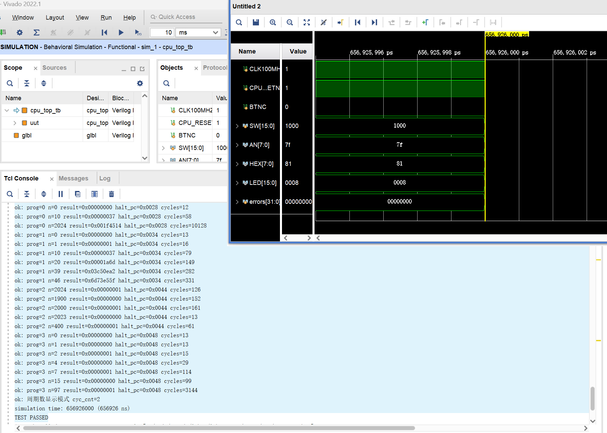
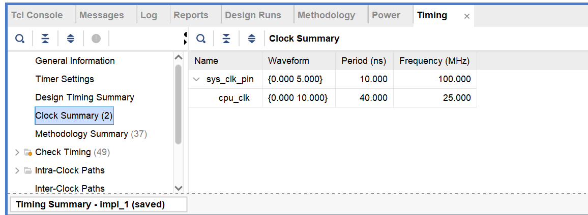
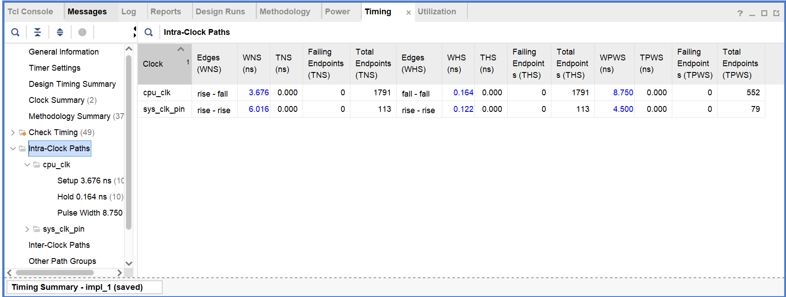

# Lab10 实验报告：RV32I 五段流水线 CPU

- **学号**：____________（dummy）
- **姓名**：____________（dummy）
- **日期**：2026 年 10 月

---

## 1. 实验目的

1. 掌握把一条 RV32I 指令的执行划分为 IF、ID、EX、MEM、WB 五个流水段的方法，理解段寄存器保存数据和后续控制信号的作用。
2. 掌握 WB→EX、MEM→EX 两条前转路径和 load-use 阻塞，理解 WB→ID 前转由寄存器堆的读写时序自然完成。
3. 掌握在 EX 阶段统一解决跳转的控制冒险，理解冲刷与阻塞的优先级关系。
4. 学会用课程单步 testbench、RISC-V 官方测试集和上板程序验证流水线 CPU，并比较流水线与单周期的周期数、资源和时序。

## 2. 实验原理

### 2.1 五段流水线与段寄存器

相邻流水段之间插入段寄存器，保存上一周期的中间结果和后续阶段需要的控制信号。

| 段寄存器 | 数据部分 | 控制部分 | 位数 |
| :--- | :--- | :--- | :---: |
| IF/ID | PC、instr | 无 | 64 |
| ID/EX | PC、imm、rs1data、rs2data | rs1、rs2、rd、EX 10 位、MEM 4 位、WB 2 位 | 159 |
| EX/MEM | ALUResult、rs2data | rd、MEM 4 位、WB 2 位 | 75 |
| MEM/WB | ALUResult、MemOut | rd、WB 2 位 | 71 |

段寄存器用带段前缀的独立寄存器实现，例如 `EX_pc`、`MEM_alu_result`、`WB_rd`，每个寄存器只在下降沿的 `always` 块中赋值。控制信号在 ID 阶段译码产生后逐级传递：EX 阶段用 `branch`、`ALUAsrc`、`ALUBsrc`、`ALUctr`，MEM 阶段用 `MemOp`、`MemWr`，WB 阶段用 `RegWr`、`MemtoReg`。PC 和 imm 也要送到 EX，供 `auipc`、`jal`、`jalr` 和条件分支计算地址；rs1、rs2、rd 跟随指令前进，供前转比较和写回使用。

### 2.2 流水线时序

设计以时钟下降沿作为周期起点。下降沿更新 PC 和四个段寄存器，并按 `memop` 写入数据存储器；上升沿取指、读数据存储器、写回寄存器堆；两个边沿之间完成译码、立即数生成、寄存器读、ALU、前转选择和跳转判断。对应端口为 `imemclk = dmemrdclk = clock`，`dmemwrclk = ~clock`。

寄存器堆在上升沿写、组合读，WB 阶段的结果在同一周期内就能被 ID 阶段读到，因此 WB→ID 前转不需要额外的选择器。数据存储器先读后写，MEM 阶段在下降沿交班时读出的数据已经稳定，`board_dmem` 可以按字节写入。

### 2.3 数据冒险

| 距离 | 生产者 | 消费者 | 处理方式 |
| :---: | :--- | :--- | :--- |
| 3 条 | WB | ID | 上升沿写寄存器堆、组合读，天然完成 |
| 2 条 | WB | EX | 用 WB 阶段的写回数据替换 EX 操作数 |
| 1 条 | MEM | EX | 用 MEM 阶段的 ALU 结果替换 EX 操作数 |
| 1 条且生产者为 load | MEM | EX | 阻塞一个周期，等 load 到 WB 后再前转 |

前转的比较条件是目的寄存器号相同、对应阶段写使能有效、目的寄存器不为 0；MEM 阶段还要排除 load，即 `MEM_memtoreg` 为 0。MEM 级的 load 数据尚未准备好，不参与 MEM→EX 前转，交给 load-use 阻塞处理。MEM 阶段离 EX 最近，优先级最高。load-use 的检测条件是 EX 的源寄存器号与 MEM 的 load 目的寄存器号相同且不为 0。

条件成立时 `stallIF`、`stallID`、`stallEX` 同时有效，PC 和 IF/ID、ID/EX 保持，`flushEX` 把 EX/MEM 清零插入气泡。下个周期 load 进入 WB，消费者重新执行 EX，用 WB→EX 前转拿到数据。

### 2.4 控制冒险

所有跳转统一在 EX 阶段确定，IF 阶段缺省用 $\mathrm{PC}+4$ 预测。EX 阶段算出跳转成立时，`flushIF` 清空 IF/ID，`flushID` 清空 ID/EX，前面取到的两条错误指令变成空指令；`PCSrc` 有效，下降沿把 PC 更新为跳转目标。每次预测错误付出两个气泡。跳转目标为

$$\mathrm{Branchtarget} = \begin{cases}\mathrm{rs1}+\mathrm{imm} & \text{jalr}\\[2pt] \mathrm{PC}+\mathrm{imm} & \text{其他跳转}\end{cases}$$

`jalr` 的结果还要清零最低位。

### 2.5 冲刷与阻塞的优先级

阻塞和冲刷可能同时发生，必须约定优先级，否则会用旧数据算出的跳转错误地冲刷流水线。PC 的三选一里 `stallIF` 高于 `PCSrc`，阻塞期间 PC 保持不变；冲刷信号在阻塞周期被屏蔽，即 `flushIF = ex_branch_taken & ~stallID`，`flushID = ex_branch_taken & ~stallEX`。

讲义中 `addi`、`lw`、`sw` 三条指令的例子还有一种特殊情况：`sw` 在 EX 阶段遇到 load-use 阻塞时，前一条 `addi` 的结果只在这个周期的 WB 阶段出现，下个周期该指令已经离开流水线。因此在 `stallEX` 的保持分支里，若 `wb_fwd_rs1` 或 `wb_fwd_rs2` 有效，就把 `wb_data` 直接写入 `EX_rs1data` 或 `EX_rs2data` 段寄存器。

### 2.6 上板顶层

上板工程沿用单周期实验的存储器映射：

| 地址 | 访问方式 | 功能 |
| :--- | :--- | :--- |
| `0x0000_0000` 起 4KB | 读写 | 数据 RAM |
| `0x0000_2000` | 只读 | `{16'b0, SW[15:0]}` |
| `0x0000_2004` | 只写 | 结果寄存器，送数码管以十六进制显示 |

顶层增加一个 32 位周期计数器，`SW[12]=1` 时数码管显示已执行的 CPU 周期数，可以直接看到跳转冲刷和 load-use 阻塞产生的气泡。自动模式下 CPU 时钟由 100MHz 四分频得到连续 25MHz，周期 40ns，高电平 10ns、低电平 30ns。单步模式下 BTNC 消抖后产生 10ns 脉冲，经 BUFG 作为 `cpu_clk`，脉冲的两个边沿正好对应一个流水线周期的两个事件，按一次按钮流水线前进一个周期。指令 ROM 也接这个时钟，地址用 PC，复位期间 ROM 已在读 0 地址。

## 3. 实验设备

- 电脑一台，安装 Xilinx Vivado 2022.1
- Digilent Nexys A7-100T 开发板一块
- USB 下载线一根

## 4. 实验步骤

### 4.1 CPU 模块

两个在线评测题目都提交 `lab10/exp1_cpu/rv32ip.v`，模块名 `rv32ip`，端口与课程 testbench 一致，`dbgdata` 输出 PC。寄存器堆写成同文件的 `rv32i_regfile` 子模块，实例名 `myregfile`，数组名 `regs`，便于 testbench 直接访问。指令译码、ALU、跳转和访存宽度编码沿用单周期实验的 `localparam` 命名；全零指令走译码的 `default` 分支，控制信号取默认值，功能上等价于 NOP，这是冲刷后段寄存器清零还能正常工作的前提。

### 4.2 功能仿真

自检 testbench `rv32ip_tb.v` 的检查序列与课程 `cpu_step.v` 一致，出错时打印 MISMATCH 并计数，最后输出 `TEST PASSED` 或 `TEST FAILED`。四段程序分别覆盖连续三条运算指令、几乎每条都依赖前一条结果的 ALU 指令、各类 load/store 与符号扩展、六条条件分支和 `jal`、`jalr`。仿真前要把 `tests/` 目录拷到 Vivado 的仿真工作目录 `工程名.sim/sim_1/behav/xsim/`，因为 `$readmemh` 的相对路径按仿真工作目录解析。

普通测试集对冒险的覆盖不完整，另写 `rv32ip_hazard_tb.v`，程序为 `tests/hazard.S`，覆盖 load 后紧跟 ALU、分支紧跟 ALU 结果、load 后紧跟分支、`jalr` 的 rs1 相隔一条、`sw` 的数据来源相隔一条五类组合。

### 4.3 官方测试集

`cpu_batch_tb.v` 依次运行 rv32ui-p 的 38 个用例。每个用例装入指令和 `_d.hex` 数据文件，运行到取指得到 `0xdead10cc`，再检查 `a0`：`0x00c0ffee` 为通过，`0xdeaddead` 为测试代码判错，其他值或超过 20000 周期为异常。课程测试数据已在检查点前插入 4 条全零指令，保证取到检查点时流水线已经写回全部结果。`rv32ui-p-fence_i` 需要可写的统一指令/数据存储器和 `fence.i` 语义，本设计的指令存储器只读，不支持该用例。

### 4.4 上板工程

上板文件为 `lab10/exp2_board/` 下的 `cpu_top.v`、`rv32ip.v`、`prog_rom.v`、`board_dmem.v`、`prog.hex` 和 `cpu_top.xdc`，顶层设为 `cpu_top`。`rv32ip.v` 与在线评测的 CPU 相同，`prog_rom.v` 是同步读指令 ROM，`board_dmem.v` 是 4KB 数据存储器。仿真前把 `prog.hex` 拷到仿真工作目录；综合前把它加入工程，若日志提示打不开再拷到 `工程名.runs/synth_1/`。

板上资源分配：

- `SW[15:14]` 选择程序，00 累加和、01 斐波那契、10 闰年判断、11 素数判断；
- `SW[13]=1` 自动运行 25MHz，`SW[13]=0` 用 BTNC 单步；
- `SW[12]=0` 显示程序结果，`SW[12]=1` 显示已执行的周期数；
- `SW[11:0]` 为参数 n，范围 `0x000` 到 `0xFFF`；
- `CPU_RESETN` 低有效，复位期间锁存开关，`LED[15:0]` 显示 PC 低 16 位；
- 8 位数码管以十六进制显示 32 位结果或周期数。

四段汇编程序为 `prog_sum.S`、`prog_fib.S`、`prog_leap.S`、`prog_prime.S`，由 `make_rom.py` 调用 `tools/rvasm.py` 汇编成 `prog.hex`，每段 256 字。上板自检 `cpu_top_tb.v` 把复位、分频和扫描周期通过参数缩小，逐个程序检查结果寄存器、停机循环、LED 和数码管段码，共 21 组参数。

为了比较两种 CPU 的周期数，用同一个顶层、同一个 `prog.hex` 分别运行单周期和流水线版本，统计到停机为止的周期数。单周期版本计到 PC 停在 `hang`，流水线版本计到停机指令在 EX 阶段确定跳转，两者相差不超过两个周期。

## 5. 实验结果

### 5.1 功能仿真

四段程序全部通过：

```text
~~~ Begin test case add ~~~
~~~ Begin test case alu ~~~
~~~ Begin test case mem ~~~
~~~ Begin test case branch ~~~
TEST PASSED
```

`mem` 段最后是 `lbu` 紧跟 `sw`、`lbu` 紧跟 `sb`，检查点要求多花一个周期，说明 load-use 正好阻塞一个周期，store 的地址和数据也用上了前转。`branch` 段每次跳转确定后 PC 立即跳到目标，被冲刷的两条预取指令不写寄存器也不写存储器。

### 5.2 冒险专项自检

```text
TEST PASSED
```

五类冒险组合的寄存器与存储器结果都符合预期，包括 load 后紧跟分支不能误跳、`jalr` 用 WB→EX 前转的 rs1 计算目标，以及 stallEX 周期写回 ID/EX 的特殊组合。

### 5.3 官方测试集

38 个 rv32ui-p 用例全部通过：

```text
TEST PASSED: 38/38
```

两个在线评测题目提交同一个 `rv32ip.v`，流水线功能测试和流水线 CPU 官方测试均已通过在线评测。

### 5.4 上板自检

`cpu_top_tb.v` 的 21 组参数全部通过，覆盖四个程序的结果寄存器、停机循环、LED、数码管段码，以及周期数显示和单步执行。整段仿真约 657us，运行前要把仿真时长调到 700us 以上。



四个程序在 25MHz 版本上板验证，数码管显示与下表一致：

| 程序 | 参数 | 数码管显示 |
| :--- | :--- | :--- |
| 累加和 | n=0、10、2024 | 0x00000000、0x00000037、0x001F4514 |
| 斐波那契 | n=0、1、10、20、39、46 | 0x00000000、0x00000001、0x00000037、0x00001A6D、0x03C50EA2、0x6D73E55F |
| 闰年判断 | 2024、1900、2000、2023、400 | 0x00000001、0x00000000、0x00000001、0x00000000、0x00000001 |
| 素数判断 | 0、1、2、4、7、15、97 | 0x00000000、0x00000000、0x00000001、0x00000000、0x00000001、0x00000000、0x00000001 |

单步模式下按一次 BTNC 走一个周期，PC 依次为 4、8、12，`SW[12]=1` 时周期数同步加一。进入停机循环 `j hang` 后继续按键，PC 会在 `hang`、`hang+4`、`hang+8` 之间循环，这是跳转在 EX 阶段解决、预取指令被冲刷的正常现象。此时结果寄存器不再变化，停机与否以数码管结果为准。自动模式下 LED 刷新太快，看到的是三个地址的按位或：累加和 `0x28|0x2C|0x30=0x3C`，斐波那契 `0x34|0x38|0x3C=0x3C`，闰年 `0x44|0x48|0x4C=0x4C`，素数 `0x48|0x4C|0x50=0x5C`。

### 5.5 周期数对比

| 程序 | 参数 | 单周期周期数 | 流水线周期数 | 比值 |
| :--- | :---: | ---: | ---: | ---: |
| 累加和 | n=2 | 13 | 18 | 1.38 |
| 累加和 | n=10 | 37 | 58 | 1.57 |
| 累加和 | n=100 | 307 | 508 | 1.65 |
| 累加和 | n=2024 | 6079 | 10128 | 1.67 |
| 斐波那契 | n=20 | 108 | 149 | 1.38 |
| 闰年判断 | 2024 | 75 | 126 | 1.68 |
| 素数判断 | 97 | 2033 | 3144 | 1.55 |

累加和的主体是三条指令的循环：

```asm
sum_loop:
    add  a0, a0, a1
    addi a1, a1, -1
    bne  a1, x0, sum_loop
```

每轮 `bne` 都成立，流水线要花 5 个周期，单周期只要 3 个，所以 $n=2024$ 时周期数从 6079 涨到 10128，比值稳定在 1.67 左右。按讲义估计，程序中约 20% 是跳转指令、其中 70% 会跳转，平均每 100 条指令多出 $2\times14\%=28$ 个周期；这段循环的跳转比例达到三分之一，代价更大。

周期数增加并不代表性能下降。单周期的时钟周期要容纳取指、译码、读寄存器、ALU、访存、写回整条通路，关键路径很长；流水线把它切成五段，每段延迟约为原来的五分之一，主频可以提高数倍。吞吐量由每条指令的平均周期数和时钟频率共同决定，流水线多用约 1.6 倍的周期，换来了更高的主频。

### 5.6 资源与时序

流水线版本占 1094 个 LUT、539 个触发器、44 个 LUTRAM、2 个 Block RAM，IO 为 51 个；IO 占用 24.29%，LUT 占 1.73%，Block RAM 占 1.48%。


与单周期版本相比，触发器涨了三倍多，LUT 反而少了 211 个：

| 资源 | 单周期 | 流水线 |
| :--- | ---: | ---: |
| LUT | 1305 | 1094 |
| 触发器 | 144 | 539 |
| LUTRAM | 44 | 44 |
| Block RAM | 2 | 2 |
| IO | 51 | 51 |

LUT 的差值主要来自指令 ROM：单周期版本把 ROM 综合成了 LUTROM，占 995 个 LUT 加 1 个 Block RAM，流水线版本是纯 Block RAM。两者只差 ROM 取指的时钟沿，单周期用下降沿、地址接 NextPC，流水线用上升沿、地址接 PC。只看 CPU 本体，流水线为 1018 个 LUT、395 个触发器，单周期为 267 个 LUT、32 个触发器；多出的触发器是四个段寄存器、PC 的流水副本和冒险检测寄存器，多出的 LUT 主要来自前转网络、冒险检测和更宽的寄存器号通路。


时序报告中有两根时钟：100MHz 系统时钟和周期 40ns、高电平 10ns 的 `cpu_clk`，后者在 XDC 中用 `create_generated_clock -edges {1 3 9}` 声明在 BUFG 输出上。1904 个端点全部参与分析，没有违例：WNS 3.676ns、WHS 0.122ns、最差脉宽余量 4.500ns，TNS 和 THS 均为 0。




| 时钟 | WNS | WHS | WPWS |
| :--- | ---: | ---: | ---: |
| `cpu_clk` | 3.676ns，上升沿到下降沿 | 0.164ns | 8.750ns |
| `sys_clk_pin` | 6.016ns，上升沿到上升沿 | 0.122ns | 4.500ns |



WNS 3.676ns 落在 `cpu_clk` 上升沿到下降沿的 10ns 高电平段，与单周期工程同类：上升沿读指令存储器、读数据存储器或写寄存器堆，下降沿由段寄存器捕获。25MHz 下段间组合路径有完整的 40ns，尚未成为瓶颈。与单周期的 3.102ns 相比，流水线的 WNS 余量更大，缩短组合通路的收益要到 50MHz 才能体现。50MHz 尝试需要把 `DIV_BITS` 改为 1、XDC 改为 `-edges {1 3 5}` 后重跑 implementation，结果待补。

## 6. 思考题

### 6.1 段寄存器控制信号清零后为什么等价于 NOP

清零后 `RegWr` 和 `MemWr` 为 0，`branch` 为 `BR_NONE`，指令不写寄存器、不写存储器，PC 照常加 4。译码的 `default` 分支给出的正是这组默认值。全零指令仍会读寄存器、驱动 ALU，但这些部件只读状态。0 号寄存器的写使能也要屏蔽，否则零寄存器会被写坏。

### 6.2 阻塞时重复执行 IF、ID、EX 会不会有副作用

不会。三个阶段都只读状态，真正改变 CPU 状态的只有 MEM 的存储器写和 WB 的寄存器写，而阻塞时 `flushEX` 会清空 EX/MEM，重复的 EX 不会变成多余的写。唯一的例外是 EX 用旧数据算出的跳转结论，它必须被 `stallIF` 和屏蔽后的冲刷信号挡住。

### 6.3 ID 阶段为什么要把 PC 和 imm 传到 EX

EX 阶段还要用它们算地址：`auipc` 要 $\mathrm{PC}+\mathrm{imm}$，`jal` 的返回地址是 $\mathrm{PC}+4$，条件分支的目标是 $\mathrm{PC}+\mathrm{imm}$，`jalr` 的目标是 $\mathrm{rs1}+\mathrm{imm}$。`rs1data`、`rs2data` 也要传，因为前转发生在 EX 阶段，前转单元要拿到原始操作数才能决定是否替换。

### 6.4 为什么不在 ID 阶段就把 ALU 的两个输入选好

ID 阶段读到的值可能在周期结束时已经过期，生产者的结果要等一两个周期才出现在 MEM 或 WB 阶段。若在 ID 就选好操作数，EX 阶段就无法用最新数据覆盖，只能靠阻塞等待，流水线会频繁停顿。把选择推迟到 EX，前转单元可以用 MEM、WB 的数据直接覆盖选择器输出，绝大多数 RAW 冒险不用阻塞，代价是 ID/EX 要多传四个 32 位数。

### 6.5 提前在周期中间写寄存器有没有副作用

没有副作用，这正是 WB→ID 前转成立的原因。WB 阶段在上升沿写寄存器堆，同一周期 ID 阶段组合读到的就是新值。指令在 ID 读完寄存器后于本周期下降沿锁进 ID/EX，之后寄存器堆再被改写也影响不到它；写寄存器只会让更晚读的指令看到新值，符合程序顺序语义。

### 6.6 WB→EX 前转要注意什么

要检查 `WB_RegWr`，否则不写寄存器的指令也会前转；要使用经过 `MemtoReg` 选择后的最终写回数据；写入 0 号寄存器时不能前转；两个源寄存器匹配同一个 `WB_rd` 时，两路选择器各自取同一份数据即可；前转是组合逻辑，必须在同一周期内生效。

### 6.7 MEM→EX 前转应该用 ALUResult 还是 MemOut

用 `MEM_ALUResult`。load 的数据要到周期中间的上升沿才读出，再经过字节/半字选择和符号扩展，留给 EX 重做 ALU 和跳转判断的时间太紧。设计的做法是识别 load-use 后阻塞一个周期，让 load 进入 WB 再从 WB 前转，所以 MEM→EX 的条件里带有 `~MEM_memtoreg`。

### 6.8 load-use 时阻塞 EX 会有什么副作用

EX 用旧数据算出的结果不能保留，要用 `flushEX` 清空 EX/MEM；用旧数据算出的跳转结论也不能生效，所以 `stallIF` 要优先于 `PCSrc`，冲刷信号要在阻塞周期屏蔽。还有一处容易漏掉：阻塞期间若发生 WB→EX 前转，新数据只在这个周期出现在 WB 阶段，必须写进 ID/EX 段寄存器，否则重新执行 EX 时该指令已经离开流水线，数据会永久丢失。

## 个人思考

这次实验最直接的收获，是把“流水线不减少周期数”从结论变成了测出来的数字。累加和程序从单周期的 6079 个周期涨到 10128 个，因为循环里每轮都有一条 `bne`，跳转要到 EX 阶段才解决，两个气泡躲不掉。周期数除以主频才是时间，流水线真正缩短的是关键路径。

调试时踩了两个坑。`cpu_top_tb.v` 沿用单周期的停机判断，流水线预取 $\mathrm{PC}+4$ 会短暂经过停机地址，自检因此误判；改成等跳转在 EX 阶段确定、再等 store 写完才稳定。另一个是讲义里 `addi`、`lw`、`sw` 的组合，必须在 `stallEX` 周期把 WB→EX 前转结果写进 ID/EX，否则 `sw` 的地址会算错。这类问题只在特定指令组合下出现，自己写 `hazard.S` 集中测试才暴露出来。
