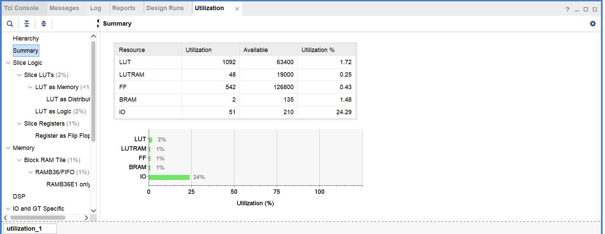
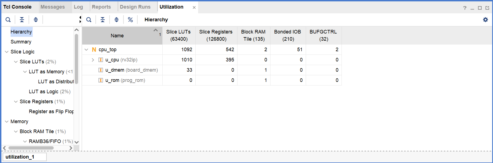
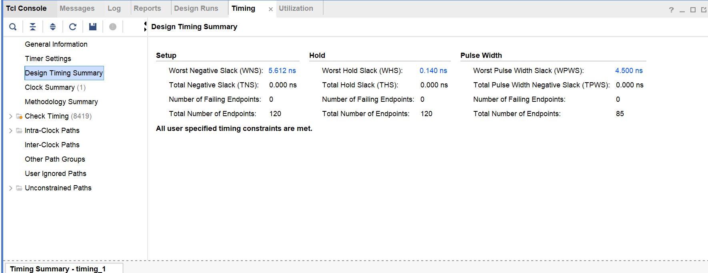

# Lab10 实验报告：RV32I 五段流水线 CPU

- **学号**：____________（dummy）
- **姓名**：____________（dummy）
- **日期**：2026 年 10 月

---

## 1. 实验目的

1. 理解单周期 CPU 在时序和模块化上的问题，掌握把一条指令的执行划分为 IF、ID、EX、MEM、WB 五个流水段的方法。
2. 掌握段寄存器的作用：每条指令在后续阶段需要的全部数据和向后传递的控制信号都必须保存下来。
3. 理解五段流水线中唯一的 RAW 数据冒险，掌握 WB→ID、WB→EX、MEM→EX 三条前转路径和 load-use 阻塞。
4. 理解在 EX 阶段统一解决跳转的控制冒险方案，掌握冲刷和阻塞的优先级关系。
5. 学会用课程单步 testbench、RISC-V 官方测试集和上板程序验证流水线 CPU，并理解流水线的时延与吞吐量。

## 2. 实验原理

### 2.1 五段流水线与段寄存器

RISC-V 指令的执行可以划分为取指、译码、执行、访存、写回五个阶段，每个阶段只做一件事。相邻阶段之间插入段寄存器，把上一周期的中间结果和后续阶段需要的控制信号保存下来：

| 段寄存器 | 数据部分 | 控制部分 | 合计 |
| :--- | :--- | :--- | :---: |
| IF/ID | PC、instr | 无 | 64 |
| ID/EX | PC、imm、rs1data、rs2data | rs1、rs2、rd、EX 10 位、MEM 4 位、WB 2 位 | 159 |
| EX/MEM | ALUResult、rs2data | rd、MEM 4 位、WB 2 位 | 75 |
| MEM/WB | ALUResult、MemOut | rd、WB 2 位 | 71 |

实现时没有把段寄存器打成一个长向量，而是用带段前缀的独立寄存器，例如 `EX_pc`、`EX_rs1data`、`MEM_alu_result`、`WB_rd`，每个寄存器只在一个下降沿的 `always` 块里赋值。这样代码和电路图一一对应，也方便前转单元按名字取信号。

控制信号在 ID 阶段由指令译码产生，之后随指令逐级传递：

- EX 阶段使用 `branch`、`ALUAsrc`、`ALUBsrc`、`ALUctr`；
- MEM 阶段使用 `MemOp`、`MemWr`；
- WB 阶段使用 `RegWr`、`MemtoReg`。

ID 阶段还要把 `PC` 和 `imm` 一起送到 EX，因为 `auipc` 要算 $\mathrm{PC}+\mathrm{imm}$，`jal`、`jalr` 要算返回地址 $\mathrm{PC}+4$，条件分支要算 $\mathrm{PC}+\mathrm{imm}$ 的跳转目标，而 `jalr` 的目标是 $\mathrm{rs1}+\mathrm{imm}$。寄存器号 rs1、rs2、rd 也要跟着走：EX 阶段的前转单元要靠它们判断匹配，MEM 和 WB 阶段要靠 rd 决定写到哪个寄存器。

### 2.2 流水线时序

本设计按实验指导的约定，以时钟下降沿作为周期的起点和终点：

- 下降沿：PC 更新为下一取指地址；四个段寄存器更新；数据存储器按 `memop` 写入。
- 上升沿：指令存储器按当前 PC 取指；数据存储器读出数据；寄存器堆写回 WB 阶段的结果。
- 两个边沿之间：译码、立即数生成、寄存器读、ALU、前转选择、跳转判断等组合逻辑。

对应到端口：

```verilog
assign imemaddr  = pc;        // 取指地址用 PC
assign imemclk   = clock;     // 上升沿取指
assign dmemrdclk = clock;     // 上升沿读数据存储器
assign dmemwrclk = ~clock;    // 下降沿写数据存储器
```

寄存器堆在上升沿写、组合读。这一点是实现 WB→ID 前转的关键：WB 阶段的指令在本周期中间就把结果写进寄存器堆，同一个周期里 ID 阶段的指令组合读寄存器时就能读到新值，不需要额外的选择器。

数据存储器的读放在上升沿，写放在下降沿，这样一来 MEM 阶段在下降沿交班时读出的数据已经稳定，而且写操作发生在读之后，`board_dmem` 可以用“先读后写”的方式实现按字节写入。

### 2.3 数据冒险：前转与阻塞

生产者和消费者的距离决定了要用哪一条前转路径：

| 距离 | 生产者所处阶段 | 消费者所处阶段 | 处理方式 |
| :---: | :--- | :--- | :--- |
| 3 条 | WB | ID | 上升沿写寄存器 + 组合读，天然完成 |
| 2 条 | WB | EX | 用 WB 阶段的写回数据替换 EX 的操作数 |
| 1 条 | MEM | EX | 用 MEM 阶段的 ALU 结果替换 EX 的操作数 |
| 1 条且生产者为 load | MEM | EX | 阻塞一个周期，等 load 到 WB 后再前转 |

前转单元的比较条件是目的寄存器号相同、对应阶段的写使能有效、目的寄存器不是 0 号寄存器：

```verilog
wire mem_fwd_rs1 = MEM_regwr & (MEM_rd != 5'd0) & (MEM_rd == EX_rs1) & ~MEM_memtoreg;
wire wb_fwd_rs1  = WB_regwr  & (WB_rd  != 5'd0) & (WB_rd  == EX_rs1);
```

MEM 级如果是 load，它的数据还没准备好，所以不参与 MEM→EX 前转，交给 load-use 阻塞处理。优先级上 MEM 最新，所以

$$\mathrm{ex\_rs1data} = \begin{cases}\mathrm{MEM\_alu\_result} & \text{MEM 前转}\\[2pt] \mathrm{wb\_data} & \text{WB 前转}\\[2pt] \mathrm{EX\_rs1data} & \text{不前转}\end{cases}$$

WB→ID 前转的优先级最低，但它不需要额外处理：即使 WB 送来的数据已经写进 ID/EX 段寄存器，后续更近的指令在 EX 阶段也会用前转把它覆盖掉。

load-use 冒险的检测条件是 EX 阶段的源寄存器号与 MEM 阶段的 load 目的寄存器号相同：

```verilog
wire load_use = MEM_regwr & MEM_memtoreg & (MEM_rd != 5'd0) &
                ((MEM_rd == EX_rs1) | (MEM_rd == EX_rs2));
```

一旦成立，`stallIF`、`stallID`、`stallEX` 同时有效：PC 保持、IF/ID 保持、ID/EX 保持，同时 `flushEX` 把 EX/MEM 清零，插入一个气泡。下个周期 load 进入 WB，消费者重新执行 EX，用 WB→EX 前转拿到数据。

### 2.4 控制冒险

所有跳转统一在 EX 阶段确定。IF 阶段缺省用 $\mathrm{PC}+4$ 预测下一条指令，当 EX 阶段算出 `Branchsel` 为真时：

- `flushIF` 把 IF/ID 清零，`flushID` 把 ID/EX 清零，前面两级取到的两条错误指令变成空指令；
- `PCSrc` 有效，下降沿把 PC 更新为跳转目标；
- EX、MEM、WB 中更早的指令不受影响，继续执行。

因此每次预测错误付出两个气泡。跳转目标由 EX 阶段的 ALU 结果和加法器给出：

$$\mathrm{Branchtarget} = \begin{cases}\mathrm{rs1data}+\mathrm{imm} & \text{jalr}\\[2pt] \mathrm{PC}+\mathrm{imm} & \text{其他跳转}\end{cases}$$

`jalr` 的结果还要把最低位清零，即 `{sum[31:1], 1'b0}`。

### 2.5 冲刷与阻塞的优先级

阻塞和冲刷可能同时发生，必须约定优先级，否则会出现“用旧数据算出的跳转把正确的流水线冲刷掉”的问题：

- PC 的三选一里，`stallIF` 的优先级高于 `PCSrc`：阻塞期间 PC 保持不变，即使 EX 阶段用旧数据算出了跳转；
- `flushIF` 和 `flushID` 在阻塞周期被屏蔽：`flushIF = ex_branch_taken & ~stallID`，`flushID = ex_branch_taken & ~stallEX`。

### 2.6 load-use 阻塞时的特殊情况

讲义里给出的例子是：

```asm
addi a1, a0, 16     # 指令 1
lw   t1, 0(a2)      # 指令 2
sw   t1, 0(a1)      # 指令 3
```

指令 3 在 EX 阶段时，指令 2 在 MEM 阶段产生 load-use 冒险，指令 1 在 WB 阶段要把 a1 前转给指令 3。此时指令 3 的 EX 结果被 `flushEX` 丢弃，而 a1 的新值只在这一周期出现在 WB 阶段；如果只是保持 ID/EX 不变，下个周期指令 1 已经离开流水线，a1 的旧值就永远补不回来了。

解决办法是在 `stallEX` 的保持分支里，把 WB→EX 前转的结果写进 ID/EX 段寄存器：

```verilog
end else if (stallEX) begin
    if (wb_fwd_rs1) EX_rs1data <= wb_data;
    if (wb_fwd_rs2) EX_rs2data <= wb_data;
end
```

`rv32ip_hazard_tb.v` 专门测了这类组合，包括 load 后面紧跟分支的情况。

### 2.7 上板顶层

上板工程沿用单周期实验的存储器映射，CPU 的数据地址空间划分为：

| 地址 | 访问方式 | 功能 |
| :--- | :--- | :--- |
| `0x0000_0000` 起 4KB | 读写 | 数据 RAM |
| `0x0000_2000` | 只读 | `{16'b0, SW[15:0]}` |
| `0x0000_2004` | 只写 | 结果寄存器，送数码管以十六进制显示 |

流水线版本增加了一个 32 位周期计数器，`SW[12]=1` 时数码管显示已经执行过的 CPU 周期数，可以在板上直接看到跳转冲刷和 load-use 阻塞带来的气泡。

单步时钟沿用单周期实验的方案：顶层的 BTNC 消抖后产生一个 10ns 的脉冲作为 `cpu_clk`，脉冲的上升沿和下降沿正好对应一个流水线周期的两个事件，所以每按一次按钮流水线只前进一段，PC 和结果一步一步变化。指令 ROM 仍然用 100MHz 连续读 PC，复位期间 PC 一直是 0，第一次取指不会拿到未初始化数据。

## 3. 实验设备

- 电脑一台，安装 Xilinx Vivado 2022.1
- Digilent Nexys A7-100T 开发板一块
- USB 下载线一根

## 4. 实验步骤

### 4.1 CPU 模块

两个在线评测题目都提交 `lab10/exp1_cpu/rv32ip.v`，模块名 `rv32ip`，端口与课程 testbench 一致：

```verilog
module rv32ip(
    input  wire        clock,
    input  wire        reset,
    output wire [31:0] imemaddr,
    input  wire [31:0] imemdataout,
    output wire        imemclk,
    output wire [31:0] dmemaddr,
    input  wire [31:0] dmemdataout,
    output wire [31:0] dmemdatain,
    output wire        dmemrdclk,
    output wire        dmemwrclk,
    output wire [2:0]  dmemop,
    output wire        dmemwe,
    output wire [31:0] dbgdata
);
```

`dbgdata` 输出 PC，单步 testbench 用它检查取指和跳转。寄存器堆写成同文件的 `rv32i_regfile` 子模块，实例名 `myregfile`，数组名 `regs`，这样 testbench 里的 `mycpu.myregfile.regs[x]` 可以直接访问。

指令译码、ALU 编码、跳转编码、访存宽度编码都沿用单周期实验的 `localparam` 命名。全零指令在译码时走 `default` 分支，所有控制信号取默认值，等价于 NOP，这是冲刷后段寄存器内容全零还能正常工作的前提。

### 4.2 单步功能仿真

自检 testbench 是 `rv32ip_tb.v`，检查序列与课程提供的 `cpu_step.v` 完全一致，只是把每条检查改成出错时打印 MISMATCH 并计数，最后输出 `TEST PASSED` 或 `TEST FAILED`。四段程序分别覆盖：

- `add`：三条连续运算指令，验证 5 个周期的写回延迟；
- `alu`：加减、逻辑、移位、带符号和无符号比较，几乎每条指令都用到上一条的结果，主要走前转通路；
- `mem`：`lw`、`sw`、`lb`、`lbu`、`lh`、`lhu`、`sb`、`sh` 与符号扩展，最后三条是 load-use 冒险，要求正好阻塞一个周期；
- `branch`：六条条件分支和 `jal`、`jalr`，逐周期检查 PC，验证跳转在 EX 阶段解决、每次冲刷两条指令。

仿真前要把 `tests/` 目录拷贝到 Vivado 的仿真工作目录 `工程名.sim/sim_1/behav/xsim/`，因为 `$readmemh` 的相对路径按仿真工作目录解析。

### 4.3 冒险专项自检

普通测试集对冒险的覆盖并不完整，因此另外写了 `rv32ip_hazard_tb.v`，程序是 `tests/hazard.S`，覆盖五类情况：

1. load 后面紧跟使用其结果的 ALU 指令，检查是否正好阻塞一个周期；
2. 分支紧跟在 ALU 结果之后，走 MEM→EX 前转；
3. load 后面紧跟分支，用旧数据算出的跳转结果不能生效；
4. `jalr` 的 rs1 与上一条指令相隔一条，走 WB→EX 前转；
5. `sw` 的数据来源相隔一条指令，走 MEM→EX 前转。

### 4.4 官方测试集

`cpu_batch_tb.v` 按顺序运行 rv32ui-p 开头的 38 个用例。每个用例把指令文件装入指令存储器、把 `_d.hex` 装入数据存储器，然后运行到取指得到 `0xdead10cc` 为止，再检查 `a0`：

- `0x00c0ffee` 表示通过；
- `0xdeaddead` 表示测试代码自己判错；
- 其他值或超过 20000 周期表示运行异常。

课程提供的流水线测试数据已经做了调整：在检查点前插入了 4 条全零指令。流水线写回寄存器需要 5 个周期，取到检查点时前面 4 条指令都已经写回，所以按取指判断停机依然能读到完整的 `a0`。

`rv32ui-p-fence_i` 不在列表里。这个用例把新的指令写进存储器再跳过去执行，需要统一的指令/数据存储器和 `fence.i` 语义；本设计的指令存储器是只读的，从原理上无法支持。

### 4.5 上板顶层

上板文件为 `lab10/exp2_board/` 下的 `cpu_top.v`、`rv32ip.v`、`prog_rom.v`、`board_dmem.v`、`prog.hex` 和 `cpu_top.xdc`。把这 6 个文件加入工程、顶层设为 `cpu_top` 即可综合。`rv32ip.v` 与在线评测提交的 CPU 相同，`prog_rom.v` 是同步读的指令 ROM，`prog.hex` 是它的初始化文件，`board_dmem.v` 是 4KB 数据存储器。

`$readmemh` 的相对路径按工具的工作目录解析。仿真前把 `prog.hex` 拷到 `工程名.sim/sim_1/behav/xsim/`；综合前把 `prog.hex` 加入工程，如果综合日志提示文件打不开，再把它拷到 `工程名.runs/synth_1/`。

板上资源分配：

- `SW[15:14]` 选择程序，00 累加和、01 斐波那契、10 闰年判断、11 素数判断；
- `SW[13]` 为 1 时自动运行，约 780kHz，为 0 时用 `BTNC` 单步；
- `SW[12]` 为 0 显示程序结果，为 1 显示已经执行的 CPU 周期数；
- `SW[11:0]` 是参数 n，范围 `0x000` 到 `0xFFF`；
- `CPU_RESETN` 低有效，复位期间锁存开关；
- `LED[15:0]` 显示 PC 的低 16 位；
- 8 位数码管以十六进制显示 32 位结果或周期数。

四段汇编程序是 `prog_sum.S`、`prog_fib.S`、`prog_leap.S`、`prog_prime.S`，由 `make_rom.py` 调用 `tools/rvasm.py` 汇编成 `prog.hex`，每段 256 字，用 `@000`、`@100`、`@200`、`@300` 分段。

上板顶层自检是 `cpu_top_tb.v`，把上电复位、自动运行分频、数码管扫描分频都通过参数缩小，逐个程序检查结果寄存器、停机循环、LED 和数码管段码，共 21 组参数。

流水线停机检测与单周期不同：CPU 会顺序预取 $\mathrm{PC}+4$，在循环里也可能短暂地出现在停机地址上，所以自检不看 PC，而是等停机指令 `j hang` 在 EX 阶段确定跳转到自己，再等数据存储器写完。停机后 LED 会在 `hang`、`hang+4`、`hang+8` 三个值之间跳动，这是预取被冲刷的正常现象。

### 4.6 周期数对比

为了看清流水线的收益和代价，用同一个上板程序分别跑单周期 CPU 和流水线 CPU，统计到停机为止的 CPU 周期数。两个 CPU 用同一个顶层结构、同一个 `prog.hex`，只有 CPU 不同。单周期版本计到 PC 停在 `hang`，流水线版本计到停机指令在 EX 阶段确定跳转，两者相差两个周期以内。

## 5. 实验结果

### 5.1 单步功能仿真

四段程序全部通过：

```text
~~~ Begin test case add ~~~
~~~ Begin test case alu ~~~
~~~ Begin test case mem ~~~
~~~ Begin test case branch ~~~
TEST PASSED
```

`mem` 一段的最后是 `lbu` 紧跟 `sw`、`lbu` 紧跟 `sb`，检查点要求正好多花一个周期，说明 load-use 阻塞的周期数正确，`sw`、`sb` 的地址和数据也用上了前转；`branch` 一段每个跳转指令确定跳转后 PC 立刻跳到目标地址，被冲刷的两条预取指令既不写寄存器也不写存储器，后续检查点的 PC 与寄存器值都与单周期版本一致。

### 5.2 冒险专项自检

```text
TEST PASSED
```

五类冒险组合的寄存器与存储器结果都与预期一致，包括 load 后面紧跟分支时不能误跳、`jalr` 用 WB→EX 前转的 rs1 计算目标、以及讲义里“WB→EX 前转发生在 EX 被阻塞的周期”那个特殊组合。

### 5.3 官方测试集

38 个 rv32ui-p 用例全部通过：

```text
TEST PASSED: 38/38
```

用例列表：

```text
simple  add    addi   and    andi   auipc  beq    bge    bgeu
blt     bltu   bne    jal    jalr   lb     lbu    lh     lhu
lui     lw     or     ori    sb     sh     sll    slli   slt
slti    sltiu  sltu   sra    srai   srl    srli   sub    sw
xor     xori
```

两个在线评测题目提交的都是同一个 `rv32ip.v`，流水线功能测试和流水线 CPU 官方测试两个题目都已通过在线评测。

### 5.4 上板自检

`cpu_top_tb.v` 的 21 组参数全部通过，另外还检查了周期数显示模式和单步执行。这组测试逐个程序检查结果寄存器、停机循环、LED 和数码管段码，整段仿真约 657us，运行前要把仿真时长调到 700us 以上，否则只能看到前面几个周期。


四个程序的结果：

| 程序 | 参数 | 数码管显示 |
| :--- | :--- | :--- |
| 累加和 | n=0、10、2024 | 0x00000000、0x00000037、0x001F4514 |
| 斐波那契 | n=0、1、10、20、39、46 | 0x00000000、0x00000001、0x00000037、0x00001A6D、0x03C50EA2、0x6D73E55F |
| 闰年判断 | 2024、1900、2000、2023、400 | 0x00000001、0x00000000、0x00000001、0x00000000、0x00000001 |
| 素数判断 | 0、1、2、4、7、15、97 | 0x00000000、0x00000000、0x00000001、0x00000000、0x00000001、0x00000000、0x00000001 |

单步模式下按一次 `BTNC` 走一个周期，PC 依次是 4、8、12，`SW[12]=1` 时数码管显示的周期数也同步加一，说明单步脉冲确实是一个完整周期。

上板复核结果：待实验后补充。

### 5.5 周期数对比

| 程序 | 参数 | 单周期周期数 | 流水线周期数 | 比值 |
| :--- | :---: | ---: | ---: | ---: |
| 累加和 | n=2 | 13 | 18 | 1.38 |
| 累加和 | n=10 | 37 | 58 | 1.57 |
| 累加和 | n=100 | 307 | 508 | 1.65 |
| 累加和 | n=2024 | 6079 | 10128 | 1.67 |
| 斐波那契 | n=20 | 108 | 149 | 1.38 |
| 闰年判断 | 2024 | 75 | 126 | 1.68 |
| 素数判断 | 97 | 2033 | 3144 | 1.55 |

累加和的主体是

```asm
sum_loop:
    add  a0, a0, a1
    addi a1, a1, -1
    bne  a1, x0, sum_loop
```

三条指令里每轮都有一条 `bne` 成立，流水线每轮要 5 个周期，单周期只要 3 个周期，所以 $n=2024$ 时周期数从 6079 涨到 10128，比值稳定在 1.67 左右。按讲义估计，程序里约 20% 是跳转指令、其中 70% 会跳转，平均每 100 条指令多出 $2\times 14\%=28$ 个周期；这段循环的跳转比例高达三分之一，所以付出更多代价。

周期数变多不等于性能变差。单周期 CPU 的时钟周期必须容纳取指、译码、读寄存器、ALU、访存、写回一整条通路，关键路径很长；流水线把这条通路切成五段，每段的延迟只有原来的五分之一左右，时钟频率可以提高数倍。最终吞吐量由“每条指令平均周期数”和“时钟频率”共同决定，流水线用多了约 1.6 倍的周期，换来了数倍的主频。

### 5.6 综合资源与时序

流水线版本占 1092 个 LUT、542 个触发器、48 个 LUTRAM、2 个 Block RAM，IO 是 51 个，占用 24.29%，其余都在 2% 以内。



和单周期版本对比，LUT 基本持平，触发器涨了三倍多：

| 资源 | 单周期 | 流水线 |
| :--- | ---: | ---: |
| LUT | 1117 | 1092 |
| 触发器 | 147 | 542 |
| LUTRAM | 48 | 48 |
| Block RAM | 2 | 2 |
| IO | 51 | 51 |

分层报告里流水线 CPU 本体占 1010 个 LUT 和 395 个触发器，单周期 CPU 只有 257 个 LUT 和 32 个触发器。多出来的触发器是四个段寄存器、PC 的流水副本和冒险检测用的寄存器；LUT 数量几乎没变，是因为单周期版本那条长组合通路本来就由大量多路选择器拼成，流水线把它切成五段之后选择器仍在，只是被段寄存器隔开，而前转网络和冒险检测又补回了一部分。



100MHz 下的时序报告给出 WNS 5.612ns、WHS 0.140ns，保持时间和脉宽都没有违例，工具结论是所有时序约束都已满足。这个数值和单周期版本完全相同，说明两份工程最差的路径都落在两个版本共用的顶层逻辑上，CPU 内部的组合延迟在两版里都不是瓶颈。流水线缩短关键路径的收益要跑在更高的主频上才能体现出来。



## 6. 思考题

### 6.1 段寄存器控制信号清零后为什么等价于 NOP

清零后 `RegWr` 和 `MemWr` 都是 0，`branch` 是 `BR_NONE`，指令不会写寄存器、不会写存储器、不会改变 PC 的走向，PC 照常 $\mathrm{PC}+4$。译码的 `default` 分支给出的正是这组默认值，所以全零指令在功能上就是一条空指令。它仍会读寄存器、驱动 ALU，但这些部件只读状态，不会改变 CPU 的状态。需要注意 0 号寄存器的写使能也要被屏蔽，否则零寄存器会被写坏。

### 6.2 阻塞时重复执行 IF、ID、EX 会不会有副作用

不会。IF 只是重新按同样的 PC 取指，ID 只是重新译码并组合读同样的寄存器，EX 只是重新算一遍 ALU，三个阶段都只读状态。真正改变 CPU 状态的只有 MEM 阶段的数据存储器写和 WB 阶段的寄存器写，而阻塞时 `flushEX` 会把 EX/MEM 清零，重复的 EX 不会变成一次多余的写。唯一的例外是 EX 阶段算出用旧数据判断的跳转结果，它必须被 `stallIF` 和屏蔽掉的 `flushIF`、`flushID` 挡住，否则会产生一次错误的冲刷。

### 6.3 ID 阶段为什么要把 PC 和 imm 传到 EX

因为 EX 阶段还要用它们算地址：`auipc` 要 $\mathrm{PC}+\mathrm{imm}$；`jal` 的返回地址是 $\mathrm{PC}+4$；条件分支的目标是 $\mathrm{PC}+\mathrm{imm}$；`jalr` 的目标是 $\mathrm{rs1}+\mathrm{imm}$。这些都在 EX 阶段完成，所以 PC 和立即数必须跟着指令流过 ID/EX 段寄存器。`rs1data`、`rs2data` 也要传，因为前转发生在 EX 阶段，前转单元要拿到原始操作数才能决定是否替换。

### 6.4 为什么不在 ID 阶段就把 ALU 的两个输入选好

ID 阶段读到的寄存器值可能在当前周期结束时就已经过期：生产者的结果要等下一两个周期才出现在 WB 或 MEM 阶段。如果 ID 阶段就把操作数选进 ID/EX，那么到了 EX 阶段就没法用最新的数据覆盖它，只能靠阻塞来等，流水线会频繁停顿。把选择推迟到 EX，前转单元可以用当前周期 MEM、WB 阶段的数据直接覆盖选择器的输出，绝大多数 RAW 冒险不用阻塞。代价是 ID/EX 段寄存器要传 `rs1data`、`rs2data`、`imm`、`PC` 四个 32 位数，多占一些寄存器资源。

### 6.5 提前在周期中间写寄存器有没有副作用

没有副作用，反而是 WB→ID 前转能成立的原因。WB 阶段在上升沿写寄存器，同一个周期里 ID 阶段组合读寄存器，读到的是已经更新过的值。会不会有指令因此读到“错误的新数据”？不会。指令在 ID 阶段读完寄存器后，会在本周期的下降沿把它锁进 ID/EX，之后即使寄存器堆被更年轻的指令改写，也影响不到已经锁存的值。写寄存器只会让“更晚读”的指令看到新值，这正是程序顺序语义要求的。

### 6.6 WB→EX 前转要注意什么

第一，必须检查 `WB_RegWr`，否则一条不写寄存器的指令也会把数据前转过去。第二，要用 WB 阶段最终写回的数据，也就是经过 `MemtoReg` 选择之后的值：load 用 `MemOut`，其他指令用 `ALUResult`，而不是固定的某一个。第三，写入 0 号寄存器时不能前转，因为零寄存器的值恒为 0。第四，如果 EX 的两个源寄存器都匹配上同一个 `WB_rd`，两个前转选择器各自独立选择即可，两路都取同一个 WB 数据，不会冲突。第五，前转是纯组合逻辑，必须在同一周期内生效，否则 ALU 会用到旧数据。

### 6.7 MEM→EX 前转应该用 ALUResult 还是 MemOut

用 `MEM_ALUResult`。MEM 阶段的 load 要到周期中间的上升沿才把数据读出来，再经过字节/半字选择和符号扩展，留给 EX 阶段重新做 ALU 和跳转判断的半周期太紧，所以设计的做法是识别出 load-use 冒险后直接阻塞一个周期，让 load 进入 WB 再从 WB 前转，而不是从 MEM 阶段前转 load 数据。这也解释了为什么 MEM→EX 前转的条件里带了 `~MEM_memtoreg`。

### 6.8 load-use 时阻塞 EX 会有什么副作用

EX 阶段的指令用旧数据算出的结果不能留下，所以要用 `flushEX` 把 EX/MEM 清零；它用旧数据算出的跳转结论也不能生效，所以 PC 的选择器里 `stallIF` 要优先于 `PCSrc`，`flushIF` 和 `flushID` 要在阻塞周期被屏蔽。还有一个容易漏掉的地方：阻塞期间如果有 WB→EX 前转，新数据只在这一周期出现在 WB 阶段，必须把它写进 ID/EX 段寄存器，否则重新执行 EX 时旧指令已经离开流水线，这部分数据就永久丢失了。讲义里 `addi`、`lw`、`sw` 三条指令的例子就是这种情况，本设计在 `stallEX` 分支里专门处理了它，并用 `rv32ip_hazard_tb.v` 验证。

## 个人思考

这个实验最直观的收获，是“流水线不减少周期数”这件事从口号变成了自己测出来的数字。我一开始想当然地以为五段流水线会让程序跑得更快，结果把累加和程序放上去一测，周期数从 6079 涨到了 10128。盯着波形看了半天才想明白：三条指令的循环里每轮都有一条 `bne`，跳转在 EX 阶段才解决，两个气泡是躲不掉的，一轮 3 条指令要 5 个周期。把这些周期数除以主频才是时间，而流水线真正省下的是关键路径：单周期要把取指、译码、读寄存器、ALU、访存、写回全部塞进一个周期，流水线每段只做一件事。所以“时延”和“吞吐量”不是一回事，讲义开头引用《资本论》讲原料同时处在所有生产阶段，确实比看公式更容易记住。

另一个坑是 `cpu_top_tb.v` 里的停机判断。单周期版本里等 `PC == hang` 就够了，搬到流水线上却大面积失败，而且失败得很“随机”：有的用例对，有的用例结果全是 0。原因是流水线会顺序预取 $\mathrm{PC}+4$，累加和的循环里 PC 会短暂出现在 0x28，正好是停机地址，自检以为程序停了，其实 `sw` 还在 ID 阶段，结果寄存器当然还是 0。改成等停机指令在 EX 阶段确定跳转自己、再等一段让 store 写完后，所有用例一次通过。这件事让我意识到，验证流水线时“看到某个信号”和“这条指令真的退休了”是两码事，测试平台必须按流水线的方式去看。

第三个坑是讲义里那段 `addi`、`lw`、`sw`。第一次实现时我只做了常规的 WB→EX、MEM→EX 前转和 load-use 阻塞，跑单步测试的 mem 段居然也过了，因为讲义给的测试程序里 load 后面跟的是另一个 `lbu` 而不是 `sw`。后来自己写了 `hazard.S`，把“load 后面紧跟分支”“load 后面紧跟 store”“jalr 的 rs1 只隔一条指令”集中测了一遍，才发现只有把 WB→EX 前转的结果在 `stallEX` 周期写进 ID/EX 段寄存器，`sw` 的地址才算得对。这也让我理解了为什么讲义反复强调“隐藏 Bug 在上板时最难定位”：这种错误只在特定的三条指令组合下出现，普通的循环程序根本测不出来。

上板部分相对轻松，因为存储器映射、数码管扫描、消抖这些在单周期实验里已经调通了，这次只是换了 CPU 和时钟。唯一的改动是加了周期计数器，`SW[12]=1` 时可以把执行过的周期数显示在数码管上，配合单步按钮一下一下按，能直观看到取指时 PC 前进、跳转时 PC 回跳、LED 在停机循环里三个地址之间跳动。把这些现象和波形对上之后，流水线就不再是纸上的五条竖线了。
