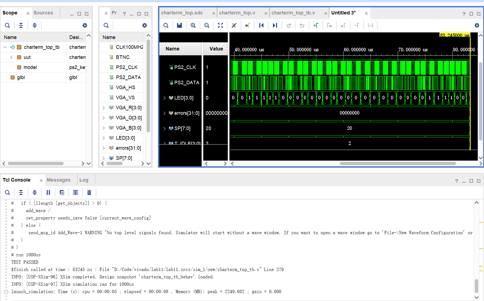

# Lab11 实验报告：字符输入界面

- **学号**：____________（dummy）
- **姓名**：____________（dummy）
- **日期**：2026 年 11 月

---

## 1. 实验目的

1. 理解字符显示的基本原理：字符显存只保存 ASCII 码，字模 ROM 保存每个字符的点阵，显示时按扫描位置查表输出像素。
2. 复用 PS/2 键盘控制器，把扫描码转换成 ASCII 码，实现键盘输入在 VGA 显示器上的回显。
3. 设计字符终端控制状态机，实现提示符、换行、行尾自动换行、自动滚屏、光标闪烁、BackSpace 和方向键移动。
4. 理解显存读写、字模 ROM 和 VGA 扫描之间的时序关系，避免字符显示出现彩色边缘或模糊。
5. 用状态机实现一个简单的图灵机，完成连续左右括号的匹配。

## 2. 实验原理

### 2.1 字符显示与字模 ROM

VGA 显示采用 640×480、60Hz 的时序，像素时钟为 25MHz。字符终端把屏幕划分为 30 行、70 列的字符阵列，每个字符占 16 行、9 列像素，因此

$$30\times 16 = 480,\qquad 70\times 9 = 630.$$

屏幕上每个字符格只需要在显存中保存 8bit 的 ASCII 码。显示时，VGA 控制模块给出当前扫描到的字符列 `char_col`、字符内的像素列 `pix_col`、字符行 `v_row` 和字符内行号 `v_line`，再用这些坐标查两张表：

1. 用 `{字符行, 字符列}` 查字符显存，得到当前字符的 ASCII 码 `chr`；
2. 用 `{chr, v_line}` 查字模 ROM，得到该字符当前行的 9bit 点阵；
3. 用 `pix_col` 从 9bit 中选出当前像素，决定输出白色还是黑色。

本实验使用 `vga_font.txt`，文件按 256 个字符、每个字符 16 行排列，每行一个 12bit 十六进制数，bit0 对应最左侧像素，最高 3bit 为 0。字模用的是林同学修正过的版本：手册提供的版本中，0xB0~0xDF 区段的块元素和制表符整体偏左一个像素，单线制表符还多出一个左侧杂点，修正版把这些字符右移一个像素并去掉了杂点，块元素能连续拼成整块，制表符也能和相邻字符格的线对齐；0x20~0x7E 的 ASCII 部分与手册完全一致。文件行尾统一为 LF，避免 `$readmemh` 读到回车符。模块中用

```verilog
reg [11:0] font_rom [0:4095];
initial $readmemh("vga_font.txt", font_rom);

wire [11:0] font_addr = {chr, v_line};
wire [11:0] font_row  = font_rom[font_addr];
wire        font_bit  = font_row[pix_col];
```

完成字模查表。字符显存采用 32 行×128 列的异步读 RAM，实际显示只使用前 30 行、70 列。多出来的两行用于自动滚屏时做环形缓冲，避免每次滚屏都搬动整屏数据。

### 2.2 VGA 扫描时序

`vga_ctrl` 用 100MHz 系统时钟四分频得到 25MHz 像素时钟。行、场时序参数分别为：

| 参数 | 行 | 场 |
| :--- | ---: | ---: |
| 同步脉冲 | 96 | 2 |
| 后沿 | 48 | 33 |
| 有效显示 | 640 | 480 |
| 前沿 | 16 | 10 |
| 总长 | 800 | 525 |

模块同时输出字符列号 `char_col`、字符内像素列 `pix_col`，以及字符行 `v_row` 和字符内行号 `v_line`，供显存和字模 ROM 使用。字符列号每 9 个像素加一，字符行号每 16 行加一，地址计算只使用计数和位拼接，避免在像素时钟内做乘除法。

### 2.3 键盘输入与扫描码转换

键盘控制器沿用实验七的 `ps2_keyboard` 模块。PS/2 时钟先经过三级寄存器同步，检测下降沿后在时钟低电平期间采样数据位。一帧数据包含起始位、8 位数据、奇校验位和停止位，校验通过后写入 8 级 FIFO。终端每读走一个字节，控制器把读指针后移。

键盘扫描码到 ASCII 码的转换由 `ascii_of` 函数完成。需要处理两种特殊情况：

- 断码前缀 `8'hF0`：表示按键释放，后面的扫描码不再产生字符；
- 扩展前缀 `8'hE0`：方向键和右 Ctrl、右 Shift 使用扩展码，需要单独解析。

Shift 键分为左右两个，按下时置位，收到 `F0` 断码时清零。字母键根据 Shift 状态输出大写或小写，数字键根据 Shift 输出数字或上档符号。终端只处理无需 Shift 就能输入的符号，包括 `` ` ``、`-`、`=`、`[`、`]`、`\`、`;`、`'`、`,`、`.`、`/` 和空格。Tab 键的扫描码 `8'h0D` 不经过 `ascii_of`，在按键解析状态机里直接产生一个 Tab 事件，避免和回车的 ASCII 码 `0Dh` 混淆。

### 2.4 字符终端控制状态机

终端控制状态机负责显存写入、光标移动和滚屏：

| 状态 | 作用 |
| :--- | :--- |
| `T_CLEAR` | 复位后清空 30×70 个字符格 |
| `T_PROMPT` | 在新行写入提示符 `> ` |
| `T_IDLE` | 等待键盘事件 |
| `T_PRINT` | 在当前光标位置写字符并右移光标 |
| `T_TAB` | 连续写空格，直到光标落在下一个 4 列制表位 |
| `T_SCROLL_INIT` | 计算需要清除的物理行 |
| `T_SCROLL` | 清除环形缓冲中的新底行 |
| `T_BS` | 删除光标前一个字符 |
| `T_BSCAN` | 从右向左扫描上一行，寻找最后一个非空字符 |
| `T_JOIN0` / `T_JOIN1` | 行首退格时清除本行提示符 |
| `T_JOIN2` | 退格跨行时把光标所在行号减一 |
| `T_SCAN` | 上下移动光标时从右向左扫描目标行，用于钳位列号 |

字符显存的地址由 `{字符行, 字符列}` 组成，行号 5bit、列号 7bit。光标位置用 `cur_row`、`cur_col` 保存，屏幕最上面一行对应的物理行由 `top_row` 保存。显示时用

$$\mathrm{disp\_phys} = (\mathrm{top\_row} + v\_row) \bmod 32$$

得到当前扫描行在 32 行缓冲中的物理地址。输入到第 29 行后再换行时，`top_row` 加一，新底行被清空，屏幕内容整体上移一行。

提示符只出现在按回车产生的逻辑行行首。一行文字写满 70 列后自动换行，续行从第 0 列接着写，不再打印 `> `，这样一整条逻辑行在屏幕上是连续的一段文字，和 DOS 字符界面、Linux 终端一致。滚屏状态用一个 `scroll_prompt` 标志区分两种情况：按回车触发的滚屏要打印提示符，行满触发的滚屏是续行，不打印提示符。

光标画在字符格最左侧的一列像素上，约 1.5Hz 闪烁。BackSpace 在行内删除光标前一个字符；光标已经在本行行首时，删除动作跨到上一行，光标停在上一行最后非空字符之后。自动换行产生的续行没有提示符，退格到续行行首时删掉的是上一行第 69 列的字符，光标停在该位置；按回车产生的行在行首退格时，先清掉本行的 `> ` 提示符，再回到上一行末尾。

方向键左右移动光标，列号限制在 0 到 69 之间。左右键不做行末钳位，光标可以走到本行文字之后的空白格。输入是覆盖式的，字符写在光标所在格并把光标右移一格，行内已有的字符不会被推开，所以在行末之后的空白处输入会在这一行里留下空格，这一点和自由编辑器一致，和只有单行编辑的命令行不同。上下移动时，如果目标行的文字比当前列号短，光标收到目标行最后一个非空字符之后，而不是停在空白区域；目标行只有提示符时停在提示符后面，目标行完全空白时停在行首。判断某一行是否带提示符的方法是读该行第 0 列的字符，只有 `>` 才算逻辑行首。

Tab 键补空格到下一个 4 列制表位。制表位按绝对列号计算，与提示符无关，因此从第 2 列按 Tab 补两个空格到第 4 列，从第 4 列按 Tab 补四个空格到第 8 列。补空格的过程中如果碰到第 69 列，按行满换行处理，换行后正好落在第 0 列，也是一个制表位。

### 2.5 简单图灵机

图灵机用状态 0~4 完成括号匹配，状态 7 为停机状态。基本思路是轮流擦除最左边的左括号和最右边的右括号：

1. 状态 0 检查当前格：空白表示全部匹配，写 `T` 停机；`(` 擦成空白并右移，进入状态 1；`)` 直接写 `F` 停机。
2. 状态 1 向右扫描，遇到 `(` 原样写回，遇到 `)` 进入状态 2，遇到空白说明左括号没有配对，写 `F` 停机。
3. 状态 2 继续向右扫描，遇到 `)` 原样写回，遇到 `(` 说明括号顺序错误，写 `F` 停机，遇到空白则左移进入状态 3。
4. 状态 3 停在最右边的 `)` 上，把它擦成空白并左移，进入状态 4。
5. 状态 4 向左扫描，遇到括号原样写回，遇到空白说明回到最左边，右移一步并回到状态 0，开始下一轮匹配。

状态 7 保持停机，同时输出 `halt`。`dataout`、`move`、`halt` 与状态寄存器在同一个时钟沿更新，评测端在时钟沿后取寄存器输出，先完成最后一步写入和移动，再看到 `halt` 停机。

## 3. 实验设备

- 电脑一台，安装 Xilinx Vivado 2022.1
- Digilent Nexys A7-100T 开发板一块
- USB 下载线一根
- USB 键盘一个，接到开发板的 USB HID 接口
- VGA 显示器一台

## 4. 实验步骤

### 4.1 字符终端设计

上板文件位于 `lab11/exp1_charterm/`：

- `charterm_top.v`：单文件顶层，内部包含 `ps2_keyboard`、`vga_ctrl` 和 `charterm_top`；
- `charterm_top.xdc`：Nexys A7-100T 引脚约束；
- `vga_font.txt`：字模文件，由 `$readmemh` 加载。

`charterm_top` 的端口为：

```verilog
module charterm_top(
    input        CLK100MHZ,
    input        PS2_CLK,
    input        PS2_DATA,
    input        BTNC,
    output       VGA_HS,
    output       VGA_VS,
    output [3:0] VGA_R,
    output [3:0] VGA_G,
    output [3:0] VGA_B,
    output [3:0] LED
);
```

`BTNC` 是高电平有效的同步复位，按下后清屏并重新显示提示符。`LED[0]`、`LED[1]` 分别指示 Shift 和 Ctrl，`LED[2]` 指示键盘有数据，`LED[3]` 指示键盘 FIFO 溢出，调试时可以据此判断键盘是否正常工作。

字模文件通过相对路径加载。Vivado 的行为仿真和综合都在各自的 run 目录下运行，如果日志提示找不到 `vga_font.txt`，需要把该文件复制到仿真工作目录 `工程名.sim/sim_1/behav/xsim/` 或综合目录 `工程名.runs/synth_1/`。

### 4.2 字符终端功能仿真

自检 testbench 为 `charterm_top_tb.v`，用 Verilog 模拟 PS/2 键盘发送扫描码，并直接检查字符显存、光标位置和字模 ROM。覆盖的内容包括：

1. 复位后清屏，第 0 行显示 `> `，光标在第 0 行第 2 列；
2. 普通字符 `h`、`i` 回显；
3. 左 Shift 输入大写 `I`，松开 Shift 后 LED 指示恢复；
4. 回车换行，新行显示提示符；
5. 输入 `a`、`b` 后连续 BackSpace 删除；
6. 行首 BackSpace 清除本行提示符，光标回到上一行最后一个非空字符后；
7. Shift+1 输入 `!`；
8. 方向键移动光标，上下移动时列号钳位到目标行行末；
9. Tab 键补空格到 4 列制表位；
10. 第 69 列写字符后自动换行，续行不打印提示符；
11. 续行行首 BackSpace 删掉上一行第 69 列的字符；
12. 最后一行回车触发滚屏；
13. 数字 `1`、`0` 和符号 `-` 回显；
14. 连续发送两次 make 码，模拟按住键重复发送；
15. 右 Shift 输入大写；
16. 检查字模 ROM 中 `A` 和 `>` 的指定行。

仿真总时长约 90μs，Vivado 中把仿真运行时间设为 100μs 以上。完整仿真波形见实验结果部分。

### 4.3 上板

在 Vivado 中新建工程，加入 `charterm_top.v`、`charterm_top.xdc` 和 `vga_font.txt`，顶层设为 `charterm_top`。依次完成综合、实现、生成比特流和下载。

上板时需要连接 VGA 显示器和 USB 键盘。键盘接在开发板的 USB HID 接口上，开发板通过该接口同时提供 PS/2 时钟和数据。按键后屏幕上应立即回显字符；按住键不放应连续输出；输入到行尾或按回车应换行；输入超过 30 行后应自动滚屏。

### 4.4 简单图灵机

在线测试提交文件为 `lab11/exp2_turing/tm.v`，模块名和端口与题目一致：

```verilog
module tm(
    input        clk,
    input  [7:0] datain,
    input        reset,
    output reg [7:0] dataout,
    output reg       move,
    output reg       halt
);
```

状态机按题目给出的状态转移表实现，`dataout` 输出要写入的字符，`move=0` 表示右移，`move=1` 表示左移。状态 0~4 分别对应参考设计的五个步骤，状态 7 为停机状态。

## 5. 实验结果

### 5.1 字符终端功能仿真

功能仿真通过：

```text
TEST PASSED
```



波形中可以看到键盘扫描码持续输入，`LED` 在 Shift 按下和松开时变化，`errors` 始终为 0，最后 `$finish` 前打印 `TEST PASSED`。说明复位清屏、字符回显、Shift、回车、BackSpace、跨行退格、方向键、自动换行、滚屏和字模查表都符合预期。

### 5.2 字符终端上板结果

上板测试尚未进行，结果待补充。

### 5.3 简单图灵机在线评测

`lab11/exp2_turing/tm.v` 已通过在线评测。测试覆盖了空串、`()`、`(())`、`((()))` 等匹配串，以及 `(`、`)`、`)(`、`())`、`(()`、`()(`、`()()` 等不匹配串。匹配时纸带上写入 `T`，不匹配时写入 `F`，然后 `halt` 拉高停机。

## 个人思考

这次实验里，字符显示部分花时间最多的是地址和时序，状态机部分反而比较直接。字模文件的每一个 12bit 数只有最低 9 位有效，bit0 又是最左边的像素，刚开始我按常规的从左到右、从高位到低位去理解，显示出来的字符是左右颠倒的。后来把 `A` 的第 4 行单独打印出来，对照手册里的 `038h` 和点阵图，才确认应该用 `font_row[pix_col]` 直接从低位往高位取。字符显存和字模 ROM 都是异步读，25MHz 的像素时钟下组合路径够用，但地址必须在扫描位置变化后的同一个周期内准备好，否则字符边缘会出现一列错位。

键盘部分比较麻烦的是扫描码和 ASCII 码并不相同。断码前缀 `F0` 必须吞掉后面的扫描码，扩展前缀 `E0` 又要单独处理方向键和右 Shift。一开始只做了左 Shift，右 Shift 按下没有反应，自检里加上右 Shift 的用例后才暴露出来。按键重复则完全交给键盘的 typematic 机制，终端只要把连续收到的 make 码都当作普通字符处理即可，不需要自己写重复计时器。

行首退格和滚屏是另一个容易想简单的地方。退格到行首时不能只把光标移到上一行，还要把本行的提示符清掉，否则屏幕上会留下一个孤立的 `> `；滚屏改用 32 行的环形缓冲加一个 `top_row` 指针，显示时做一次模 32 的加法，每次只清空新底行。这样滚屏只需要清空新底行，代价很小。

上板之后才发现的几个问题都跟“行”的模型有关。原来行满自动换行时也会在续行打印 `> `，于是续行看起来像新的一行，按方向键上移会跑到上一行的空白区域，写满一行后按 BackSpace 又会停在上一行最后一个字符上而不是它后面。改成续行不打印提示符之后，一整条逻辑行在屏幕上是连续的，退格到续行行首删掉的就是上一行第 69 列的字符，光标自然落在行末。上下移动时另外加了一个从右向左扫描目标行的状态，把列号钳到最后一个非空字符之后，这样光标不会跑到空白区域。这两处都不难，难的是先想清楚“物理行”和“逻辑行”不是一回事，状态机里哪些状态属于逻辑行、哪些属于物理行要分得开。Tab 键则是查扫描码时才发现它被 `ascii_of` 的默认分支吃掉了，只能在解析状态机里单独产生事件。

图灵机部分让我印象最深的是仿真时序和评测时序的差别。我一开始用“时钟沿前采样”的 testbench，本地所有用例都通过，但在线评测对 `()` 输出了 `F`。后来把 testbench 改成在时钟沿后读取寄存器输出，才复现出同样的错误。原因是组合输出和状态寄存器错开了一拍，评测端看到的动作整体晚一个周期，纸带上的括号就擦错了位置。改成一段式寄存器输出状态机，并让 `halt` 与最后一步 `T/F` 在同一个时钟沿输出后，在线评测通过。这件事提醒我，验证一个时序模块时，testbench 的采样时刻本身就是设计约定的一部分，不能只凭“本地跑通了”就认为没有问题。
