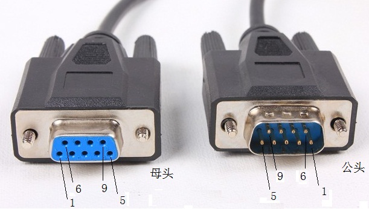
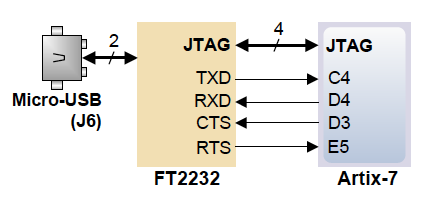
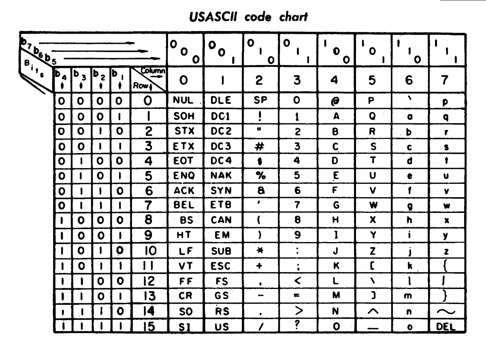

# 串口通信及加密解密

来源：`实验12 串口通信及加密解密.docx` 与 `uart_debug.zip`。本文保留原文内容，代码为 zip 内文件全文，供后续做串口调试或扩展实验时参考。

> 注意：这份 docx 是独立的小实验，不是 `lab12.pdf` 的计算机系统验收要求。`lab12.pdf` 12.4 把串口作为调试工具介绍，建议的串口参数是 115200bps、8 位数据、奇校验、1 位停止位；docx 正文建议 9600bps。以实际使用为准，两边都支持。

## 1. 实验目的

- 了解串口通信的工作原理，学习串口收发代码设计。
- 了解简单的加密解密算法应用。

## 2. 串口通信基本原理

串行接口将数据逐个比特地在单条线路上传输。这种传输模式使用的数据线少，在计算机和数字设备中应用广泛。旧式台式机常有 9 针 DB9 或 DE9 的 RS232 串行接口。



DB9 接口的数据主要通过 2、3 引脚和地线传输。接线时需要把收端 2 号引脚接到发端 3 号引脚，把发端 2 号引脚接到收端 3 号引脚，形成双向数据链路。串口一般支持全双工通信，收发两端可以同时收发。

| 引脚号 | 功能 | 缩写 | 引脚号 | 功能 | 缩写 |
| ---: | :--- | :--- | ---: | :--- | :--- |
| 1 | 数据载波检测 | RCD | 6 | 数据设备准备好 | DSR |
| 2 | 接收数据 | RXD | 7 | 请求发送 | RTS |
| 3 | 发送数据 | TXD | 8 | 可以发送 | CTS |
| 4 | 数据终端准备 | DTR | 9 | 振铃指示 | RI |
| 5 | 信号地 | GND | | | |

现代计算机一般用 USB 取代了串口。本实验针对通用异步收发传输器 UART 设计。UART 采用异步串行方式，收发两端不需要时钟同步；接收端需要自己产生时钟来读取数据。

典型帧结构：起始位由高电平变低电平指示，随后是 8 位数据位、1 位校验位和 1 位高电平停止位。异步通信的时钟由波特率决定，波特率是每秒传输的 bit 数。9600bps 时每个 bit 宽 $1/9600=0.10417$ ms。除波特率外，数据位位数、校验位、停止位长度等参数需要通信双方预先约定。

| 参数 | 常见选择范围 |
| :--- | :--- |
| 波特率 | 9600、19200、38400、57600、115200 |
| 数据位 bit 数 | 7、8 |
| 校验位 | 无校验、奇校验、偶校验 |
| 停止位 | 1 位、1.5 位、2 位 |

## 3. 硬件接口

Nexys 系列开发板的串口通过 USB-UART 桥接芯片 FT2232 实现。串口和 FPGA 程序下载共用一根 USB 线，互不干扰，下载完 bitstream 后不用拔线即可通信。



串口的 TXD、RXD、CTS、RTS 分别连接 FPGA 的 C4、D4、D3、E5。图中 TXD、RXD、CTS、RTS 是以电脑接口标注的，输入输出方向按箭头判断，不要弄错收发方向。CTS、RTS 用于硬件流控，可以不处理，只需要把 CTS 置低。

电脑侧安装串口调试助手即可。连接 USB 后会出现一个 USB 转换的串口，一般是 COM4。开发板 USB 接口附近有两个黄色 LED，分别指示串口收发，通信时随收发闪烁，可用来判断链路是否正常。串口默认不回显，发出去的命令不一定显示在接收窗口。

## 4. 发送端设计

串口发送把数据按给定波特率逐位发送到对端 RXD。发送端需要一个时钟模块产生特定频率的发送时钟，例如 9600bps 需要每秒 9600 次的时钟脉冲，允许一定误差。

发送模块的输入包括发送允许和 8 位输入数据，输出发送完毕指示。发送允许从低变高表示输入数据有效，模块把数据装入寄存器，自动填写起始位、校验位和停止位，启动发送时钟，每个时钟周期发送 1 bit。顺序发送可以用移位寄存器实现。发送过程中如果发送允许再次有效，要等前一次数据全部发送完再开始下一次。

调试时可以用拨动开关作为输入数据，按钮作为发送允许。串口助手参数一致时，每按一次按钮应发送一个数据，并在串口助手中显示。

## 5. 接收端设计

异步串口接收先检测数据帧起始位，方法与键盘实验类似；区别是需要自己产生接收时钟。

检测到起始位由高变低后，要确定在什么时刻采样数据线。PS/2 接口用时钟下降沿判断，异步串口则需要产生周期与波特率一致的时钟，让采样沿正好落在每个数据位的正中间。中间位置信号相对稳定，不会受前后跳变影响。产生时钟时，要在检测到起始位的同时启动计数，确保采样沿在每位中间。之后的采集过程与 PS/2 键盘类似。接收端的时钟是自行产生的，一个触发器不能同时由两个不同的时钟驱动。

调试时可以用串口助手发送单个 ASCII 码，接收端把收到的十六进制数据显示在两位七段数码管上。

## 6. 数据加密与解密

数据通信中常常需要加密，防止被窃听。本实验结合串口和线性反馈移位寄存器 LFSR 实现简单的加密解密。

$n$ 位 LFSR 可以产生 $2^n-1$ bit 的伪随机序列，修改初始值可以控制序列起点。LFSR 每次移位产生 1 bit 随机输出，把这个随机比特和数据中的对应比特异或，就完成了加密；解密用同样的异或。LFSR 的初始值就是密钥。

设输入数据第 $i$ 比特为 $X_i$，LFSR 产生的第 $i$ 比特为 $C_i$，加密结果为

$$Y_i = X_i \oplus C_i.$$

解密端收到 $Y_i$ 后计算

$$Y_i \oplus C_i = (X_i \oplus C_i) \oplus C_i = X_i,$$

即可恢复原始数据。加密时把数据看成比特流，与 LFSR 生成的伪随机比特流逐位异或即可。类似方法有 DVD 使用的 Content Scramble System，40 位密钥；以及 CDMA 信道加扰使用的 42 位长码。

## 7. 实验内容

实现一个能通过串口把字符串加密和解密的 FPGA 程序：

1. LFSR 为 8 位，初始值由 8 个拨动开关确定；另用一个拨动开关或按钮置数。
2. 加密：设置密钥，在串口助手输入一串英文 ASCII 字符，例如 `njucslab`，发送给 FPGA。FPGA 收到字符后与 LFSR 伪随机比特流异或，通过串口返回加密结果，例如 `NTGWr}QY`，记录结果。
3. 解密：重置密钥使之与加密密钥相等，把加密结果再次发送给 FPGA，观察返回的解密结果是否正确。FPGA 的加密和解密过程完全一样，只要实现一个对串口数据做 LFSR 异或的功能。

ASCII 的特殊处理：8 位数据中只考虑高两位为 `01` 的 ASCII 码，即十六进制 `40`（`@`）到 `7F`（DEL），这部分包含所有英文大小写字母，但不包含数字和空格。只对低 6 位异或，结果高位仍为 `01`，输出保持在 `40`–`7F`。其中 `7F`（DEL）不可显示，加密后如果结果是 `7F`，强制转成 `3F`（`?`）发送；解密时如果收到 `3F`，先转回 `7F` 再解密。这样每个字符从 LFSR 序列取 6 bit，异或数据低 6 位。

调试建议先实现多字符输入输出，确认不丢字符，再加入加密解密。



### 观察与思考

- 如果密钥错误，返回的解密结果是否正确？
- 在不重置密钥的条件下，反复发送加密数据尝试解密，会出现什么现象？
- 现在使用的 8 位 LFSR 能够用什么方法攻击解密？如果加长位数，例如使用 128 位 LFSR，生成公式参见 <https://www.xilinx.com/support/documentation/application_notes/xapp052.pdf>，是否还能找到有效的解密方法？

## 附录 A：`uart_debug.zip` 源码

四个文件：`clkgen.v`、`serial_tx.v`、`serial_rx.v`、`uart_port.v`。顶层的 `clk` 是调试模块和 CPU 的时钟，`clk100m` 是给串口模块产生波特率的 100MHz 时钟。

### A.1 `clkgen.v`

```verilog
module clkgen(input clkin, input rst, input clken, output reg clkout);
    parameter clk_freq=1000;
    parameter countlimit=100000000/2/clk_freq-1;
   reg[31:0] clkcount;
   initial
   begin clkcount=32'd0; clkout=1'b0; end
   always @ (posedge clkin)
    if(rst)
     begin
        clkcount<=32'd0;
        clkout<=1'b0;
     end
    else
    begin
     if(clken)
        begin
            if(clkcount>=countlimit)
             begin
                clkcount<=32'd0;
                clkout<=~clkout;
             end
             else
             begin
                clkcount<=clkcount+32'd1;

             end
         end
     end
endmodule
```

`clkgen #(115200)` 在 100MHz 输入下产生 115200Hz 的方波，占空比 50%。`rst` 用于在检测到起始位时把相位复位，`clken` 控制是否计数。

### A.2 `serial_tx.v`

```verilog
module serial_tx(
    input clk,
    input [7:0] data,
    input tx_enable,
    output reg tx_out,
    output tx_ready
    );
    wire tx_clk; // serial clock
    reg  tx_busy;
    reg [10:0] tx_buf;
    reg [3:0]  tx_count;
    initial
    begin
        tx_count= 4'd0;
        tx_busy = 1'b0;
        tx_out = 1'b1;
    end
    clkgen #(115200) mytxclk(clk,1'b0,1'b1,tx_clk); //always enable tx_clock

    assign tx_ready = ~ tx_busy;
    always@(posedge tx_clk)  //state change only at the tx_clk edge
    begin
        if(tx_busy) //busy, ignore tx_enable and send
        begin

          tx_out<=tx_buf[0];
          tx_buf[9:0]<=tx_buf[10:1];//shift tx_buf

          if(tx_count>=4'd10)  //finished
          begin
            tx_busy = 1'b0;
            tx_count<=4'd15;
          end
          else
          begin
            tx_busy = 1'b1;
            tx_count<=tx_count+4'd1;
          end
        end
        else
        begin
           tx_out=1'd1;
           if(tx_enable) //load the buffer and start next cycle
           begin
                tx_buf[0]<=1'b0;
                tx_buf[8:1]<=data[7:0];
                tx_buf[9]<=~(^data[7:0]);
                tx_buf[10]<=1'b1;
                tx_busy<=1'd1;
                tx_count<=4'd0;
            end
            else //no data
            begin
                tx_buf<=tx_buf;
                tx_busy<=1'd0;
                tx_count<=4'd0;
            end

        end
    end
endmodule
```

`tx_buf[0]` 是起始位 0，`tx_buf[8:1]` 是 8 位数据，`tx_buf[9]` 是奇校验 `~(^data)`，`tx_buf[10]` 是停止位 1。`tx_ready = ~tx_busy`，上层在 `tx_ready` 为 1 时给出 `tx_enable` 和 `data`。

### A.3 `serial_rx.v`

```verilog
module serial_rx(
    input clk,
    input txd_in,
    output reg [7:0] rx_data,
    output reg rx_finish,
    input rx_ready
    );

wire rx_clk;
reg [2:0] clk_sync;
reg [2:0] start_sync;
reg [3:0] rx_count;
reg [10:0] rx_buf;
wire sampling;
wire start_bit;
reg rx_busy;
reg rx_clk_rst;

initial
begin
  rx_finish =1'b0;
  rx_busy =1'b0;
  rx_clk_rst =1'b0;
end

clkgen #(115200) mytxclk(clk,rx_clk_rst,rx_busy,rx_clk); //rst the clk at negedge

always @ (posedge clk)
begin
    clk_sync <=  {clk_sync[1:0],rx_clk};
end
assign sampling = ~clk_sync[2] & clk_sync[1]; //sampling of receive clock, posedge because we start the clock at begining of the bit

always @ (posedge clk)
begin
    start_sync <=  {start_sync[1:0],txd_in};
end
assign start_bit = start_sync[2] & ~start_sync[1]; //find negedge of start bit


always @ (posedge clk) //triger the clock when find negedge
begin
    if(rx_busy) //receiving
    begin
        rx_clk_rst<=1'b0; //reset only last one clock
        if(rx_finish)
        begin
            rx_busy<=1'b0;
        end
        else
        begin
            rx_busy<=rx_busy;
            if(sampling)
            begin
                if(rx_count>=4'd10)
                begin
                    if( (rx_buf[0]==0)&&(^rx_buf[9:1]) )
                    begin
                        rx_data[7:0]<=rx_buf[8:1];
                        rx_finish<=1'b1;
                    end
                end
                else
                begin
                    rx_buf[rx_count]<= txd_in;
                    rx_count <= rx_count + 4'd1;
                end
            end
        end
    end
    else//not busy
    begin
       if(start_bit & (~rx_finish)) //start receiving when find start bit
       begin
            rx_busy<=1'b1;
            rx_clk_rst<=1'b1;
            rx_count<=4'd0;
            rx_data<=8'd0;
            rx_finish<=1'b0;
       end
       else
       begin
            rx_busy<=1'b0;
            rx_clk_rst<=1'b0;
       end
       if(rx_ready)
       begin
           rx_finish<=1'b0;
       end
    end
end

endmodule
```

接收端先对 `txd_in` 打三拍，检测下降沿；检测到起始位后复位 `clkgen`，让接收时钟与发送端对齐；`sampling` 是 `rx_clk` 的上升沿，出现在每位中间；收满 11 位后检查起始位为 0、奇校验通过，输出 `rx_data` 并置 `rx_finish`。上层用 `rx_ready` 握手清除 `rx_finish`。

### A.4 `uart_port.v`

```verilog
module uart_port(input clk,
                 input clk100m,
                 output rxd_out,
                 input txd_in,
                 output reg [31:0] dbgdata,
                 input rst,
                 output [31:0] instaddr,
                 output reg[31:0] instdata,
                 output reg iwe,
                 output [31:0] dataaddr,
                 output[31:0] mdata,
                 output reg dwe,
                 output reg cpuhalt,
                 output reg cpureset
    );

    wire tx_ready;
    wire rx_ready;
    reg  rx_gotdata;
    reg  tx_send;
    reg  [7:0] tx_buf[15:0];
    reg  [7:0] rx_buf[15:0];
    reg  [3:0] tx_head;
    reg  [3:0] tx_tail;
    reg  [3:0] rx_head;
    reg  [3:0] rx_tail;
    reg  [3:0] uart_state;
    reg  [7:0] rst_cnt;
    wire [7:0] rx_data;
    reg  [7:0] tx_data;
    wire [7:0] temp1;
    wire [7:0] temp2;
    wire [7:0] temp3;
    reg  [31:0] instcnt;
    reg  data_inst;

initial
begin
  tx_buf[0]=8'h55; //U
  tx_buf[1]=8'h41; //A
  tx_buf[2]=8'h52; //R
  tx_buf[3]=8'h54; //T
  tx_buf[4]=8'h20;
  tx_buf[5]=8'h4f;
  tx_buf[6]=8'h4b;
  tx_buf[7]=8'h0d;
  tx_buf[8]=8'h0a;
  tx_head=4'd0; tx_tail=4'd9;
  rx_head=4'd0; rx_tail=4'd0;
  uart_state=4'd0;
  tx_send=1'b0; rx_gotdata=1'b0;
  cpuhalt=1'b0;cpureset=1'b0;iwe=1'b0;dwe=1'b0;
  data_inst=1'b0;
end


serial_tx tx_module(clk100m, tx_data, tx_send, rxd_out,tx_ready);

serial_rx rx_module(clk100m, txd_in, rx_data, rx_ready, rx_gotdata);

assign temp1=rx_buf[rx_head]-8'h30;
assign temp2=rx_buf[rx_head]-8'h37;
assign temp3=rx_buf[rx_head]-8'h57;
assign instaddr={instcnt[29:0],2'b0};
assign dataaddr=instaddr;   //use the same data and address for inst and data
assign mdata= instdata;     // only difference is the write enable signal
// send and receive logic
always@(posedge clk)
begin
    if(rst)
    begin
        tx_head<=4'd0;rx_tail<=4'd0;
        tx_send<=1'b0; rx_gotdata<=1'b0;
    end
    else
    begin
      if(rx_ready)
          begin
             if(rx_gotdata==1'b0)
             begin
                rx_buf[rx_tail]<=rx_data;
                rx_tail<=rx_tail+4'd1;
                //dbgdata<={tx_head,rx_head,dbgdata[15:0],rx_data};
                rx_gotdata<=1'b1;
             end
          end
      else
          begin
             rx_gotdata<=1'b0;
          end
      if(tx_head!=tx_tail)//has data to send
          begin
             if(~tx_send&tx_ready) //tx free
             begin
                tx_data <= tx_buf[tx_head];
                tx_head<= tx_head+4'd1;
                tx_send<=1'b1;
             end
             else
             begin
                  if(~tx_ready) tx_send<=1'b0;
             end
          end
       else
          begin
            if(~tx_ready)
               begin
                  tx_send<=1'b0;
               end
          end

    end
end


// processing data
always @(posedge clk)
begin
    if(rst)
    begin
       tx_tail<=4'd9;
       rx_head<=4'd0; cpuhalt=1'b0;cpureset=1'b0;iwe=1'b0;dwe=1'b0;
       uart_state<=4'd0;
    end
    else
    case(uart_state)
    4'd0: //idle case
    begin
      if(rx_head!=rx_tail)  //get inputs
      begin
         case(rx_buf[rx_head])
         8'h69: //'i' update inst mem
         begin
           tx_buf[tx_tail]<=8'h69; tx_tail<=tx_tail+4'd1;
           data_inst<=1'b1;
           uart_state<=4'd2; cpuhalt<=1'b1;instcnt<=32'b0;instdata<=32'b0;
         end
         8'h72: //'r' reset
          begin
           tx_buf[tx_tail]<=8'h72; tx_tail<=tx_tail+4'd1;
           uart_state<=4'd5; cpureset<=1'b1; rst_cnt<=8'd0;
          end
         8'h64: //'d' update data mem
         begin
           tx_buf[tx_tail]<=8'h64; tx_tail<=tx_tail+4'd1;
           uart_state<=4'd2; cpuhalt<=1'b1;instcnt<=32'b0;instdata<=32'b0;
           data_inst=1'b0;
         end
         default:
         begin
            uart_state<=4'd0;
         end
         endcase
         rx_head<=rx_head+4'd1;
      end
    end

    4'd1:  //cpu reset return
    begin
       uart_state<=4'd0; cpureset<=1'b0; cpuhalt<=1'b0;iwe<=1'b0;dwe<=1'b0;//return to normal
    end

    4'd2:  //inst write inputs
    begin
       if(rx_head!=rx_tail)  //get inputs
       begin
          case(rx_buf[rx_head])
          8'h71: //'q' exit
          begin
            uart_state<=4'd5; cpureset<=1'b1; cpuhalt<=1'b0;rst_cnt<=8'd0;
            /*tx_buf[tx_tail]<=8'h71; tx_tail<=tx_tail+4'd1;*/
          end
          8'h40: //'@' addr
          begin
            uart_state<=4'd3; instdata<=32'd0;instcnt<=32'd0;
          end
          8'h0a: //return
          begin
            uart_state<=4'd4; iwe<=1'd1&data_inst; dwe<=1'd1&(~data_inst);
          end
          8'h30,8'h31,8'h32,8'h33,8'h34,8'h35,8'h36,8'h37,8'h38,8'h39:
          begin
            instdata<={instdata[27:0],temp1[3:0]};
          end
          8'h41,8'h42,8'h43,8'h44,8'h45,8'h46:
          begin
            instdata<={instdata[27:0],temp2[3:0]};
          end
          8'h61,8'h62,8'h63,8'h64,8'h65,8'h66:
          begin
            instdata<={instdata[27:0],temp3[3:0]};
          end
          default:
          begin
            //do nothing
          end
          endcase
          rx_head<=rx_head+4'd1;
       end
    end

    4'd3:  //inst addr
    begin
      if(rx_head!=rx_tail)  //get inputs
       begin
          case(rx_buf[rx_head])
          8'h0a: //return
          begin
            uart_state<=4'd2;
          end
          8'h30,8'h31,8'h32,8'h33,8'h34,8'h35,8'h36,8'h37,8'h38,8'h39:
          begin
            instcnt<={instcnt[27:0],temp1[3:0]};
          end
          8'h41,8'h42,8'h43,8'h44,8'h45,8'h46:
          begin
            instcnt<={instcnt[27:0],temp2[3:0]};
          end
          8'h61,8'h62,8'h63,8'h64,8'h65,8'h66:
          begin
            instcnt<={instcnt[27:0],temp3[3:0]};
          end
          default:
          begin
            //do nothing
          end
          endcase
          rx_head<=rx_head+4'd1;
       end
    end

    4'd4:  //write memory data
    begin
       instcnt<=instcnt+32'd1; instdata<=32'd0; iwe<=1'd0; dwe<=1'd0;
       uart_state<=4'd2;
    end

    4'd5: //reset delay
    begin
       rst_cnt<=rst_cnt+8'd1;
       if(rst_cnt>=8'd120) begin uart_state<=4'd1; end
    end


    default:
    begin
       uart_state<=4'd0;
    end
    endcase
    dbgdata<={instaddr[15:0],instdata[15:0]};
end
endmodule
```

### A.5 `uart_port` 的用法要点

- 状态机命令：`i` 加载指令存储器，`d` 加载数据存储器，`r` 重启 CPU，`q` 结束加载并复位 CPU。
- `@` 后跟十六进制地址，`\n` 表示一行数据结束。地址按字节给出，内部右移两位变成字地址。
- 十六进制字符 `0`–`9`、`A`–`F`、`a`–`f` 通过 `temp1`/`temp2`/`temp3` 转成 4 位值，逐位移入 `instdata` 或 `instcnt`。
- `instaddr = {instcnt[29:0], 2'b0}`，`dataaddr = instaddr`，指令和数据共用地址，靠 `iwe`/`dwe` 区分写哪一片存储器。
- `dbgdata = {instaddr[15:0], instdata[15:0]}`，可以接七段数码管显示当前加载地址和数据。
- `cpuhalt` 拉高时暂停 CPU：顶层用 `clock & ~cpuhalt` 作为 CPU 时钟；`cpureset` 用来重启 CPU。
- 存储器接口在 `uart_halt` 有效时切换到 UART 的地址、时钟和写使能，详细写法见 `lab12.pdf` 12.4.3。

## 附录 B：与 `lab12.pdf` 的对应关系

| docx 内容 | `lab12.pdf` 对应章节 | 差异 |
| :--- | :--- | :--- |
| 串口原理、帧格式、DB9 | 12.4.1 串口背景知识 | 基本一致 |
| 串口引脚、FT2232 | 12.4.1 图 12-5 | 一致 |
| 发送端设计 | 12.4.2 串口收发设计 | 代码相同 |
| 接收端设计 | 12.4.2 | 代码相同 |
| 加密解密实验 | 无 | docx 独有，可作为扩展实验 |
| `uart_port` 调试器 | 12.4.3 UART 调试功能设计 | `lab12.pdf` 更详细，含状态机与存储器切换 |
| 串口参数建议 9600 | 建议 115200 | 以上层实际配置为准 |
