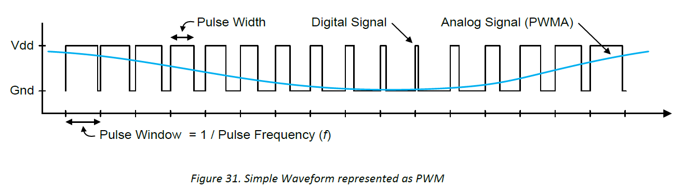

# 音频输出实验

来源：`实验11音频输出实验.docx` 与 `sound_source.zip`。本文保留原文内容，代码为 zip 内文件全文。该实验是 `lab12.pdf` 之外的扩展实验，可作为键盘钢琴、音乐播放器的基础。

## 1. 实验目的

学习音频信号的输出方式，以及把数字信号转换为模拟信号的基本原理。

## 2. 音频输出原理

### 2.1 音频信号与采样

人耳能听到的声音频率一般在 20Hz 到 20kHz。扬声器、耳机等音频设备接收的是模拟信号，即时间上连续的信号。数字器件只能按固定间隔产生数字输出，因此需要通过数字/模拟转换把数字信号变成模拟信号。根据采样定律，采样率应不低于信号最高频率的两倍。数字音频一般采用 44.1kHz（CD）或 48kHz 采样率，保证 20kHz 信号不失真。

在 48kHz 采样率下，每隔 $1/48000$ 秒产生一个 8 位数字样本，经过平滑后得到对应的模拟信号。例如 960Hz 正弦波周期为 $1/960$ 秒，即 1.042ms，对应 50 个样本点。

### 2.2 正弦波样本

正弦波表达式为

$$s(t)=\sin(2\pi f t).$$

采样率为 48000Hz 时，令 $t=n/48000$，其中 $n$ 是样本点编号，则

$$s(n)=\sin\left(2\pi f\frac{n}{48000}\right).$$

代入 $f=960$Hz：

$$s(n)=\sin\left(2\pi\frac{960n}{48000}\right)=\sin\left(2\pi\frac{n}{50}\right).$$

所以 $n$ 每变化 50，正弦波完成一个周期。

实际输出一般不使用浮点数，而用 0–255 的无符号整数代替 $-1$ 到 $1$：

$$s'(n)=\left\lfloor s(n)\times 128\right\rfloor+128.$$

$s(n)=0$ 时对应 128，$s(n)=-1$ 时对应 0，$s(n)=1$ 时对应 255。$s(n)=1.000$ 的特殊情况强制取 255，避免上溢。

960Hz 信号的样本示例：

| $n$ | 0 | 1 | 2 | 3 | … | 48 | 49 | 50 | 51 |
| :--- | ---: | ---: | ---: | ---: | :---: | ---: | ---: | ---: | ---: |
| $s(n)$ | 0 | 0.125 | 0.249 | 0.368 | … | -0.249 | -0.125 | 0 | 0.125 |
| $s'(n)$ | 128 | 144 | 159 | 175 | … | 96 | 111 | 128 | 144 |

### 2.3 板载音频接口

Nexys 系列开发板提供 3.5mm 音频输出接口 J8，可以接耳机或有源音箱。板载电路完成数字到模拟的转换。与音频输出相关的两个 FPGA 信号是 `AUD_PWM` 和 `AUD_SD`：

| 信号 | Nexys A7-100T 引脚 | 作用 |
| :--- | :--- | :--- |
| `AUD_PWM` | A11 | PWM 输出，经过低通滤波变成模拟电压 |
| `AUD_SD` | D12 | 音频放大器控制，1 为放大，0 为小音量 |

`AUD_SD` 接 1 时音量会大很多，测试时耳机不要贴太近。部分耳机只有一个声道发声，调试时注意。

### 2.4 PWM 与低通滤波

PWM 是一串数字脉冲，脉冲宽度不同，经过低通滤波后的平均电压也不同。占空比为 10% 时，模拟电压约为 $0.1\times V_{DD}$。如果把脉冲间隔设为 256，通过调整脉宽 1–256，可以得到 256 种电压。



板载使用巴特沃斯低通滤波器把 `AUD_PWM` 变成模拟音频。PWM 频率应远大于音频采样率，滤波后的波形才平滑。48kHz 采样时，PWM 频率应大于 48kHz，一般取采样率的数倍，让同一个样本值持续多个 PWM 脉冲。

## 3. 参考系统设计

系统输入：100MHz 时钟 `clk`、拨动开关输入的音频使能 `AUD_EN`、音调选择 `AUD_FREQ`、放大器选择 `AUD_SD_IN`。输出：`AUD_PWM`、`AUD_SD`。

主要模块：

- **PWM 发生器**：根据 8 位 `PWM_DATA` 产生对应宽度的 `AUD_PWM`。用 100MHz 时钟，每计数 256 输出一个 PWM 脉冲，脉冲频率约 390kHz，满足 PWM 频率要求。计数值小于 `PWM_DATA` 时输出 1，否则输出 0。
- **波形发生器**：产生 8 位 `PWM_DATA`，采样率 48kHz，即每 $1/48$ ms 更新一次。由系统时钟分频出的 48kHz 信号驱动，每个采样周期从 RAM 读取正弦表数据输出。

正弦表可以用下面的 Python 程序生成 256 点 8 位无符号单周期数据：

```python
import numpy as np
for j in range(256):
    data = np.floor(np.sin(j/256.0*2*3.1415926)*128)+128
    print("@%02x %02x" % (j, data))
```

生成的文件按存储器实验的方法初始化 RAM。RAM 地址 $k$ 对应的值是

$$\left\lfloor \sin\left(2\pi\frac{k}{256}\right)\times 128\right\rfloor+128.$$

### 3.1 音调与步长

要产生频率 $f$ 的正弦波，在 48kHz 采样率下，每个正弦周期有 $48000/f$ 个采样点。第 $n$ 个样本对应的表地址为

$$k=\left(\frac{n f}{48000}\times 256\right)\bmod 256.$$

每个样本 $n$ 递增 1，表地址递增

$$\Delta k=\frac{256f}{48000}.$$

这个增量通常不是整数。实际做法是用一个 16 位计数器，每次递增 $\frac{65536f}{48000}$，用计数器高 8 位作为 RAM 地址。这样每个正弦周期近似产生 $48000/f$ 个样本点。如果步长小于 256，相邻样本会取到相同的值，对波形形状影响不大。

参考代码里 `readdata.v` 用 16 位 `address`，每次加 `step[freq]+step[freq]`，取 `address[15:8]` 作为 RAM 地址。`step` 的取值对应一组音高，可根据实际听感调整。

### 3.2 钢琴音高表

| 音名 \ 八度 | 3 | 4 | 5 | 6 |
| :--- | ---: | ---: | ---: | ---: |
| C | 130.81Hz | 261.63Hz（中央 C，C4） | 523.25Hz | 1046.5Hz |
| C# | 138.59Hz | 277.18Hz | 554.37Hz | 1108.7Hz |
| D | 146.83Hz | 293.66Hz | 587.33Hz | 1174.7Hz |
| D# | 155.56Hz | 311.13Hz | 622.25Hz | 1244.5Hz |
| E | 164.81Hz | 329.63Hz | 659.26Hz | 1318.5Hz |
| F | 174.61Hz | 349.23Hz | 698.46Hz | 1396.9Hz |
| F# | 185.00Hz | 369.99Hz | 739.99Hz | 1480.0Hz |
| G | 196.00Hz | 392.00Hz | 783.99Hz | 1568.0Hz |
| G# | 207.65Hz | 415.30Hz | 830.61Hz | 1661.2Hz |
| A | 220.00Hz | 440.00Hz | 880.00Hz | 1760.0Hz |
| A# | 233.08Hz | 466.16Hz | 932.33Hz | 1864.7Hz |
| B | 246.94Hz | 493.88Hz | 987.77Hz | 1975.5Hz |

实现中可以选择 C5 到 C6 这八个音。

## 4. 实验要求

系统通过拨动开关输入控制信号：

- 音频输出使能开关，关闭则不输出音频；
- 音频放大开关，对应 `AUD_SD`；
- 音调调节开关，至少 3 个，通过组合实现不同音高。

可选扩展：利用键盘驱动，用键盘代替拨动开关，做成简单电子琴，按下按键发出对应音调。

调试提示：系统较复杂，按模块分别调通再联调；先确认 PWM 输出能随 `PWM_DATA` 变化，再确认正弦表读出正确，最后接耳机。

## 附录 A：`sound_source.zip` 源码

五个文件：`clkgen.v`、`my_ram.v`、`pwm_output.v`、`readdata.v`、`sound_exp.v`，外加 `ram_data.txt`。

### A.1 `clkgen.v`

```verilog
module clkgen(
    input clkin,
    input rst,
    output reg clkout
    );
    parameter clk_freq=1000;
    parameter countlimit=100000000/2/clk_freq; //
   //integer countlimit=8388;
   reg[31:0] clkcount;
   always @ (posedge clkin)
    if(rst)
     begin
        clkcount=0;
        clkout=1'b0;
     end
    else
     begin
        clkcount=clkcount+1;
        if(clkcount>countlimit)
          begin
           clkcount=31'd0;
           clkout=~clkout;
          end
         else
           clkout=clkout;
     end
endmodule
```

与 `uart_debug` 里的 `clkgen` 不同，这个版本没有 `clken`，复位时清零，计数值大于 `countlimit` 时翻转。`sound_exp` 用 `clkgen #(48000)` 产生 48kHz 采样时钟。

### A.2 `my_ram.v`

```verilog
module my_ram(
    input clk,
    input we,
    input [7:0] address,
    input [7:0] data_in,
    output reg [7:0] data_out
    );
    reg [7:0] ram[255:0];
    initial
        $readmemh("ram_data.txt",ram,0,255);
    begin
    end
    always @(posedge clk)
    begin
        if(we)
            ram[address]<=data_in;
        else
            data_out<= ram[address];
    end
endmodule
```

`ram_data.txt` 是 256 行、每行 `@地址 数据` 的十六进制正弦表。文件开头如下：

```text
@00 80
@01 83
@02 86
@03 89
@04 8c
...
```

`0x80` 对应正弦值为 0 的中点 128。`$readmemh` 的相对路径按综合/仿真的工作目录解析，文件要在对应 run 目录下，或者作为设计源文件加入工程。

### A.3 `pwm_output.v`

```verilog
module pwm_output(
    input clk,
    input reset,
    input [7:0] data,
    output reg pwmout
    );
    reg [7:0] counter;
    always@(posedge clk)
    begin
        if(reset)
            begin
                pwmout=1'b0;
                counter=0;
            end
        else
            begin
                counter <= counter + 1;
                if(counter < data)
                    pwmout=1'b1;
                else
                    pwmout=1'b0;
            end

    end
endmodule
```

100MHz 时钟下 8 位计数器每 256 个时钟循环一次，PWM 频率为 $100\text{MHz}/256\approx390\text{kHz}$。`data=0` 时占空比为 0，`data=255` 时占空比接近 100%。

### A.4 `readdata.v`

```verilog
module readdata(
    input clk,
    input reset,
    input [3:0] freq,
    output reg [7:0] dataout
    );
    reg [15:0] address;
    reg [11:0] step[7:0];
    wire [7:0] data;
    initial
    begin
    step[0]=12'd357;
    step[1]=12'd401;
    step[2]=12'd450;
    step[3]=12'd477;
    step[4]=12'd535;
    step[5]=12'd601;
    step[6]=12'd674;
    step[7]=12'd714;
    end
    //blk_mem_gen_0 mem(.addra(address),.clka(clk),.dina(8'h00),.douta(data),.ena(1'b1),.wea(1'b0));
    my_ram mem(.clk(clk),.we(1'b0),.address(address[15:8]),.data_in(8'h00),.data_out(data));
    always@(posedge clk)
      begin
        if(reset)
            address=0;
        else
            address = address+step[freq]+step[freq];
        dataout=data;
       end
endmodule
```

`freq` 只有 3 位有效值时对应 8 个音高。代码里每次加两次 `step`，所以表地址对应的计数器总增量是

$$2\times\text{step}=\frac{65536f}{48000},$$

即

$$\text{step}=\frac{65536f}{96000}.$$

表中的 `step[0]=357` 对应约 523Hz，即 C5；`step[7]=714` 对应约 1046Hz，即 C6。实际实现时可以按需要重新计算。

### A.5 `sound_exp.v`

```verilog
module sound_exp(
    input clk,
    input [4:0] iSW,
    output [2:0] led,
    output ampPWM,
    output ampSD
    );
wire [7:0] soutdata;
wire dataclk;
wire  [2:0] freq;

assign freq[2:0] = iSW[3:1];
assign led[0]=iSW[0];
assign ampSD=iSW[4];
clkgen #(48000) dataclk(clk,iSW[0],dataclk);
readdata mydata(dataclk,iSW[0],freq,soutdata);
pwm_output mypwm(clk,iSW[0],soutdata,ampPWM);

endmodule
```

`iSW[0]` 是复位/使能，`iSW[3:1]` 选择音高，`iSW[4]` 控制 `AUD_SD`。`led[0]` 指示使能。顶层端口名 `ampPWM`、`ampSD` 对应 `ref.xdc` 的 `AUD_PWM`（A11）、`AUD_SD`（D12）。

### A.6 上板与调试

- 先把 `ram_data.txt`、`vga_font.txt` 这类初始化文件加入工程，确认综合日志没有 “cannot be opened”。
- 用示波器或耳机先确认 `AUD_PWM` 有波形；`AUD_SD=1` 时音量明显增大。
- 如果只有噪声，检查 48kHz 采样时钟是否真的产生，`my_ram` 的读地址是否在 0–255 内。
- 如果音调不对，重新计算 `step`，注意 16 位计数器取高 8 位作为地址。
