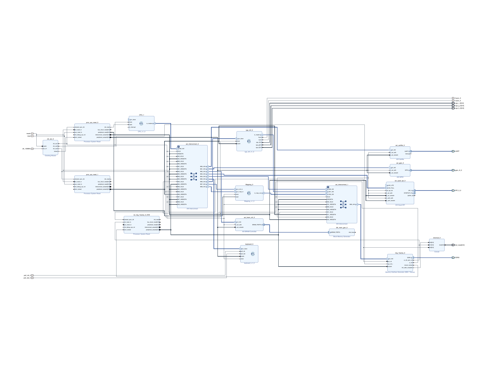

# 参考板级设计与 RTL

来源：`student-board-design-min.zip`，内容从 2021 级 `n4-riscv/project_1` 中抽取，导出日期 2026-11-09。本文保留 README、接口事实表、约束说明和关键 RTL 源码，供扩展 DDR、AXI、QSPI、VGA 时参考。

> 这是只读参考包，**不是可以直接综合的完整 Vivado 工程**。旧 CPU 是 RV64，Block Design 带有 Vivado 2019.1 的痕迹，不能原样当学生工程。新系统必须替换 CPU、重新生成 wrapper、地址映射、复位和约束。

## 1. 参考包内容

| 目录 | 内容 |
| :--- | :--- |
| `01_board_topology/` | `design_1.bd`、`design_1_bd.tcl`、`design_1.hwh`、`design_1_wrapper.v`、接口事实表、Block Design 图 |
| `02_custom_rtl/` | `vga_ctrl_comb.v`、`reg.v`、`S011HD1P_X256Y2D32.v`、`keyboard.v`、`Mapping.v`、`mref/*/component.xml` |
| `03_ip_config/` | `clk_wiz_0.xci`、`mig_7series_0.xci`、`mig_a.prj`、`mig_b.prj`、`axi_interconnect_*.xci`、`axi_uartlite_0.xci`、`axi_quad_spi_0.xci`、`axi_gpio_0.xci`、`axi_bram_ctrl_0.xci`、`blk_mem_gen_0.xci`、`proc_sys_reset_*.xci` |
| `04_constraints/` | `board_pins_reference.xdc`、`constraints_notes.md`、`ip_board/*.xdc` |

资料优先级：

1. 组件、接口、地址、时钟域：`design_1.bd`
2. 板级顶层端口：`design_1_wrapper.v`
3. Interface 到 RTL 物理端口：`mref/*/component.xml`
4. IP 参数：对应 `.xci`，MIG 硬件参数再对照 `mig_a.prj`
5. 板级引脚：整理后的 XDC 或原始 IP board XDC
6. `design_1.hwh` 只用于快速索引

## 2. 系统结构

### 2.1 AXI 拓扑

第一级互连，CPU 作为唯一 Master：

```text
CPU_1/io_master -> axi_interconnect_0/S00_AXI
```

`axi_interconnect_0` 的九个 Master 端口：

| 端口 | 连接对象 |
| :--- | :--- |
| `M00_AXI` | `axi_uartlite_0/S_AXI` |
| `M01_AXI` | `axi_gpio_0/S_AXI` |
| `M02_AXI` | `axi_bram_ctrl_0/S_AXI` |
| `M03_AXI` | `axi_quad_spi_0/AXI_FULL` |
| `M04_AXI` | `axi_interconnect_1/S00_AXI`，进入 DDR 路径 |
| `M05_AXI` | `keyboard_0/io_slave` |
| `M06_AXI` | `vga_ctrl_0/io_slave` |
| `M07_AXI` | `Mapping_0/io_ctrl_in` |
| `M08_AXI` | `Mapping_0/io_map_in` |

第二级互连，三个 Master 访问 DDR：

```text
axi_interconnect_0/M04_AXI -> axi_interconnect_1/S00_AXI
vga_ctrl_0/io_master       -> axi_interconnect_1/S01_AXI
Mapping_0/io_map_out       -> axi_interconnect_1/S02_AXI
axi_interconnect_1/M00_AXI -> mig_7series_0/S_AXI
```

DDR 访问者：CPU、VGA 帧缓存读取、Mapping 输出。加入 D-Cache 后，CPU 与 VGA 读取 DDR 之间必须明确一致性策略。

### 2.2 时钟

| 时钟 | 标称频率 | 来源 | 主要使用方 |
| :--- | ---: | :--- | :--- |
| `clk_100MHz` | 100MHz | 板载输入 | Clocking Wizard |
| `clk_wiz_0/clk_out1` | 40MHz | Clocking Wizard | CPU、普通 AXI 外设、UART、QSPI、PS/2、Mapping |
| `clk_wiz_0/clk_out3` | 100MHz | Clocking Wizard | VGA 控制器 |
| `clk_wiz_0/clk_out2` | 200MHz | Clocking Wizard | MIG `sys_clk_i` |
| `mig_7series_0/ui_clk` | 81.247969MHz | MIG | AXI Interconnect 1、MIG AXI Slave |

关键连接：

```text
clk_wiz_0/clk_out1 -> CPU_1/clock
clk_wiz_0/clk_out1 -> axi_uartlite_0/s_axi_aclk
clk_wiz_0/clk_out1 -> axi_quad_spi_0/s_axi_aclk
clk_wiz_0/clk_out1 -> keyboard_0/clock
clk_wiz_0/clk_out1 -> Mapping_0/clock
clk_wiz_0/clk_out2 -> mig_7series_0/sys_clk_i
clk_wiz_0/clk_out3 -> vga_ctrl_0/clock
mig_7series_0/ui_clk -> axi_interconnect_1/ACLK 及各 S/M 端口
```

VGA Interface 的 `CLK_DOMAIN` 属性残留为 `clk_out1`，实际网络接 `clk_out3`，频率 100MHz。以实际 `nets` 连接和 `clk_wiz_0` 参数为准。

### 2.3 AXI 接口宽度

| 接口 | 协议 | 数据位宽 | 地址位宽 | ID 位宽 |
| :--- | :--- | ---: | ---: | ---: |
| `CPU_1/io_master` | AXI4 | 64 | 32 | 4 |
| `CPU_1/io_slave` | AXI4 | 64 | 32 | 4 |
| `Mapping_0/io_ctrl_in` | AXI4 | 64 | 32 | 4 |
| `Mapping_0/io_map_in` | AXI4 | 64 | 32 | 4 |
| `Mapping_0/io_map_out` | AXI4 | 64 | 32 | 4 |
| `keyboard_0/io_slave` | AXI4 | 64 | 32 | 4 |
| `vga_ctrl_0/io_master` | AXI4 | 64 | 32 | 4 |
| `vga_ctrl_0/io_slave` | AXI4 | 64 | 32 | 4 |
| `axi_uartlite_0/S_AXI` | AXI4-Lite | 32 | 寄存器窗口 | 无 |
| `axi_gpio_0/S_AXI` | AXI4-Lite | 32 | 寄存器窗口 | 无 |
| `axi_bram_ctrl_0/S_AXI` | AXI4 | 32 | 17 | 0 |
| `axi_quad_spi_0/AXI_FULL` | AXI4 | 32 | 24 | 0 |
| `mig_7series_0/S_AXI` | AXI4 | 64 | 27 | 6 |

学生的 CPU 不必直接输出完整 AXI，可以先做局部总线，再用一个 AXI bridge 接入系统。

### 2.4 地址映射

CPU `io_master` 地址空间：

| 起始地址 | 大小 | 设备 |
| :--- | ---: | :--- |
| `0x1000_0000` | 4 KiB | AXI UART-Lite |
| `0x1000_1000` | 4 KiB | AXI GPIO |
| `0x1000_2000` | 4 KiB | PS/2 键盘 |
| `0x1000_3000` | 4 KiB | VGA 控制寄存器 |
| `0x1000_4000` | 4 KiB | Mapping 控制寄存器 |
| `0x3000_0000` | 16 MiB | QSPI Flash AXI 窗口 |
| `0x7000_0000` | 128 KiB | AXI BRAM |
| `0x7FE0_0000` | 2 MiB | Mapping 输入窗口 |
| `0x8000_0000` | 128 MiB | MIG DDR2 |

VGA `io_master` 和 Mapping `io_map_out` 的 DDR 窗口都是 `0x8000_0000`–`0x87FF_FFFF`。

### 2.5 DDR2

| 属性 | 值 |
| :--- | :--- |
| FPGA | `XC7A100T-1CSG324C` |
| Board part | `digilentinc.com:nexys4_ddr:part0:1.1` |
| Memory part | `MT47H64M16HR-25E` |
| 物理数据宽度 | 16 bit |
| 容量 | 128 MiB |
| MIG 系统输入 | 约 200MHz |
| MIG UI 时钟 | 约 81.25MHz |
| AXI 接口 | AXI4，64 bit |

DDR 物理层用 Vivado MIG，不建议自己写 DDR2 PHY。

### 2.6 中断现状

旧 Block Design 中 `CPU_1/io_interrupt` 和 `CPU_1/io_slave` 都没有连接，导出的 PDF 里 UART `interrupt` 和 QSPI `ip2intc_irpt` 也没有连线。旧工程没有完整外设中断路径。新系统要明确：

- 键盘、UART 是否产生中断；
- 定时器中断来自 CLINT、自写 timer 还是 AXI Timer；
- 多个 IRQ 如何汇聚；
- CPU 如何执行 `mip`/`mie`/`mstatus` 判定和 `mret`。

### 2.7 已知冲突与不可信信息

- `design_1.hwh` 把 `ps2_clk_0` 标成 100MHz；
- `design_1_ooc.xdc` 把 `ps2_clk_0` 定义成 10ns 周期时钟；
- 某些 OOC XDC 中的 25MHz、40MHz、100MHz 只是 OOC 默认值；
- VGA Interface 的 `CLK_DOMAIN` 残留 `clk_out1`，实际是 `clk_out3`；
- MIG `.xci` 包含大量未启用的控制器模板参数，不能任取一个 `MODELPARAM_VALUE` 当当前配置。

遇到冲突时报告来源差异，以 `.bd` 的实际网络和 IP 当前参数为准。

## 3. 自定义 RTL

### 3.1 `preg.v`

```verilog
module preg #(parameter w = 1, parameter reset_val = 0)(
    input clock,
    input reset,
    input [w-1:0] din,
    output [w-1:0] dout,
    input wen
);

reg [w-1:0] data;
assign dout = data;

always @(posedge clock) begin
    if(reset)
        data <= reset_val;
    else if(wen)
        data <= din;
end

endmodule
```

带复位值和写使能的通用寄存器，VGA 控制器大量使用它保存状态。

### 3.2 `S011HD1P_X256Y2D32.v`

```verilog
module S011HD1P_X256Y2D32(
    Q, CLK, CEN, WEN, A, D
);
parameter Bits = 32;
parameter Word_Depth = 512;
parameter Add_Width = 9;
parameter Wen_Width = 32;

output reg [Bits-1:0] Q;
input                 CLK;
input                 CEN;
input                 WEN;
input [Add_Width-1:0] A;
input [Bits-1:0]      D;

wire cen  = ~CEN;
wire wen  = ~WEN;

reg [Bits-1:0] ram [0:Word_Depth-1];
always @(posedge CLK) begin
    if(cen && wen) begin
        ram[A] <= D;
    end
    Q <= cen && !wen ? ram[A] : {4{$random}};
end

endmodule
```

512×32 单口 SRAM 包装。注意 `CEN`、`WEN` 都是低有效，读出用同步读。VGA 乒乓行缓存用它，每个字放两个 12bit RGB444 像素。

### 3.3 `keyboard.v`（AXI4 Read Slave + 扫描码 FIFO）

```verilog
module keyboard(
    input ps2_clk,
    input ps2_dat,
    input resetn,
    input clock,
    output        io_slave_awready,
    input         io_slave_awvalid,
    input  [31:0] io_slave_awaddr,
    input  [3:0]  io_slave_awid,
    input  [7:0]  io_slave_awlen,
    input  [2:0]  io_slave_awsize,
    input  [1:0]  io_slave_awburst,
    output        io_slave_wready,
    input         io_slave_wvalid,
    input  [63:0] io_slave_wdata,
    input  [7:0]  io_slave_wstrb,
    input         io_slave_wlast,
    input         io_slave_bready,
    output        io_slave_bvalid,
    output [1:0]  io_slave_bresp,
    output [3:0]  io_slave_bid,
    output        io_slave_arready,
    input         io_slave_arvalid,
    input  [31:0] io_slave_araddr,
    input  [3:0]  io_slave_arid,
    input  [7:0]  io_slave_arlen,
    input  [2:0]  io_slave_arsize,
    input  [1:0]  io_slave_arburst,
    input         io_slave_rready,
    output        io_slave_rvalid,
    output [1:0]  io_slave_rresp,
    output [63:0] io_slave_rdata,
    output        io_slave_rlast,
    output [3:0]  io_slave_rid
    );

    reg [7:0] fifo[7:0];
    reg [2:0] w_ptr, r_ptr;
    reg [9:0] buffer;
    reg [3:0] count;
    reg [2:0] ps2_clk_sync;
    always @(posedge clock) begin
        ps2_clk_sync <= {ps2_clk_sync[1:0],ps2_clk};
    end
    wire sampling = ps2_clk_sync[2] & ~ps2_clk_sync[1];
    always @(posedge clock) begin
        if (!resetn) begin
            count <= 0; w_ptr <= 0;
        end
        else begin
            if (sampling) begin
                if (count == 4'd10) begin
                    if ((buffer[0] == 0) && // start bit
                        (ps2_dat) && // stop bit
                        (^buffer[9:1])) begin // odd parity
                        fifo[w_ptr] <= buffer[8:1]; // kbd scan code
                        w_ptr <= w_ptr+3'b1;
                    end
                    count <= 0; // for next
                end else begin
                    buffer[count] <= ps2_dat; // store ps2_data
                    count <= count + 3'b1;
                end
            end
        end
    end

    parameter [1:0] sIdle = 0, sWdata = 1, sWresp = 2, sRaddr = 1, sRdata = 2;
    reg [1:0] srstate = sIdle;
    reg sraddrEn = 1;
    reg srdataEn = 0;
    reg [31: 0] srdata = 0;
    reg srlast = 0;
    reg [3:0] srid = 0;

    always @(posedge clock) begin // slave read channel
        if(!resetn) begin
            srstate <= sIdle;
            sraddrEn <= 1;
            srdataEn <= 0;
            srlast <= 0;
        end else if (srstate == sIdle) begin
            if(sraddrEn & io_slave_arvalid) begin
                srstate <= sRdata;
                sraddrEn <= 0;
                srdataEn <= 1;
                srdata <= r_ptr == w_ptr? 0 : fifo[r_ptr];
                r_ptr <= r_ptr == w_ptr? r_ptr : r_ptr + 1;
                srlast <= 1;
                srid <= io_slave_arid;
            end
        end else if (srstate == sRdata) begin
            if(srdataEn & io_slave_rready) begin
                srstate <= sIdle;
                sraddrEn <= 1;
                srdataEn <= 0;
                srlast <= 0;
            end
        end
    end

    assign io_slave_awready = 0;
    assign io_slave_wready  = 0;
    assign io_slave_bvalid  = 0;
    assign io_slave_bresp   = 0;
    assign io_slave_bid     = 0;
    assign io_slave_arready = sraddrEn;
    assign io_slave_rvalid  = srdataEn;
    assign io_slave_rresp   = 1;
    assign io_slave_rdata   = srdata;
    assign io_slave_rlast   = srlast;
    assign io_slave_rid     = srid;

endmodule
```

要点：

- PS/2 时钟打三拍，取下降沿采样数据；一帧 11 位，起始位 0、8 位数据、奇校验、停止位 1。
- FIFO 8 项，`r_ptr == w_ptr` 表示空，读出返回 0；读操作会推进读指针，一次读消费一个扫描码。
- 只实现读通道，写通道的 ready 全部为 0，CPU 不能写键盘。

### 3.4 `vga_ctrl_comb.v`（DDR 显存，800×600）

完整源码如下。它是 800×600 和 400×300 两种模式的 DDR 帧缓存控制器：CPU 通过 AXI Slave 写状态和基地址，VGA 通过 AXI Master 以 burst 读 DDR，两个 512×32 SRAM 做乒乓行缓存。

```verilog
module vga_ctrl(
	input clock,
	input resetn,
	input         io_master_awready,
    output        io_master_awvalid,
    output [31:0] io_master_awaddr,
    output [3:0]  io_master_awid,
    output [7:0]  io_master_awlen,
    output [2:0]  io_master_awsize,
    output [1:0]  io_master_awburst,
    input         io_master_wready,
    output        io_master_wvalid,
    output [63:0] io_master_wdata,
    output [7:0]  io_master_wstrb,
    output        io_master_wlast,
    output        io_master_bready,
    input         io_master_bvalid,
    input  [1:0]  io_master_bresp,
    input  [3:0]  io_master_bid,
    input         io_master_arready,
    output        io_master_arvalid,
    output [31:0] io_master_araddr,
    output [3:0]  io_master_arid,
    output [7:0]  io_master_arlen,
    output [2:0]  io_master_arsize,
    output [1:0]  io_master_arburst,
    output        io_master_rready,
    input         io_master_rvalid,
    input  [1:0]  io_master_rresp,
    input  [63:0] io_master_rdata,
    input         io_master_rlast,
    input  [3:0]  io_master_rid,

    output        io_slave_awready,
    input         io_slave_awvalid,
    input  [31:0] io_slave_awaddr,
    input  [3:0]  io_slave_awid,
    input  [7:0]  io_slave_awlen,
    input  [2:0]  io_slave_awsize,
    input  [1:0]  io_slave_awburst,
    output        io_slave_wready,
    input         io_slave_wvalid,
    input  [63:0] io_slave_wdata,
    input  [7:0]  io_slave_wstrb,
    input         io_slave_wlast,
    input         io_slave_bready,
    output        io_slave_bvalid,
    output [1:0]  io_slave_bresp,
    output [3:0]  io_slave_bid,
    output        io_slave_arready,
    input         io_slave_arvalid,
    input  [31:0] io_slave_araddr,
    input  [3:0]  io_slave_arid,
    input  [7:0]  io_slave_arlen,
    input  [2:0]  io_slave_arsize,
    input  [1:0]  io_slave_arburst,
    input         io_slave_rready,
    output        io_slave_rvalid,
    output [1:0]  io_slave_rresp,
    output [63:0] io_slave_rdata,
    output        io_slave_rlast,
    output [3:0]  io_slave_rid,

	output hsync,
	output vsync,
	output [3:0]vga_r,
	output [3:0]vga_g,
	output [3:0]vga_b
);

    wire vga_clk_din, vga_clk_dout;
    preg #(1,0) vga_clk_gen(clock, ~resetn, ~vga_clk_dout, vga_clk_dout, 1);
    wire vga_clk_en = vga_clk_dout;

	parameter h_frontporch = 120;
	parameter h_active = 184;
	parameter h_backporch = 984;
	parameter h_total = 1040;

	parameter v_frontporch = 6;
	parameter v_active = 29;
	parameter v_backporch = 629;
	parameter v_total = 666;

    parameter MODE800x600 = 0;
    parameter MODE400x300 = 1;

    wire [8:0] buf1_addr, buf2_addr;
    wire [23:0] buf1_din, buf2_din, buf1_dout, buf2_dout;
    wire buf1_wen, buf2_wen;

    S011HD1P_X256Y2D32 buffer1(buf1_dout, clock, 0, ~buf1_wen, buf1_addr, buf1_din);
    S011HD1P_X256Y2D32 buffer2(buf2_dout, clock, 0, ~buf2_wen, buf2_addr, buf2_din);

    wire [31:0] status_din, status_dout, base_din, base_dout;
    wire status_wen, base_wen;
    preg #(32, 0) status_r(clock, ~resetn, status_din, status_dout, status_wen);
    preg #(32, 0) base_r(clock, ~resetn, base_din, base_dout, base_wen);

    wire isMode800 = status_dout[0] == MODE800x600;

	// 像素计数值
    wire [10:0] x_next_din, x_next_dout;
    wire [9:0] y_next_din, y_next_dout;
    wire x_next_wen, y_next_wen;
    preg #(11, 1) x_next_cnt (clock, ~resetn, x_next_din, x_next_dout, x_next_wen);
    assign x_next_din = base_dout == 0 ? 0 : (x_next_dout == h_total ? 1 : x_next_dout + 11'd1);
    assign x_next_wen = vga_clk_en;

    preg #(10, 1) y_next_cnt (clock, ~resetn, y_next_din, y_next_dout, y_next_wen);
    assign y_next_din = base_dout == 0 ? 0 : ((y_next_dout == v_total & x_next_dout == h_total) ? 1 : y_next_dout + 10'd1);
    assign y_next_wen = (x_next_dout == h_total) & vga_clk_en;

    wire [10:0] x_din, x_dout;
    wire [9:0] y_din, y_dout;
    wire x_wen, y_wen;
    preg #(11, 1) x_cnt (clock, ~resetn, x_din, x_dout, x_wen);
    preg #(10, 1) y_cnt (clock, ~resetn, y_din, y_dout, y_wen);
    assign x_din = x_next_dout;
    assign x_wen = 1;
    assign y_din = y_next_dout;
    assign y_wen = 1;

	wire h_valid;
	wire v_valid;

	// 生成同步信号
	assign hsync = (x_dout > h_frontporch);
	assign vsync = (y_dout > v_frontporch);
	// 生成消隐信号
	assign h_valid = (x_dout > h_active) & (x_dout <= h_backporch);
	assign v_valid = (y_dout > v_active) & (y_dout <= v_backporch);
	wire valid = h_valid & v_valid;
	// 计算当前有效像素坐标
	wire [10:0] h_addr = x_next_dout - (h_active + 1);
	wire [9:0] v_addr = y_next_dout - (v_active + 1);
	// 设置输出的颜色值
    wire vga_idx_v = isMode800? v_addr[0] : v_addr[1];
    wire [9:0] vga_idx_h = isMode800 ? h_addr : h_addr[10:1];
    wire [10:0] pixel_h = x_dout - (h_active + 1);
    wire [9:0] pixel_v = y_dout - (v_active + 1);
    wire secondHalf = isMode800? pixel_h[0]: pixel_h[1];
    wire isBuf2 = isMode800? pixel_v[0]: pixel_v[1];
    wire [11:0] pixel = ({12{!isBuf2 & !secondHalf}} & buf1_dout[11:0]) | ({12{!isBuf2 & secondHalf}} & buf1_dout[23:12]) |
                        ({12{isBuf2 & !secondHalf}} & buf2_dout[11:0]) | ({12{isBuf2 & secondHalf}} & buf2_dout[23:12]);

	assign vga_r = valid ? pixel[11:8] : 0;
	assign vga_g = valid ? pixel[7:4] : 0;
	assign vga_b = valid ? pixel[3:0] : 0;

    wire [10:0] vidx_din, vidx_dout, pre_vidx_din, pre_vidx_dout;
    wire vidx_wen, pre_vidx_wen, vaddr_wen;
    wire [19:0] vaddr_din, vaddr_dout;
    preg #(11, 0) axi_vidx(clock, ~resetn, vidx_din, vidx_dout, vidx_wen);
    preg #(11, 0) pre_axi_vidx(clock, ~resetn, pre_vidx_din, pre_vidx_dout, pre_vidx_wen);
    preg #(20, 0) axi_vaddr(clock, ~resetn, vaddr_din, vaddr_dout, vaddr_wen);
    assign vidx_din = y_dout == v_backporch ? 0 : vidx_dout + 1;
    assign vidx_wen = v_valid && (x_dout == 1) && vga_clk_en;
    assign vaddr_din = y_dout == v_backporch ? 0 : vaddr_dout + (isMode800 ? 20'd800 : 20'd400);
    assign vaddr_wen = v_valid && (x_dout == 1) && vga_clk_en;
    // wire [19:0] axi_vaddr = vidx_dout * (isMode800 ? 20'd800 : 20'd400);
    assign pre_vidx_din = vidx_dout;
    assign pre_vidx_wen = 1;

    // 更新buffer
    parameter[1:0] mIdle = 0, mRaddr = 1, mRdata = 2;
    wire [1:0] mstate_din, mstate_dout;
    wire mstate_wen;
    preg #(2, mIdle) mstate (clock, ~resetn, mstate_din, mstate_dout, mstate_wen);

    wire axi_idx_din, axi_idx_dout, axi_idx_wen;
    preg #(1,0) axi_idx(clock, ~resetn, axi_idx_din, axi_idx_dout, axi_idx_wen);
    wire mraddrEn_din, mraddrEn_dout, mraddrEn_wen, second_din, second_dout, second_wen, mrdataEn_din, mrdataEn_dout, mrdataEn_wen;
    preg #(1,0) mraddrEn(clock, ~resetn, mraddrEn_din, mraddrEn_dout, mraddrEn_wen);
    preg #(1,0) mrdataEn(clock, ~resetn, mrdataEn_din, mrdataEn_dout, mrdataEn_wen);
    preg #(1, 0) second (clock, ~resetn, second_din, second_dout, second_wen);
    wire [31:0] mraddr_din, mraddr_dout;
    wire mraddr_wen;
    preg #(32,0) mraddr(clock, ~resetn, mraddr_din, mraddr_dout, mraddr_wen);
    wire [8:0] axiOffset_din, axiOffset_dout;
    wire axiOffset_wen;
    preg #(9,0) axiOffset(clock, ~resetn, axiOffset_din, axiOffset_dout, axiOffset_wen);

    wire mIdle_s = (base_dout != 0) & (mstate_dout == mIdle & (isMode800 ? pre_vidx_dout != vidx_dout || second_dout == 1 : pre_vidx_dout[10:1] != vidx_dout[10:1]));
    wire mRaddr_s = mstate_dout == mRaddr & mraddrEn_dout & io_master_arready;
    wire mRdata_data = mstate_dout == mRdata & mrdataEn_dout & io_master_rvalid;
    wire mRdata_last = mRdata_data & io_master_rlast;
    wire mRdata_nlast = mRdata_data & !io_master_rlast;
    wire mhs_ar = mraddrEn_dout & io_master_arready;

    assign mstate_din = mIdle_s ? mRaddr : mRaddr_s ? mRdata : mRdata_last ? mIdle : mstate_dout;
    assign mstate_wen = mIdle_s | mRaddr_s | mRdata_last;
    assign axi_idx_din = isMode800? vidx_dout[0] : vidx_dout[1];
    assign axi_idx_wen = mIdle_s;
    assign mraddrEn_din = mIdle_s;
    assign mraddrEn_wen = mIdle_s | (mRaddr_s & mhs_ar);
    assign mraddr_din = base_dout + (isMode800? vaddr_dout + (second_dout ? 10'd400 : 0) : vaddr_dout/2) * 4;
    assign mraddr_wen = mIdle_s;

    assign mrdataEn_din = mRaddr_s;
    assign mrdataEn_wen = mRaddr_s | mRdata_last;
    assign axiOffset_din = mRdata_last ? 0 : axiOffset_dout + 1;
    assign axiOffset_wen = mRdata_data;
    assign second_din = ~second_dout;
    assign second_wen = mRdata_last;

    assign buf1_wen = axi_idx_dout == 0 & mRdata_data & (io_master_rresp == 0 | io_master_rresp == 1);
    assign buf1_addr = vga_idx_v == 0 ? vga_idx_h[9:1] : ((mRdata_data & second_dout & isMode800) ? 9'd200 + axiOffset_dout : axiOffset_dout);
    assign buf1_din = {io_master_rdata[55:52], io_master_rdata[47:44], io_master_rdata[39:36], io_master_rdata[23:20], io_master_rdata[15:12], io_master_rdata[7:4]};
    assign buf2_wen = axi_idx_dout == 1 & mRdata_data & (io_master_rresp == 0 | io_master_rresp == 1);
    assign buf2_addr = vga_idx_v == 1 ? vga_idx_h[9:1] : ((mRdata_data & second_dout & isMode800) ? 9'd200 + axiOffset_dout : axiOffset_dout);
    assign buf2_din = buf1_din;

    parameter [1:0] sIdle = 0, sWdata = 1, sWresp = 2, sRaddr = 1, sRdata = 2;
    wire [1:0] swstate_din, swstate_dout, srstate_din, srstate_dout;
    wire swstate_wen, srstate_wen;
    preg #(2, sIdle) swstate(clock, ~resetn, swstate_din, swstate_dout, swstate_wen);
    preg #(2, sIdle) srstate(clock, ~resetn, srstate_din, srstate_dout, srstate_wen);

    wire waddr_din, waddr_dout, waddr_wen;
    preg #(1, 0) waddr_r(clock, ~resetn, waddr_din, waddr_dout, waddr_wen);

    wire swaddrEn_din, swaddrEn_dout, swaddrEn_wen, swdataEn_din, swdataEn_dout, swdataEn_wen, sbEn_din, sbEn_dout, sbEn_wen;
    preg #(1,1) swaddrEn(clock, ~resetn, swaddrEn_din, swaddrEn_dout, swaddrEn_wen);
    preg #(1,0) swdataEn(clock, ~resetn, swdataEn_din, swdataEn_dout, swdataEn_wen);
    preg #(1,0) sbEn(clock, ~resetn, sbEn_din, sbEn_dout, sbEn_wen);
    wire [3:0] sbid_din, sbid_dout;
    wire sbid_wen;
    preg #(4,0) sbid(clock, ~resetn, sbid_din, sbid_dout, sbid_wen);

    wire sIdle_sw = swstate_dout == sIdle & swaddrEn_dout & io_slave_awvalid;
    wire sWdata_data = swstate_dout == sWdata & swdataEn_dout & io_slave_wvalid;
    wire sWdata_last = sWdata_data & io_slave_wlast;
    wire sWresp_sw = swstate_dout == sWresp & sbEn_dout & io_slave_bready;

    assign swstate_din = sIdle_sw ? sWdata : sWdata_last ? sWresp : sWresp_sw ? sIdle : swstate_dout;
    assign swstate_wen = sIdle_sw | sWdata_last | sWresp_sw;
    assign waddr_din = io_slave_awaddr[2];
    assign waddr_wen = sIdle_sw;
    assign swaddrEn_din = sWresp_sw;
    assign swaddrEn_wen = sIdle_sw | sWresp_sw;
    assign swdataEn_din = sIdle_sw;
    assign swdataEn_wen = sIdle_sw | sWdata_last;
    assign sbEn_din = sWdata_last;
    assign sbEn_wen = sWdata_last | sWresp_sw;
    assign sbid_din = io_slave_awid;
    assign sbid_wen = sIdle_sw;

    assign status_din = io_slave_wdata[31:0];
    assign status_wen = sWdata_data & !waddr_dout;
    assign base_din = io_slave_wdata[63:32];
    assign base_wen = sWdata_data & waddr_dout;

    wire sraddrEn_din, sraddrEn_dout, sraddrEn_wen, srdataEn_din, srdataEn_dout, srdataEn_wen, srlast_din, srlast_dout, srlast_wen;
    preg #(1,1) sraddrEn(clock, ~resetn, sraddrEn_din, sraddrEn_dout, sraddrEn_wen);
    preg #(1,0) srdataEn(clock, ~resetn, srdataEn_din, srdataEn_dout, srdataEn_wen);
    preg #(1,0) srlast(clock, ~resetn, srlast_din, srlast_dout, srlast_wen);
    wire [3:0] srid_din, srid_dout;
    wire srid_wen;
    preg #(4,0) srid(clock, ~resetn, srid_din, srid_dout, srid_wen);
    wire [63:0] srdata_din, srdata_dout;
    wire srdata_wen;
    preg #(64,0) srdata(clock, ~resetn, srdata_din, srdata_dout, srdata_wen);

    wire sIdle_sr = srstate_dout == sIdle & sraddrEn_dout & io_slave_arvalid;
    wire sRdata_data = srstate_dout == sRdata & srdataEn_dout & io_slave_rready;

    assign srstate_din = sIdle_sr ? sRdata : sIdle;
    assign srstate_wen = sIdle_sr | sRdata_data;
    assign sraddrEn_din = sRdata_data;
    assign sraddrEn_wen = sIdle_sr | sRdata_data;
    assign srdataEn_din = sIdle_sr;
    assign srdataEn_wen = sIdle_sr | sRdata_data;
    assign srid_din = io_slave_rid;
    assign srid_wen = sIdle_sr;
    assign srlast_din = sIdle_sr;
    assign srlast_wen = sIdle_sr | sRdata_data;
    assign srdata_din = io_slave_araddr[2:0] == 0? {32'h0, status_dout}: {base_dout, 32'h0};
    assign srdata_wen = sIdle_sr;

    assign io_master_awvalid    = 0;
    assign io_master_awaddr     = 0;
    assign io_master_awid       = 0;
    assign io_master_awlen      = 0;
    assign io_master_awsize     = 0;
    assign io_master_awburst    = 0;
    assign io_master_wvalid     = 0;
    assign io_master_wdata      = 0;
    assign io_master_wstrb      = 0;
    assign io_master_wlast      = 0;
    assign io_master_bready     = 0;
    assign io_master_arvalid    = mraddrEn_dout;
    assign io_master_araddr     = mraddr_dout;
    assign io_master_arid       = 0;
    assign io_master_arlen      = 8'd199;
    assign io_master_arsize     = 3;
    assign io_master_arburst    = 1;
    assign io_master_rready     = mrdataEn_dout;

    assign io_slave_awready = swaddrEn_dout;
    assign io_slave_wready  = swdataEn_dout;
    assign io_slave_bvalid  = sbEn_dout;
    assign io_slave_bresp   = 0;
    assign io_slave_bid     = sbid_dout;
    assign io_slave_arready = sraddrEn_dout;
    assign io_slave_rvalid  = srdataEn_dout;
    assign io_slave_rresp   = 1;
    assign io_slave_rdata   = srdata_dout;
    assign io_slave_rlast   = srlast_dout;
    assign io_slave_rid     = srid_dout;

endmodule
```

使用说明：

- `base_dout` 是 DDR 帧缓存基地址，`status_dout[0]` 选 800×600 或 400×300。
- CPU 通过 Slave 写 `status` 和 `base`，读回这两个寄存器。
- VGA 每扫描一行，用 AXI burst 读下一行，`arlen=199`、`arsize=3`（8 字节），一行 800 像素每像素 2 字节，需要 200 个 8 字节 beat。
- 两个 `S011HD1P_X256Y2D32` 乒乓缓冲，每字放两个 12bit RGB444 像素，800 像素约 400 个表项，所以地址用 9 位。
- 像素输出 `pixel[11:8]` 是红，`[7:4]` 绿，`[3:0]` 蓝。

### 3.5 `Mapping.v`（AXI 地址偏移器）

```text
output_address = input_address + software_configured_offset
```

- `io_ctrl_in` 是控制寄存器 AXI Slave，CPU 写 `offset`。
- `io_map_in` 是数据 AXI Slave，`io_map_out` 是 AXI Master，读写地址都加上 `offset`。
- 它不是 MMU，没有页表、权限、TLB 或区间映射。旧软件用它把 framebuffer 地址 `0x7FE0_0000` 转成 DDR 地址 `0x8100_0000`。
- 新系统通常不需要它，可以直接把 framebuffer 放在 DDR 固定物理地址。保留它只用于理解旧程序和旧 Block Design。

关键代码：

```verilog
reg [31:0] offset;

assign io_map_out_awaddr = io_map_in_awaddr + offset;
assign io_map_out_araddr = io_map_in_araddr + offset;

// 控制通道写 offset
if (wdataEn & io_ctrl_in_wvalid)
    offset <= io_ctrl_in_wdata[31:0];
```

### 3.6 IP 参数速查

从 `03_ip_config/*.xci` 抽出的主要参数。完整参数需要重新生成 IP 时，以原 `.xci` 为准；参考包只保留了这些结论。

| IP | 关键参数 |
| :--- | :--- |
| `clk_wiz_0` | 输入 100MHz；`clk_out1` 40MHz、`clk_out2` 200MHz、`clk_out3` 100MHz |
| `axi_uartlite_0` | 115200bps，8 位数据，无校验，1 位停止位 |
| `axi_gpio_0` | 8 位单通道 |
| `axi_bram_ctrl_0` | AXI4，32 位数据，`MEM_DEPTH=32768` 字，即 128KiB |
| `axi_quad_spi_0` | AXI4，32 位数据，24 位地址 |
| `mig_7series_0` | DDR2，128MiB，16 位物理数据宽度，UI 时钟约 81.25MHz |

注意 UART IP 实际配置是**无校验**，与 `lab12.pdf` 建议的奇校验不同。自己做串口时，收发双方参数必须一致。

### 3.7 `design_1_wrapper.v` 端口

```verilog
module design_1_wrapper
   (DDR2_addr, DDR2_ba, DDR2_cas_n, DDR2_ck_n, DDR2_ck_p, DDR2_cke,
    DDR2_cs_n, DDR2_dm, DDR2_dq, DDR2_dqs_n, DDR2_dqs_p, DDR2_odt,
    DDR2_ras_n, DDR2_we_n,
    SPI_0_0_io0_io, SPI_0_0_io1_io, SPI_0_0_ss_io,
    UART_rxd, UART_txd,
    clk_100MHz,
    gpio_rtl_0_tri_o,
    hsync_0,
    led_reset,
    ps2_clk_0, ps2_dat_0,
    reset, resetn,
    vga_b_0, vga_g_0, vga_r_0, vsync_0);
```

端口方向与位宽：DDR2 地址 13 位、ba 3 位、dq 16 位、dqs 2 位、dm 2 位；SPI 三个双向引脚；UART `rxd` 输入、`txd` 输出；`clk_100MHz` 输入；GPIO 8 位输出；VGA 红绿蓝各 4 位；`ps2_clk_0`、`ps2_dat_0` 输入；`reset`、`resetn` 输入；`led_reset` 3 位输出。

## 4. 约束

`constraints_notes.md` 的要点：

1. `board_pins_reference.xdc` 只覆盖 VGA、PS/2、部分 GPIO、LED、reset；UART、QSPI、时钟、MIG 的引脚在各自的 IP board XDC 里。
2. `BOARD_PIN` 约束需要相同的 Digilent Board Part，不能当普通 `PACKAGE_PIN` 文件直接用。
3. DDR2 的物理引脚和 I/O 标准主要在 MIG 的 `mig_a.prj` 及其生成约束中。
4. 原 `cons.xdc` 中部分 UART、QSPI、时钟和 GPIO 约束被注释，因为对应 IP 用 Board Part。
5. `design_1_ooc.xdc` 被刻意排除，它只用于 OOC 综合，并把 `ps2_clk_0` 错误定义为 10ns 周期时钟。
6. 新 CPU、Cache、中断和频点加入后，必须重新检查所有时钟、复位、false path 和 CDC 约束；不要把这些参考 XDC 全部直接加入新工程。

### 4.1 常用引脚（来自仓库根目录 `ref.xdc`）

| 信号 | 引脚 | 说明 |
| :--- | :--- | :--- |
| `CLK100MHZ` | E3 | 100MHz 时钟 |
| `CPU_RESETN` | C12 | 低有效复位 |
| `BTNC` | N17 | 高有效按钮 |
| `SW[15:0]` | J15, L16, M13, R15, R17, T18, U18, R13, T8, U8, R16, T13, H6, U12, U11, V10 | 拨动开关 |
| `LED[15:0]` | H17, K15, J13, N14, R18, V17, U17, U16, V16, T15, U14, T16, V15, V14, V12, V11 | LED |
| `AN[7:0]` | J17, J18, T9, J14, P14, T14, K2, U13 | 数码管位选，低有效 |
| `CA`–`CG`、`DP` | T10, R10, K16, K13, P15, T11, L18, H15 | 数码管段选，低有效 |
| `VGA_R[3:0]` | A4, C5, B4, A3 | VGA 红 |
| `VGA_G[3:0]` | A6, B6, A5, C6 | VGA 绿 |
| `VGA_B[3:0]` | D8, D7, C7, B7 | VGA 蓝 |
| `VGA_HS` | B11 | 行同步 |
| `VGA_VS` | B12 | 场同步 |
| `PS2_CLK` | F4 | PS/2 时钟，上拉 |
| `PS2_DATA` | B2 | PS/2 数据，上拉 |
| `UART_TXD_IN` | C4 | 电脑发、FPGA 收 |
| `UART_RXD_OUT` | D4 | FPGA 发、电脑收 |
| `UART_CTS` | D3 | 输入，可置 0 处理 |
| `UART_RTS` | E5 | 输出，可不判断 |
| `AUD_PWM` | A11 | PWM 音频输出 |
| `AUD_SD` | D12 | 音频放大使能 |
| `QSPI_DQ[3:0]` | K17, K18, L14, M14 | QSPI 数据 |
| `QSPI_CSN` | L13 | QSPI 片选 |

完整引脚表以 `ref.xdc` 为准，不要从这份表里猜未列出的引脚。

## 5. 导出 Block Design 图

如果需要在装有 Vivado 的机器上重新导出原生布局：

```tcl
open_project /absolute/path/to/project_1.xpr
open_bd_design [get_files design_1.bd]
write_bd_layout -format svg -force /absolute/path/to/design_1.svg
write_bd_layout -format pdf -force /absolute/path/to/design_1.pdf
```

参考包里的 `design_1.pdf` 是旧工程已有导出，`design_1.png` 是位图版本，`n4-board-design-overview.png` 是根据 BD 网络关系重建的简化图，不是 Vivado 原生画布布局。



## 6. 参考包没有包含的内容

- `newtop.v`；
- `project_1.xpr`；
- `project_1.runs/`、`.cache/`、`.sim/`；
- 综合网表、`.dcp`；
- `design_1_ooc.xdc`；
- 自动生成的 `auto_cc`、`auto_ds`、`auto_pc`、`xbar` XCI；
- Flash 应用镜像、COE/MEM 文件、bitstream。

因此它不能独立综合。新工程要自己建 CPU、IP、Block Design wrapper 和顶层约束。
