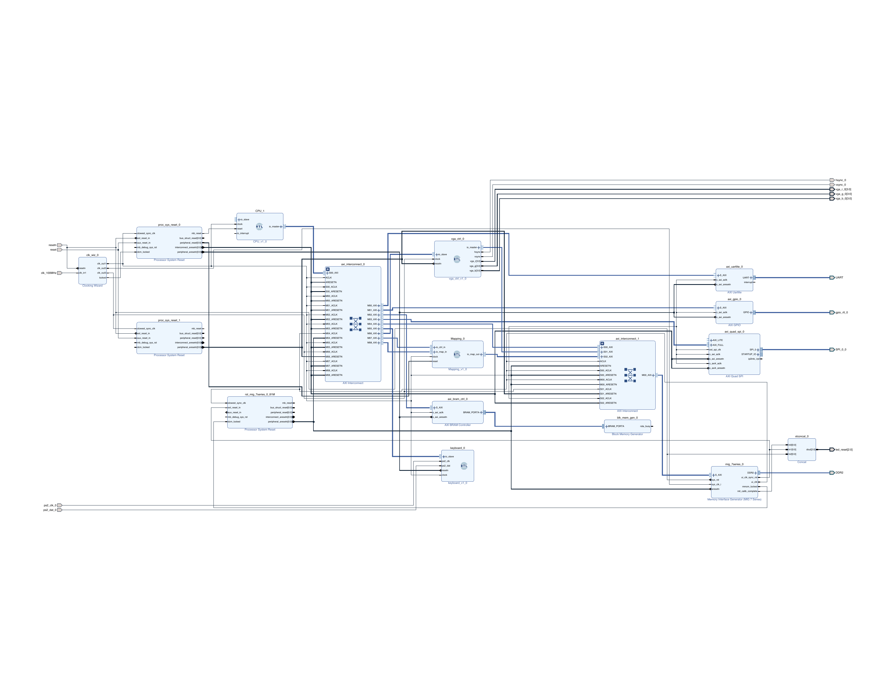

# 计算机系统扩展指导书

2026 年秋季学期

> 来源：`labextend.pdf` 的正文。原始 Markdown 由课程提供的 `labextend-ai.zip` 生成，这里保留全文，只增加了这段来源说明。原文 PDF 在 `lab12/labextend.pdf`，参考 Block Design 图在 `refs/assets/design_1.png` 和同目录的 `design_1.pdf`。

> “Next came a very large set of matched volumes containing reference materials: One contained designs for thousands of sleeve bearings, another for computers made of rods, still another for energy storage devices, and all of them were reactive so that she could use them to design such things to her own specifications. Then there were more books on the general principles of putting such things together into systems.”
>
> -- *The Diamond Age: A Young Lady's Illustrated Primer*, Neal Stephenson

> 本文档由 `labextend.tex` 正文转换而来，供 AI Agent 阅读、检索、摘要和继续编辑。LaTeX 封面、目录和排版配置已省略，正文内容与其中的实现约束应保留。

## 目录

- [引言](#引言)
- [基本扩展](#基本扩展)
  - [前期准备](#前期准备)
  - [CPU 扩展](#cpu-扩展)
  - [AM 移植](#am-移植)
  - [接口扩展及多媒体应用](#接口扩展及多媒体应用)
  - [图形扩展](#图形扩展)
  - [其他传感器与外设扩展](#其他传感器与外设扩展)
- [进阶扩展](#进阶扩展)
- [极限挑战](#极限挑战)

## 引言

随着 AI Agent 技术的飞速发展，我们的计算机系统大实验潜在可扩展的内容大大增加。在 AI 的帮助下，原先系统实验的开发工作量显著降低，系统整合能力和创新能力变得更加重要。在本指导书中，我们将提供一些潜在的大实验扩展路线，帮助同学们充分挖掘 Nexys A7-100T 开发板的潜力。

**硬件能力：** 当前板载硬件可以支持 25～50 MHz 的 RV32IM 流水线 CPU。FPGA 内部 Block RAM 总计约 600 KiB，可根据设计划出约 400 KiB 用于指令/数据 SRAM 或 Cache，VGA 行缓存和 FIFO 等结构还会占用其中一部分。通过总线可以访问 16 MiB 的板载 QSPI Flash（用于代码和数据加载）及 128 MiB 的 DDR2 主存。其定点整数计算量级可粗略类比二十世纪九十年代早期的 PC。

**外部接口：** 板载硬件支持单声道音频输出、PDM 麦克风、三轴加速度计、温度传感器等基础接口，并提供 microSD 卡槽、10/100 Mbps 以太网 PHY 以及 GPIO 扩展接口。通过这些接口可以实现丰富的输入输出及多媒体能力。我们通过 N4 开发板 Demo 代码（Nexys4UserDemo）提供了一些接口调用示例。不过此 Demo 使用 VHDL 语言开发，并且源自 Nexys4：它使用 PSRAM，音频输出驱动方式也与 Nexys A7 不同，移植时请仔细核对。

为充分发挥板载硬件的潜力，本指导书提供了一些系统扩展思路、基本实现路径和参考资料。同学们可以在 AI 的帮助下充分发挥想象力，做出自己满意的作品。

关于 AI 辅助开发，我们特别给出以下提示：

- 首先，工欲善其事，必先利其器。请适当研究分析当前 AI 辅助开发的最佳实践，使用相对完善可靠的 AI Agent 及基础模型。
- 在 AI 辅助开发过程中，人应当是主导者，不可放任 AI 自行其是。AI 通常会出现过度自信、迎合用户或幻觉等情况，请注意分辨。对于自己的工程实现细节要心里有数，不要被 AI 带偏。
- 开发过程中仍要遵守基本的开发规范，做好系统总体设计，尤其是可扩展可维护设计。注意规划开发步骤，分模块实现并进行验证。同时注意使用版本管理工具保存开发历史。
- 可以将系统相关资料，包括 Nexys A7 开发板手册（`nexys-a7_rm.pdf`）、系统要求、代码库等提供给 Agent。在开发过程中应不断根据实际情况，添加或修改系统提示词或 Skill。
- 出现问题后应首先分析问题，将问题范围缩小到特定模块，再进行修改。
- 本文档中提供的资料或示例代码内容繁多，且部分内容可能和大家手上的开发板及项目实践有一定区别，请让 AI 在移植时注意相关细节区别。
- 注意让 AI 保留历史聊天和问题记录，方便最后整理实验报告。

## 基本扩展

### 前期准备

在完成前期十一个实验后，大多数同学已经有了可以上板正常运行的单周期或流水线 RV32I CPU，以及基础的字符界面键盘显示器模块。在此基础上，请首先确认自己对本组实现的 CPU、键盘和显示器模块有清晰理解，即理解每一行代码的具体功能，能清晰分析 CPU 及外设在不同情况下的周期级行为。

此时可以按实验十二指导书，以内存映射方式实现 CPU 访问键盘和显示器，并熟悉 C 语言到 RV32I 的交叉编译环境（可以使用我们提供的虚拟机映像，也可以在大模型帮助下安装 RISC-V 交叉编译环境，注意 RV32 的不同版本的编译目标设置）。在此基础上，尝试编写简单的 Terminal 程序，确认没有隐藏的功能错误，并确认 CPU 可以在 25 MHz 以上主频稳定运行。

在此基础上，同学们可以参考我们建议的思路，选择合理的扩展方向，实现部分扩展内容。注意，不要求扩展面面俱到，单个功能做得很有趣或很深入也是可以的。盲目在不稳定的硬件基础上堆积新的功能可能会造成整个开发项目的崩溃。希望大家在扩展中得到乐趣而非为了完成任务得高分。

### CPU 扩展

可以考虑扩展 CPU 乘法功能。之前我们实现的 RV32I 只能通过软件来完成乘除法，感兴趣的同学可以通过 FPGA 自身携带的乘法器来实现乘法，用多个周期完成除法的方式来实现完整的 RV32IM。

### AM 移植

部分同学在计算机系统基础中的 PA 实验中走的是 RISC-V 路线，因此可以考虑将 PA 中的 AM 移植到自己的硬件 CPU 中来。

具体移植方案可以参考 2021 级贺柄毓、刘凯瑞学长的移植路径：

<https://github.com/BryanHeBY/NJU_DigitalDesignProject>

此方案实现了 AM 的 TRM 和 IOE，可以支持部分 PA 应用，包括打字小游戏、Dhrystone 等 benchmark，并能在 NEMU 和 FPGA 上运行同一份软件应用。

但是需要注意：该版本移植基于 2021 年 PA，可能与现有 PA 版本不一样。该版本 FPGA 使用的是 Altera 开发板，整个工程和实现与 Nexys A7-100T 不一样。除此之外，如果计划在 TRM 和 IOE 基础上支持 AM 的其他进阶功能，请参考进阶扩展提前计划准备。

### 接口扩展及多媒体应用

在 CPU 和键盘显示器的基础输入输出之上，同学们还可以考虑其他进阶的应用。这些应用不需要全部完成，能够有趣或者有创意即可。

#### 串口通信

板载的 USB-UART 接口可以实现与电脑之间的串口交互，支持 115200 bps 的通信速率。该功能可以用于控制 CPU，例如单步调试、加载代码和观察 CPU 状态等。该功能的具体实现可以参考课程网站上的 `实验12串口通信及加密解密.docx` 和示例代码 `uart_debug.zip`。

#### 音频扩展

板载音频输出接口可以直接连接有线耳机播放声音。可以参考课程网站上的 `实验11音频输出实验.docx` 和示例代码 `sound_source.zip` 来实现基础的音频输出。适当结合键盘输入即可实现简单的键盘钢琴功能。

对于音频，同学们可以考虑进一步扩展以下潜在功能：

- 实现简单的音乐播放器。直接播放 PCM WAV 相对容易，但数据占用较大；文件可以存放在 QSPI Flash 或 SD 卡中并搬运到 DDR 播放。若需要在有限非易失存储中保存长时间音频，可以考虑音频压缩；MP3 实时解码会有较高难度。
- 实现简单的录音功能，当然录音也会受到板载存储的限制。
- 考虑实现更加优美的钢琴音色，可以在网上下载较小容量的 soundfont 音色库来实现钢琴音色和简单的通道混音。
- 高阶扩展可以考虑实现 Farbrausch V2 风格的音频合成，此时需要对通道数量和计算量适当简化，或者增加特殊指令及硬件来加速。

### 图形扩展

基础实验部分通过小容量的字模 RAM 实现字符界面。在图形扩展中可以考虑同时支持图形模式及字符模式，并根据现有 VGA 控制器的能力增加或切换显示模式。显存可能会占用较多 BRAM，若将像素位宽降到 8 位索引色并实现相应的 VGA 时序，640×480 显示缓冲约需 300 KiB BRAM；这会与 Cache、FIFO 和行缓存共同竞争片上存储。也可以把显存放进 DDR。

**基础图形扩展：** 在有显示缓存和可用绘图 API 的条件下，可以实现直线、圆、矩形填充等基础图形操作。在此基础上可以绘制立方体、棱锥等立体线框，并利用板载加速度计读取重力方向，根据开发板的前后、左右倾角同步旋转几何体。实现时请注意硬件性能限制，三角函数等计算可以使用查表。加速度计的接口可参考 Nexys A7 手册和 Nexys4UserDemo 中的示例。

**高级图形扩展：** 可以考虑实现以下的高级图形扩展：

- 参考进阶扩展中的总线扩展方案，将 VGA 显存放至板载 DDR 中。此时可以实现更高分辨率及多帧显示绘制缓冲。
- 增加参数曲线曲面绘制、三维顶点变换、投影和 Z-buffer。加入简单纹理或三角形填充功能。可以参考 1990 年代流行的低存储需求图形 Demoscene，例如 Starfield、Vector Balls、Plasma Intro 和 Rotozoomer 等单一效果。Heaven Seven、fr-08 等作品更适合作为视觉和场景组织参考，不建议把完整复刻作为基础目标。网上可以找到这些作品的公开视频、说明或部分源码，但移植路线需要先完成基础图形库，再逐步增加效果；计算资源不足时应降低分辨率，或考虑硬件加速。
- 视频播放会有一定难度，可以考虑实现简单的 Bad Apple 或骨骼动画，但也需要仔细分析存储量和实现路径。硬件直接实现视频解码或 Motion JPEG 播放会有较高难度，可以参考开源硬件解码项目。

### 其他传感器与外设扩展

开发板上集成的三轴加速度计、温度传感器及麦克风请参考开发板手册及 Nexys4UserDemo 中的示例。

我们额外提供 OV5640 Pmod 摄像头供大家尝试，如有需要可以向老师申请。该摄像头可以接入开发板的 Pmod 接口，提供视频和图像采集功能，这对后续希望扩展目标检测等机器学习应用的同学比较重要。具体引脚、供电和寄存器配置请参考随模块提供的手册。当计划进行图像采集系统开发时，请注意以下问题：

- 建议首先确定原始图像的分辨率、像素格式、帧率和存放位置，并估算单帧及多帧缓存的大小。调试时先调通接口、完成单帧采集和 VGA 回放，确认图像正确后再考虑连续视频。
- 图像或视频采集正常后，可以进一步实现颜色跟踪、运动检测或边缘检测。目标检测可以作为更高阶的扩展，例如在降采样后运行 Tiny-YOLO 一类的轻量模型；设计时需要同时考虑定点量化、卷积、池化、激活、候选框后处理以及有限的 BRAM 和 DSP 资源。可以适当考虑增加一个 systolic array 来辅助部分计算工作。
- 低分辨率工作缓冲可以放在 BRAM，但是完整帧和多帧缓存则应放入 DDR。若外部设备或硬件加速器会写入 DDR，还需要正确处理 D-Cache 的 flush 和 invalidate。

## 进阶扩展

基础扩展由于片上 BRAM 容量限制及 CPU 自身功能不足，所以无法加载复杂的大型应用。为了支持更大规模的显存（例如 800×600 全彩多帧显存）、多媒体数据存储及中等规模的应用（例如 AM 中通过 FCEUX 执行的 Mario），有必要对 CPU 硬件架构进行较大规模的改动。请注意在改动前确认基础功能正常，保留备份。

在这一步扩展中，可以选择完成以下硬件增强的部分内容：

- CPU 支持 Zicsr 指令，并实现 M-mode trap 所需的基础 CSR 集合；可额外增加 `fence.i`。
- CPU 中增加 AXI 总线 Master。
- 通过 AXI 总线连接键盘、显示器、UART 及其他外设。
- 通过 AXI 总线连接板载 128 MiB DDR2 内存。
- 改造 VGA 控制器，支持 800×600 显示分辨率，并以 DDR 作为显存。
- 增加 QSPI 接口，读取板载 Flash。
- 增加 CPU 的 I-Cache 和 D-Cache，将代码和数据放置到 DDR 中，通过 AXI 总线在 Cache miss 时以 burst 读取 DDR 中的指令和数据。这样可以大大扩展可用存储容量且性能损失较小。
- 在片上指令 BRAM/SRAM 中加入 boot loader，从 Flash 中将指令和数据拷贝到 DDR 并开始执行。
- CPU 支持中断和 trap 功能。

建议在改造中按步骤逐步实现及验证：

- 先保持原有的指令存储和数据存储在 BRAM 中，完成 CPU 的 AXI Master，通过 AXI 访问键盘、七段数码管等外部设备，调试 AXI 总线的访问及 CPU Pipeline stall 等基础能力。
- 改造 VGA 和 DDR 存储，按后续架构通过 AXI 连接 CPU、DDR 和 VGA，测试显存正常访问及 CPU 正常访问 DDR。
- 增加 D-Cache，支持通过 Cache 访问 DDR，验证 DDR 访问的正确性。此时需要注意外设对应地址的数据不可 Cache，并仔细设计测试 D-Cache 的写回策略。
- 增加 I-Cache，支持从 DDR 读取指令；初始启动代码仍应放在片上指令 BRAM/SRAM 中。
- 增加 CSR 及中断，将键盘由轮询转为中断方式，增加时钟中断。
- 在合适的时机适配 AM 的对应软件部分。

为了方便大家实现 CPU 总线架构，我们提供了陈璐学姐的设计思路供参考。该设计思路是将 CPU 及各个模块通过 Vivado 中 Create and Package IP 功能打包成 AXI4 Peripheral，然后在 Block Design 中通过 AXI Interconnect 连线互联。具体连接方式如下图所示（此图较大，需要放大查看）：

*图：CPU 系统 Block Design 示例。高分辨率位图见 `assets/design_1.png`，原始矢量文件见 [`assets/design_1.pdf`](assets/design_1.pdf)。*

针对这个参考实现我们有以下说明：

- 参考实现只供参考，其 CPU 是 RV64，与同学们开发的 RV32I 不一样；Mapping 功能也可以不用。
- 我们将参考实现的 Block Design、IP 核配置及关键外设源码打包分发给同学们，可以借助 AI 提取关键参数和连接关系。但时钟和位宽选择需要自己思考，不可照搬；系统涉及多个时钟域，时钟和 reset 信号的生成不能出错。
- 参考实现中有 VGA 控制器、键盘等示例代码，部分代码包含 AXI 接口实现。

参考设计的总体架构如下：

- CPU 通过实现一个 AXI Master 与第一级 AXI Interconnect 相连；该互连连接 VGA 控制端口、UART、QSPI Flash、键盘、GPIO 等外设。
- DDR 通过 MIG DDR2 IP 核实现，并连接到第二级 AXI Interconnect，为 VGA 显存读取和 CPU 访存提供接口。
- VGA 控制器实现 800×600 分辨率。VGA 向 CPU 暴露一个 AXI 控制寄存器读写端口，并在扫描过程中通过 AXI 自主读取 DDR 中的显存。VGA 使用乒乓行缓存，即两个 `S011HD1P_X256Y2D32`（512×32 bit）SRAM；每个字可存放两个 12-bit RGB444 像素，800 像素一行约使用 400 个表项。实现时是扫描一行的同时去读取下一行缓存。
- 键盘采用与课程类似的实现，提供扫描码。QSPI Flash 和 UART 接口使用 IP 核。原设计中这些 IP 的中断输出没有连接；若要使用中断，需要同时修改 BD 连接、IP 配置、CPU 中断控制和软件驱动。
- DDR 和外设使用不同地址段，具体映射方式参考源文件包。

## 极限挑战

在完成自己相对满意的扩展后，如果同学们还希望进一步挑战开发板的极限，~~多烧一点 Token~~的话，可以尝试以下挑战。但是，以下路线工作量、难度和复杂性极大，失败概率较大，请务必在尝试之前确保已经完成满意的基础扩展。

- 尝试运行 PA 中的仙剑。仙剑需要运行在 Nanos-lite 中，因此需要支持 CTE 和部分 VME 功能。仙剑整体规模超过 48 MiB，板上的 Flash 放不下；如果不裁剪，需要增加 microSD 硬件接口和驱动，整体复杂度极高。
- 尝试运行 xv6 操作系统，可以考虑 xv6 的 RV32 版本，或者将处理器改造成 64 位后运行 RV64 版本。xv6 同样要求 CPU 增加 S/U 特权级、原子操作、S-mode trap 和 Sv32/Sv39 虚拟内存，即使是单核版本也非常复杂。
- 对 CPU 进行进一步改造，支持 Scoreboard、乱序执行、Tomasulo 算法、自定义加速指令等。
